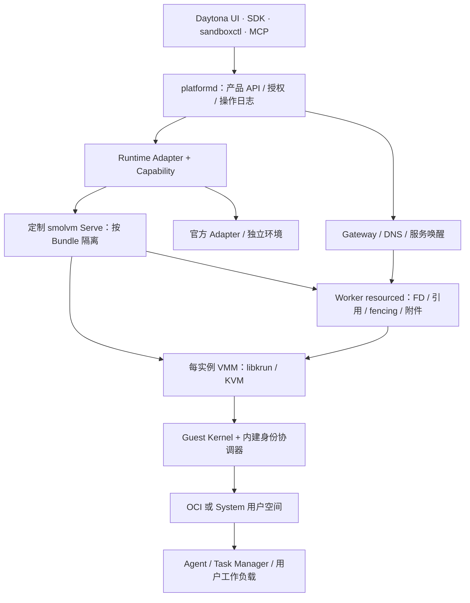
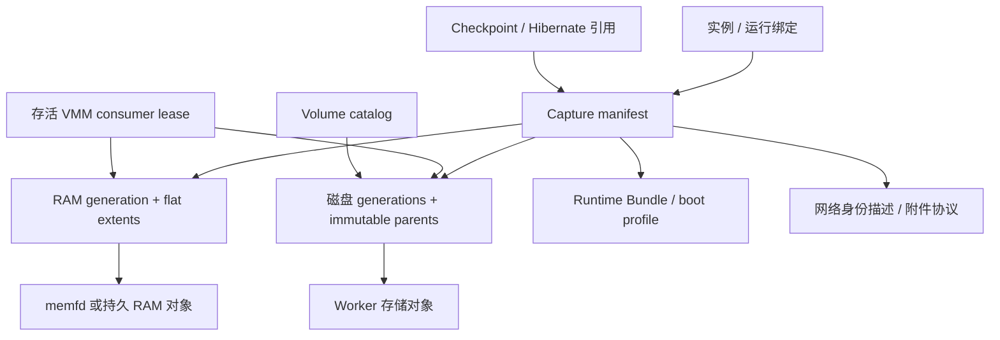

# 架构与设计

> 本文是工程决策。已有源码事实用固定提交链接支撑；“新增”均为拟实现。接口和枚举以 TECHNICAL_SPECIFICATION 为准，工作包编号见 IMPLEMENTATION_PLAN。

## 1. 总体结构：保留产品，扩展三个底层边界

平台保留单个 Go `platformd` 和 SQLite；不引入分布式数据库或调度微服务。既有 Gateway 和 Task Manager 保持职责。新增三个稳定边界：**资源引用与状态事务、宿主设备附件、Guest 启动/身份契约**。各边界采用独立模块，热点上游文件只加入调用 hook，不整体改写。

### 进程与权限

| 组件 | 职责 | 权限与故障边界 |
| --- | --- | --- |
| platformd | API、资源归属、授权、操作幂等、实例/服务目录、默认配置、审计、调度策略 | 普通用户；不持有原始 TAP、Guest RAM FD，不直接执行任意 root shell |
| 每个 Bundle 的 smolvm Serve | 管理该 Bundle 的实例、启动 VMM、执行 capture/restore、保留自身私有 DB | 独立 UDS/状态目录；只使用确定的 Bundle；重启不自动杀 VMM |
| 新增 smolvm-resourced | Worker 资源 ID、不可变 FD、物理对象引用、持久目录、单写者租约、fencing、宿主网络附件、全局准入 | 初版一个受限 root 服务；所有请求需 UDS peer 身份+范围校验；不得成为通用特权命令执行器 |
| VMM | KVM、RAM mapping、设备队列、真实运行状态、冻结与恢复 | 维持上游 per-VM uid/seccomp/Landlock 约束；通过预打开 FD 获取资源；每进程独立 scope |
| Guest 内建协调器 + 身份 helper | clone gate、恢复身份、熵、受管网卡/路由/DNS、基础设施 ACK | 不依赖普通 smolvm-agent/taskd；仅在受支持 Guest Profile 启用 |
| Guest Agent / sandbox-taskd | Exec、PTY、文件、任务管理、资源 onlining 等客体管理 | 用户可以停止或替换；健康单独报告，不决定 VMM 是否 Running |

单 Worker 一个 resourced 的理由：易失 memfd 必须有独立持有者；新/旧 Bundle 必须共用卷 writer 和网络身份排他。它**不**参与正常 RAM 读写/CoW 缺页，不解析跨版本 CPU/device blob。持久对象由文件系统承载，SQLite 保存引用和事务；资源服务不是远程内存服务器。

## 2. 真实现状与修改入口

| 层 | 已有实现，应复用 | 需要增加或改动 |
| --- | --- | --- |
| platform | `internal/runtime/types.go` 已有 Runtime 数据类型，但 `lifecycle.Engine.Runtime` 是具体 `*smolvm.Client`；操作日志、binding、reconcile、SDK/UI 已存在 | 抽 interface；官方/定制 Adapter；能力按实际 profile 求交集；新生命周期和资源 API |
| 平台复制 | `/forks` 原生 live；`/clones`、部分 snapshot/restore 依赖 `prepare_copy`、任务 clean 语义 | 保留 legacy 行为；新增 `capture_mode=vm`，完整 VM 状态不再要求 task clean |
| smolvm | `src/agent/fork.rs`、`src/portable_checkpoint.rs`、`src/agent/manager.rs` | 资源 ID/引用替代父目录依赖；新增统一捕获协调器和 held transaction |
| libkrun | `src/vmm/src/lib.rs`、`snapshot.rs`、`layered_restore.rs`、`retained_fds.rs` | 可恢复的 prepare/continue/hold/stop、Standby、资源清单/re-export、attachment bind |
| 网络 | 已有 `krun_add_net_tap`、TAP Backend、virtio-net snapshot | 新 TapFd 接口；host attachment 与 restore bind，不以已有 TAP 等同已支持完整恢复 |
| 磁盘 | virtio-blk、qcow2/raw、内部 storage/overlay/cache 分层、附加块盘 | 所有 block role 进入捕获闭包、Volume global writer、磁盘不可变代际及拓扑恢复 |
| Guest | init、Agent、crun；已有 root disk/remount 与 PID1 路径 | System Profile、独立身份协调器、版本化 gate 协议和 kernel config fragments |
| 动态资源 | `live_resize.rs` 已有 CPU 增长、Linux offline shrink、RAM 增长和重试 intent；libkrun 已有 balloon | 复用并纳入全局预算；CPU 已建 slots/MP state 与 RAM growth geometry 进入恢复契约，online mask 作为可空观测 |

源码依据：[平台 Engine](https://github.com/Zhenyu-Sun-86587/platform-smolvm/blob/582a6f141fedd7381acd54ff2cb11ae7a6e0f899/internal/lifecycle/engine.go)、[平台 snapshots](https://github.com/Zhenyu-Sun-86587/platform-smolvm/blob/582a6f141fedd7381acd54ff2cb11ae7a6e0f899/internal/platformapi/snapshots.go)、[smolvm fork](https://github.com/smol-machines/smolvm/blob/5bd7c2f8e8e2d29869226a91f766bf4147b5e693/src/agent/fork.rs)、[portable checkpoint](https://github.com/smol-machines/smolvm/blob/5bd7c2f8e8e2d29869226a91f766bf4147b5e693/src/portable_checkpoint.rs)、[live resize](https://github.com/smol-machines/smolvm/blob/5bd7c2f8e8e2d29869226a91f766bf4147b5e693/src/agent/live_resize.rs)。

## 3. 仓库边界与并行路线

平台继续一个仓库。官方路线沿现有分支推进；深度路线以 `582a6f1` 建立 `deep-runtime/main`。不把“远端当前只观察到 main”解释为另一条路线不存在；工作开始必须检查其他 worktree、远端和用户正在使用的部署。

通用产品改动使用小功能分支，标记 `runtime-independent`：UI 组件、SDK 类型、任务保留策略、文件浏览、事件消费、资源归属、Gateway 接口等可双向 cherry-pick；依赖定制能力的实现留在 custom Adapter 或 feature-gated 模块。不得整分支合并覆盖另一条路线，也不以“共享”之名让官方 Adapter 返回虚假的能力。

底层维护三个 Fork：smolvm 已有；libkrun/libkrunfw 的 Fork **来源都是 smol-machines 的定制仓库**。各保留 upstream/main 观察引用及 deep-runtime/main 下游开发线；smolvm gitlink 精确绑定两个依赖提交。`.gitmodules` 只在下游开发分支指向个人 Fork 的 HTTPS 地址。新依赖功能要先有固定提交，再更新父仓库 gitlink，不用 branch=main 漂浮依赖。

补丁分五组：资源/持有、capture/standby、attachment/storage、Guest identity/profile、性能。每项补丁记录稳定 ID、上游起点、触及的 hook、依赖、验证门、上游替代条件；避免同时改 formatter、重命名核心模块和实现协议。网络或内存优化不得与 UI 视觉改动混在一个提交。

## 4. 标识、资源图与所有权

### 4.1 不同标识不能混用

- `instance_id`：产品逻辑实例，跨休眠恢复/回滚保持；新 Fork 子实例分配新 ID。
- `incarnation_id`：一次 VMM 进程生命周期。每次冷启、Restore、Rollback 创建新 UUID；Standby/Wake 不变。
- `execution_epoch`：同一 instance 的单调 fencing 代号。新执行 incarnation 递增；由平台提出、Worker 原子接受；旧 epoch 不能重新获写/发布网络。
- `capture_id` 和 `capture_seq`：捕获事务 ID 与该 incarnation 的捕获序号；不因创建快照改变父 execution_epoch。
- `resource_id / generation_id`：不可变 backing 和状态代际身份，不携带父机器路径语义。
- `broker_session_id`：资源服务一次进程启动的会话，用于重连；不是撤销活 VMM writer 的理由。
- `attachment_id / attachment_revision`：宿主网络/设备绑定，配置变化使用 revision CAS；与 Guest 自报 MAC/IP 无关。

现有 platform binding generation 保留，迁移时建立显式映射，不将新 execution_epoch 与旧 generation 列强行视为同一个值。执行授权必须同时核对逻辑实例、binding、incarnation、epoch 和 Worker boot ID。

### 4.2 资源 DAG

逻辑 lineage 只用于历史和 UI。删除父实例删除的是父 binding/引用；不递归删除后代所需对象。RAM extents 应保持当前上游的扁平化表达，不把每次 Fork 追加成多级缺页查询链。磁盘 parent 链与 RAM extents 分开统计和压缩。

### 4.3 引用与 lease

持久根引用包括活跃 binding、checkpoint、hibernate record、volume head、显式保留和进行中的事务。资源引用在同一个 broker SQLite transaction 发布，使用 operation_id 幂等；接收 FD、验证 metadata/seals/尺寸、持有成功后，才允许 caller 释放旧引用。

lease 是“消费者身份 + 资源集合”的存活声明，不仅是时间戳。不得因平台重启、网络超时或 TTL 到期自动撤销可能仍在写卷的 VMM。`pidfd`、PID start time、Worker boot ID 和完整 inventory 用于确认进程身份；确认死亡或执行可靠设备写入 fence 后，才能转移 writer。持久 refs 与活消费者 refs 都为零、事务不确定性已解决，GC 才进入隔离回收阶段。

不可变 RAM 的接收检查不止于 FD 的 O_RDONLY 属性：其他进程仍可能持有可写 FD。memfd 必须满足所需 write/grow/shrink seals；普通文件必须属于已登记的不可变对象，并证明原 writer 已撤销。FD/路径转移不会自动迁移既有内存页的 memcg 收费，资源图和 Worker 总预算必须覆盖仍被共享引用保留的页。

### 4.4 broker 重启与 Worker 故障

默认 shared path 的每个 VMM 必须保留其映射/下次 capture 所需的 backing FD 及可导出 manifest。重启 broker 从已登记 VMM 的受认证 UDS 通过 SCM_RIGHTS 重收 FD，校验资源 ID、inode/size/seal/布局元数据，重建 consumer inventory。不是从 `/proc` 暴力抓任意进程 FD，也不是假设所有映射都能自动找回原 FD。

| 失效 | 可恢复范围 | 必须明确报告 |
| --- | --- | --- |
| platformd 或 Serve 退出 | 存活 VMM、broker 所持资源及 journal 可接管 | 旧 Exec/PTY 管理通道可能丢失；不能重跑任意任务 |
| broker 退出，VMM 活着 | 已由 VMM 保留、可 re-export 的资源可重建；持久文件可重开 | broker 独占且无其他 FD 的 volatile 对象可能消失 |
| VMM 退出，broker 活着 | 其已发布 immutable generation 可仍存在；没有持续 capture 的最新 RAM 不可重建 | 最后一次运行进度可能丢失；不标完整当前状态已保存 |
| broker 与唯一持有 VMM 同时退出 | 仅 durable checkpoint/文件闭包可恢复 | volatile-only 状态标 `lost` |
| Worker 重启/断电 | 合格 durable checkpoint、卷及 Bundle 可恢复 | memfd 全失；磁盘耐久性取决于整个 PVE 存储栈的 flush 语义 |

重启进入 `recovering`：先恢复 refs、VMM inventory 和 writer 状态，期间禁止 GC、writer 转移和新的大规模创建。未知状态宁可暂时保留对象；不能把 DB 中有 resource_id 当作 FD 仍存在的证据。

## 5. 捕获事务与父子独立

核心 API 从“做一个 Fork”提升为“获取一致、不可变的 Capture，并选择源动作和消费者”。内存实现仍调用现有 seal/generation/layered restore；不另造 RAM 镜像格式替代 live path。

### 5.1 一致捕获点

捕获前验证所有设备/profile、pending resize、网络、DAX、块盘和外部附件；预留子网络/磁盘/内存预算。可克隆 capture 先建立 Guest clone gate（第 8 节）；随后暂停 vCPU、停止新设备写入、排空已接受的 block/fs 请求，形成所有盘同一时间点的 immutable heads，再捕获 CPU/RAM/设备。

完整 VM capture 不以 Guest `sync` 或 Task Manager clean 为正确性前提：Guest page cache 仍在 RAM，已提交的设备 I/O 必须在捕获闭包内。可选择 fsync/quiesce 获得更强的独立磁盘语义，但这是附加策略。Guest 正在写文件、存在数据库事务或任务运行，不应仅因此拒绝 VM capture。设备不支持捕获、外部可写 HostMount 无快照契约或 pending resize 无法收束，必须具体拒绝。

源必须成功安装新 writable disk tips 和 RAM view、发布完整资源引用后，才能结束 capture hold。Fork/Checkpoint 默认 `source_after_capture=PRESERVE_SOURCE_STATE`：原 Running 来源使用 CONTINUE 并 thaw；原 Standby 来源使用 RETURN_STANDBY，结束本次捕获事务但保留原 gate/device hold。Hibernate 使用 KEEP_HELD，捕获仍由该操作占有。若 rebase/磁盘切换只完成一部分，保持 held 进入 recovery_required；不能“失败就一律 resume”。

### 5.2 五种操作的区别

| 操作 | 源执行 | 状态持久化 | 消费者 / 最终动作 |
| --- | --- | --- | --- |
| Live Fork / batch | publication 后原 Running 使用 CONTINUE/thaw，原 Standby 使用 RETURN_STANDBY；尽早释放源锁 | RAM 不要求落盘；必要控制 journal 很小 | 子 VMM 从同一个 capture 建立 private view；独立资源引用 |
| Checkpoint | publication 后按原稳定状态 CONTINUE 或 RETURN_STANDBY | immutable capture 后台导出，全部 flush/hash/manifest commit 才 durable | 创建持久快照；没有默认子 VMM |
| Hibernate | **保持 held，直到 durable 和停止确认** | RAM/盘/附件/Bundle 闭包持久化 | 写入 STOP_COMMIT 后终止源，确认 pidfd 死亡，最终 Hibernated |
| Restore | 原实例必须已 fenced；先校验 reader/CPU/闭包 | 使用已持久化 capture 或合法 volatile capture | 新 incarnation/epoch，绑定 exact generations、身份 gate，再激活 |
| Rollback | 先 fence 当前执行；按策略保留当前恢复点，然后停止 | 使用选定旧 capture | 同 instance、新 incarnation/epoch；恢复旧盘时间线，不覆盖独立变更的当前卷 |

Hibernate 持久化之前失败：若 held source 完整且未作不可逆 stop 决策，可显式恢复原 Running/Standby。STOP_COMMIT 是不可逆提交点；之后协调器崩溃必须继续完成 stop 或确认死亡，不得自动 resume。最终 Hibernated 需 durable manifest 和源不可继续执行两项证据。长时间写盘会使休眠暂停较长，这是第一版正确语义的代价；未来可实现 pre-copy + final delta，但不能只捕获后放源继续跑再杀掉。

Hibernate还必须完成资源归属的收束：给同一捕获点建立可独立恢复的durable表示及根引用，源退出确认后释放仅为该源/易失capture保留的pins和memfd。其他分支仍用的backing继续持有，不能因为父机休眠而丢失后代冷页。只有目录durable但broker仍无条件pin住所有易失页，并没有完成内存回收闭环；详见TECH §7.3。

原状态为 Standby 时，取消 Hibernate 返回原 gate/hold，不执行 thaw；原状态为 Running 才安全恢复执行并 thaw。新恢复目标在取得整组 writer 和旧执行 fence 证明前，CPU 与设备工作线程均不得自行开始处理可写队列；“vCPU paused”不能代替设备也停止的证明。

### 5.3 Standby

受管 Profile 的 Standby 先由内建协调器建立用户态 gate，再做 vCPU pause、设备 drain/hold、入口 gate 和专用状态记录；保留进程、KVM、RAM、磁盘 writer 与身份。不 seal RAM，不创建 checkpoint，不调用 SIGSTOP，不借用 `freeze-source`。Wake rearm 设备、处理时间、核验同实例身份、恢复 vCPU 并解除用户态 gate，再开放入口；incarnation/epoch 不变。

入 Standby 的用户态 gate 保留在待机点，因此后续 Hibernate/Fork 不需要让普通用户态先运行再冻结。低层 raw/legacy Standby 可只做 vCPU/设备 hold，但必须声明 `clone_ready=false`；其后严格 clone 拒绝，不能偷偷 Wake 推进原待机点。受管 Standby 不依赖普通 Agent，但依赖对应 Profile 的内建 gate 能力。同样需要设备可恢复 hold。正在进行 capture/restore/resize 时 Standby 排队或冲突。设备收束失败按已完成阶段恢复，不能有一部分设备仍运行却显示 Standby。

长 Standby 后再捕获必须带版本化 clock contract。现有进程内 `paused_at` 不能直接作为持久状态；bundle reader 要将已暂停时长与 KVM clock/TSC 保存关系正确归一化，避免子恢复时遗漏或重复扣除这段时间。Standby→Fork、Standby→Hibernate 和长时间 Wake 都要验证单调时钟、定时器及 wall clock 策略，不能只通过一次短暂停测试。

## 6. 内存与性能：先保持语义，再做局部优化

已有机制包括 memfd/shared generations、后续 private page 扫描/复制、layered map、retained FD 和可选 userfaultfd。首次 seal 不意味着完整后续 Fork 恒定成本；父私有脏页、页表、extent 合并和磁盘链处理都会变化。依据 [layered_restore.rs](https://github.com/smol-machines/libkrun/blob/36b0846191bf8dbfc044c98cf43922c2f1f221e4/src/vmm/src/layered_restore.rs) 与 [snapshot.rs](https://github.com/smol-machines/libkrun/blob/36b0846191bf8dbfc044c98cf43922c2f1f221e4/src/vmm/src/snapshot.rs)，工程保留这些实现，只替换资源归属和调度接口。

优先级顺序：

1. capture publication 后释放源锁；每批子机共用一次 capture；子网络/卷预算并行预留，启动有界并发；把 15 秒 Guest task adoption 从父锁/核心 fork-ready 路径移出。
2. 增加分段计时、copy bytes、extent/FD/磁盘链深度、线程与 PSS/内核记账；先找到真实瓶颈。
3. 无变化 RAM view 的 no-op rebase 快速路径必须证明 extents/底层对象/GPA/权限完全相同；`copied_bytes=0` 单一条件不够。
4. 局部 rebase 只替换发生变化的范围，保持 KVM slot/dirty log/DAX 与用户态设备写入正确性；跨热点核心代码的收益不足则推迟。
5. dirty 优化必须覆盖 vCPU 写与 VMM/设备线程写，不能只看 KVM dirty bitmap。增量 hash 仅复用不可变 generation 身份明确的 chunk，不能把未发现变化当成内容不变。
6. UFFD/lazy restore 与共享缓存是独立 backend 能力；默认采用标准 shared mapping。缓存键至少包含内容 digest、chunk、格式/压缩版本；不能每次 restore 新 memfd 后宣称 page cache 自动共享。

性能门看同机同 workload 的端到端与总吞吐量，不强制具体微秒数。标准 Linux、当前 nested KVM 和现有内存管理器是默认边界。专用 Worker 内核 CoW import 不进入主线实施依赖；若测量证明其价值，再独立研究。

## 7. 网络：B/A 共用宿主附件与内核数据面

### 7.1 共用基础设施

每个 private network 有独立 `network_id`、路由域、IPAM、DNS zone 和 ACL；不同网络即使地址范围重叠，也不共享路由域。每个 VM 的 attachment 使用受管 TAP、独立接入身份和 host gate。Guest IP/MAC 只是输入数据；授权由宿主 tap/namespace/attachment 决定。v1 默认 IPv4，IPv6 未完成等价反欺骗/RA/DHCPv6/恢复契约前明确禁用，不悄悄走旁路。

采用每个 private network 一个 router namespace、每个 attachment 一个 port namespace，port 中的 TAP 经 veth 进入 router。B 在该路径直接路由，A 在自己的 port 内转换地址；两者共用资源创建、回收和 ACL。首版是明确的 L3 私网，不默认承诺跨 VM 的任意二层广播/多播或 macvlan。重叠 CIDR 只在不同路由域隔离使用；多网卡 Guest 或跨域互联出现目的地址歧义时，要求显式 policy route/服务别名，否则拒绝配置。

TAP FD 由 resourced 创建并通过 SCM_RIGHTS 传给 VMM；VMM 不负责跨进程 setns 后按名字乱找设备。新增 TapFd API 必须约定立即 dup、CLOEXEC、失败不消费原 FD，并校验 TAP/NO_PI、VNET_HDR 大小和 offload；现有 pod TAP pump 与 libkrun 原生 TAP 的 header 约定不能直接混用。virtio-net 的队列和 feature 状态恢复仍由 libkrun；host FD/MAC/MTU/策略从新的 attachment 重绑定。

不默认引入 OVS、vhost-net、eBPF 或共享内存交换。vhost 将设备队列状态与 dirty logging 移入内核，需要独立 snapshot 协议；先完成用户态 virtio-net + direct TAP 可恢复路径，再用吞吐/CPU 证据决定。

### 7.2 B Native IP 数据路径

`Guest 原生 IP → virtio-net → TAP → per-instance 接入 namespace → private-network 路由域 → 目标 attachment / Worker egress`。Guest 获得独立原生 IP、MAC、网关/路由及 DNS；同私网或地址无歧义且显式授权的跨私网直接路由。默认不对私网东西向做地址伪装；对外 internet egress 按 Worker 策略 NAT/路由，不更改 PVE 宿主默认路由。

若 Guest 使用常规子网前缀，port TAP 需配置受控 proxy ARP、到本 Guest 的更精确 host route，以及经 veth 到私网其他成员的 route；否则 Guest 对同子网 peer 发 ARP 会在独立 port 中失败。router 以 attachment 的 host route 选目标 port。示例地址仅在安装时完成冲突检查后使用：不得默认占用 PVE `10.10.0.0/24`、Tailscale `100.64.0.0/10` 或 Mihomo fake-IP `198.18.0.0/15`。还要检查 Worker、Docker/k3s 和其他路线的地址保留。

Fork 新建 child attachment、分配新 IP/MAC。源保留原身份；子 TAP 先 quarantine。Guest 身份 gate 内改受管网卡地址、路由、ARP/邻居/DNS和必要身份，host 校验 ACK 与 attachment revision 后发布 DNS/服务/路由。进程绑定旧具体 IP、旧 TCP/TLS、应用缓存 node ID 不会自动变正确；见第 8 节，不能把 IP 成功视为所有服务 ready。

### 7.3 A Fixed Internal IP 数据路径

`Guest 保留原内部 IP/MAC → TAP → 每实例独立 namespace → 内部 IP 与外部私网 VIP 的确定映射 → private-network 路由域`。相同内部地址仅存在于各自 namespace；VIP 唯一。使用带隔离 conntrack zone 的 SNAT/DNAT/路由映射，入口 ACL 和源身份在 NAT 前后都由 attachment 锁定。两个 A Guest 的相同内部地址不能共享二层域。

不同 A/B 实例通过对方的受管私网地址和 DNS 通信：B 使用原生 IP，A 使用 VIP。网络 API 同时显示 `guest_addresses` 和 `private_addresses`，SDK 默认返回可从同网络访问的 private address，不把 A 内部地址发给其他实例。

双向源身份必须保留：A→B 只将 A 内部源地址映射为 A 的 VIP，B 看到该 VIP；B→A 只在目标边界将 A 的 VIP 转成 A 内部目的地址，A 仍看到 B 原生源地址。A→A 同理，不能把所有 peer SNAT 成一个网关。实现自身 DNS/VIP 的 hairpin、返回路由、ICMP/PMTU 和分片处理；只监听 loopback 的服务仍需显式 Guest relay，普通 TAP DNAT 不使其自动可达。

Fork 不复制宿主 conntrack，也不共享父 TAP。A 保留内部 socket tuple 只是提升部分本地兼容性；新 VIP/NAT/远端会话不提供已有连接连续性。

每附件隔离 conntrack 后，最终外网出口还必须防止不同域分配相同外部四元组；重叠私网先使用唯一的 Worker egress 标识，再进入共同的出口 NAT/端口分配范围。不得复制父 conntrack 让子旧流冒充父连接；fresh transport epoch 对 TCP 要求新连接握手。

### 7.4 隔离、控制面与服务

在 host attachment 入方向校验允许的 MAC/IP/ARP/IPv6，禁止 Guest DHCP server/RA 污染其他实例；即使 Guest root 修改 IP、添加 route、发原始包，也不能获得其他 attachment 的宿主身份。需要 IP forwarding 的容器/k3s 集群，可显式委派受管 pod CIDR/路由；不以允许整个私网源地址的方式修复 k3s。

平台设置默认 B，创建可覆盖；Fork 继承，Checkpoint manifest 保存模式和 network membership。同实例恢复保留逻辑 IP/VIP，但若当前管理配置 revision 与历史 Guest 不符，要在 gate 内协调，不能盲用历史地址抢占别人。多个私网 v1 可先支持一个 primary L3 NIC；多 attachment/额外 NIC 属于独立 capability 和拓扑契约，不能新挂 NIC 后仍沿用旧 snapshot layout。

HTTP/HTTPS/TCP/UDP 服务统一指向 attachment+guest_port。Gateway backend resolver 只接受已授权的 attachment，不能接受用户传任意 URL 直连 Worker 任意服务。SSH/桌面/RDP/VNC 入口共用该机制。唤醒事件在宿主集中并去重；HTTP 有界等待，TCP 初始连接由代理保持到目标 ready，UDP 仅提供有界缓冲或明确 first-datagram-loss 语义。现存连接不保证跨 Hibernate/Fork 延续。

## 8. Guest 身份 gate：明确前提与失败边界

### 8.1 为什么需要专用基础设施

恢复 vCPU 后普通 Agent 再跑 Netlink，不能证明旧用户线程从未执行。只关 TAP 也不能阻止 Guest loopback、Docker veth/bridge 内部通信，更不能覆盖平台授权通道、外部共享可写存储或其他设备副作用。本工程采用受支持 Guest Kernel 中的内建 clone coordinator，加预先存在的最小单线程 identity helper；普通 Agent/taskd 不参与正确性屏障。

**这是必须实现并做早期 PoC 的新能力，不是上游已具备。** 核对准确 Linux 6.18.60 的 `kernel/power/Makefile` 与 `include/linux/freezer.h` 后，确认 `CONFIG_FREEZER=y` 已编译 `freeze_processes()/thaw_processes()`，不需要为此启用整套 PM/SUSPEND。函数未导出给普通模块，新增内建 driver 可以链接；当前缺的是受管会话、helper 例外和恢复协议。不能冻结后再临时启动 usermode helper：Linux freezer 会影响新 UMH，helper 崩溃还必须能由内核协调器回收/thaw。工程用专门 kernel coordinator 持有会话，只给预创建的、受测量的 identity helper 窄例外；不开放给任意用户态设置 PF_NOFREEZE 的接口。具体 patch 需在 WP-03 验证，细节以技术规格为准。

同一个 coordinator task 调用 freeze/thaw，避免 helper 死亡后违反 Linux 的同调用者约束。helper 在 freeze 前完成 `UMH_WAIT_EXEC` 与专用 FD 握手，冻结期间不启动其他进程、不依赖被冻住的 systemd/D-Bus/networkd；必要代码和数据预取。例外不传播给任意子任务；生产实现还要阻止 root 通过 ptrace/proc-mem 接管该受控 task。只校验磁盘二进制摘要不足以证明运行中的 helper 未被改写。准确依据见 [Linux 6.18.60 freezer 调用约束](https://github.com/gregkh/linux/blob/v6.18.60/kernel/power/process.c#L114-L213) 与 [编译条件](https://github.com/gregkh/linux/blob/v6.18.60/kernel/power/Makefile)。

### 8.2 源与子的执行顺序

1. Runtime 预留外部资源并验证 profile；向 Guest 内建 coordinator 发 `PrepareGate(capture_id)`。全部普通用户态进入 freezer，包括容器任务；身份 helper 和维持设备进度的必要 kernel 线程保留。用户态冻结后关闭覆盖所有 netns 的 Guest packet gate，收束 gate 前的网络临界区，再 ACK；不能仅关闭 eth0。
2. coordinator ACK 后，Runtime 执行 vCPU pause、设备 drain 和一致 capture；被复制的状态本身是 user-gated。
3. 父机执行 `source_after_capture=PRESERVE_SOURCE_STATE`：原 Running 在 capture publication 后恢复设备/vCPU并 Continue/thaw，保留父身份；原 Managed Standby 保留原 gate/设备/vCPU hold，仅释放本次 capture 事务，不推进用户任务。
4. 子机放行 vCPU 时，保存的 freezer 仍使所有普通用户任务 frozen；kernel continuation、必要 workers 和受控 helper 可以执行。私有盘/获准卷已绑定正确子代际，host 业务网络、旧平台通道和未授权外部写附件仍 closed。通过新 VMM 的 control device 读取本次 nonce/epoch/entropy，完成身份操作并 ACK；不能从复制 RAM 中读出一个旧 ready 标记作为证明。
5. Worker 核对 instance/incarnation/epoch/capture/attachment revision，完成 writer 与入口 activation 的 CAS；然后明确 ReleaseGate，解除 Guest packet gate并 thaw。Identity ACK 时普通用户态仍冻结，Activation确认后才能标记计算已释放；服务 readiness 是之后的独立观测。若 ACK/Release 丢失，按 phase 幂等查询、保持隔离，不放出旧身份流量。

Guest gate 不冻结全部内核 workers，也不替代 VMM 对 io_uring、block/fs、virtio 队列等 writer 的 quiesce。packet gate 要覆盖本 profile 的 loopback/veth/bridge/uplink 收发，处理已排队包；XDP/AF_XDP 等旁路未覆盖就不能声称支持该 profile 的严格 gate。业务 vsock/TSI、凭据代理和 HostMount 同样在附件合同中 fence/rebind。现有 TX/RX 和 backend 缓冲的 drain/drop/epoch-reset 要单独审计，不能只改 MAC 后开放旧包。

所有将来可用于新子实例的 Checkpoint/Hibernate 保存 `clone_gate_contract=userspace-frozen-v1`。不带该契约的旧 capture 不得“先运行、再 freeze”后宣称严格子恢复；可以保留原合同下同实例恢复，或明确无法进行受管 clone。受管 Standby 在进入时已经建立 gate，Wake 保持原 incarnation 并解除 gate；raw/legacy 无 gate 待机不能自动获得可克隆能力。

冻结不要求应用主动协作，但 D 状态、FUSE 依赖被冻结进程、内核模块等可能导致超时。必须有 `GUEST_GATE_TIMEOUT` 与原源 thaw/设备恢复路径；不能无界挂住用户 VM。`t_user_quiesce` 记录 freeze请求到GateArmed；源用户态总不可执行窗口另记录到thaw完成，不能只报告短 vCPU pause。未确认源 thaw 时保留 recovery_required，不能为了结束事务强杀父 VM。PoC 若失败，继续推进与其独立的功能，但 B 严格 clone 的 capability 保持未实现；不得自行改变 B 默认或用重启修复。

### 8.3 身份矩阵

| 项目 | 同实例 Standby/Wake | 同实例 Hibernate Restore / Rollback | Fork / checkpoint 新实例 |
| --- | --- | --- | --- |
| instance_id / 私网身份 | 保留 | 保留当前分配；历史配置需核对 revision | 新分配；模式默认继承 |
| incarnation / execution_epoch | 保留 | 新 incarnation，epoch 递增 | 新 instance 的首个有效 epoch |
| host 平台 grants | 保留；暂停时可挂起通道 | 旧通道 fence，新执行上下文重新授权 | 默认无跨实例管理权；按 child policy 新授予 |
| Kernel RNG / generation | 正常时间处理 | 按 resume/rollback 事件注入新熵并更新 generation | 新 generation、新熵；不能复制受信随机种子当新随机源 |
| hostname / machine-id | 保留 | 恢复同实例受管身份 | 受管字段新生成；应用自己缓存的值不承诺通用改写 |
| SSH | 已有逻辑入口 | 重新验证 Guest/入口绑定 | 新逻辑主机身份；host proxy/CA 与 guest key 策略明确 |
| 已建立外部 TCP/TLS | 短暂停可能维持，非保证 | 远端未冻结，可能失效 | 不复制远端会话；旧 tuple 不能绕过 gate |

Guest 中已经存在的第三方 API key、TLS session、应用 PRNG、自带 machine-id 缓存等仍会按完整 RAM 复制。平台只能可靠控制其自己签发的 grants/代理凭据，不能宣称任意外部 secret 已被擦除或轮换。Secrets policy 应在创建/分支时明确 `inherit / omit_on_new_injection / proxy_only`；`omit_on_new_injection` 不等于能从既有 RAM 中删除旧值。

修改 `/etc/machine-id` 不会刷新已运行的 systemd/D-Bus/应用缓存；修改 SSH key 文件也不等于正在运行的 sshd 已装载新 key。IdentityReady 证明受管基础设施完成，不证明所有应用内部身份都已唯一化。若受管 SSH 入口要求新 host key，增加明确的 sshd 基础设施 reload/确认，仅在该服务 ready 后发布入口；自管服务声明其继承边界，不偷偷重启 PID1、数据库或用户任务。

### 8.4 授权与 root

管理调用优先使用 host 建立的每 VMM 独立 vsock/UDS relay。host 从注册连接确定 instance/incarnation/epoch，再将 request 与 grant 求交；Guest 自报 instance_id、JWT 中的父 ID、IP/MAC 均不作为唯一身份。Fork 后即使复制了父 token，新 transport 也不能授权成父身份。平台自动注入的 Guest 凭据必须是 `guest-bound` 类型；公共网络 API 也不得将它作为可从任意来源重放的普通 bearer，否则复制者可绕过 relay。旧自动注入机制先完成迁移，再宣称 child 不继承父权限。用户主动放入 Guest 的 human/admin 或第三方长期 token 属于可复制的用户秘密，不能承诺自动剥离。

Guest root 可控制自己的 OS、关闭 Agent 和工作负载；不因此变成平台 admin、卷 owner 或网络管理员。恶意 Guest 可以破坏自己的 identity helper，host 因缺 ACK 保持 quarantine；安全边界依赖 host gate，而不是相信 Guest root 永远合作。

## 9. 存储：独立卷与精确时间线

### 9.1 默认布局

v1 保留 qcow2 与现有稀疏 raw 后端。所有可管理块盘统一 `BlockDeviceSpec`：稳定 device_id、role、bus/MMIO slot、容量/sector/只读属性、backend resource、volume_id、generation、write lease、snapshot policy。root/storage/overlay/cache/data 都通过同一个枚举接口；capture closure 与 restore bind 使用同一列表。

不可变 backing 放 Worker 对象目录；每个实例或 Volume 的 writable tip 单独归属。禁止把祖先路径嵌在其他实例可删除的目录内。qcow2 backing path 使用资源目录的受控映射；只读文件权限不等于内容不变，hash/只读 FD/受管唯一 writer 一起维护不可变性。

v1 禁止跨消费者同时把同一 mutable head 挂成 RW 和 RO；RO FD/只读挂载不会让底层内容稳定，也不能保证另一个 Guest 文件系统缓存一致。RO 共享只能指向固定 immutable generation；若用户请求读取正在写的 Volume，先生成明确的只读快照代际，不直接分享其当前 mutable head。

### 9.2 存储类型与操作语义

| 类型 | Fork | Hibernate/Restore/Rollback |
| --- | --- | --- |
| 实例私有系统/数据盘 | 一致 capture 后创建独立 CoW tip；child 私有卷可新 volume_id | 绑定 capture 中精确 generation |
| 独立持久化 RW Volume | 默认 `fork_policy=clone`：生成新独立子卷，不与父共享 writer；policy 为 `reject` 时拒绝 Fork | release compute writer 但保留 hibernate pin；若卷在别处推进，恢复时 clone 旧 generation 或返回显式冲突 |
| 不可变 RO Volume | 共用同一内容身份 | 校验 digest/generation 后复用 |
| 外部共享 RW block / HostMount | 无快照、fence 与代际契约则拒绝本产品的完整 capture | 不忽略、不替换为当前内容；只允许明确非 full-state 的单独磁盘/外部数据操作 |
| Guest 通过网络访问的远程服务 | 客体 RAM/socket 被捕获，远端系统不在闭包内 | 连接/远端事务与远端状态不保证回到历史；这是外部世界边界，不等同丢弃已附着本地数据盘 |

完整 capture 是 CPU/RAM/受支持设备与受管磁盘的同一执行点；不承诺单独磁盘快照已经 application-consistent。运行中 volume snapshot 可给 crash-consistent 语义；需要 fsfreeze/数据库备份可选协作策略另列。不能把应用安全点强加给原生 full VM Fork。

### 9.3 挂接、卸载、扩容和卷回滚

先实现 Stopped 状态的真实 attach/detach，保证所有操作存在且语义正确。在线热插拔是独立 capability，需要完整设备拓扑插拔、Guest ACK、pending I/O 收束与捕获 reader；未完成时返回 `REQUIRES_STOPPED`，不把 HostMount 冒充块盘。在线 detach 默认必须卸载/停用成功；force detach 是有数据风险的显式动作，不自动用于正常流程。

扩容分 host sparse image 容量、VMM block capacity、Guest partition/filesystem 三个阶段并留 intent；部分成功可重试同一 target，不回缩已曝光容量。已有 smolvm live resize 路径可复用。卷缩容不列为首版要求。卷单独 rollback 只允许无 writer 或明确停止/卸载后进行；不能把旧 volume head 替换到仍持有新状态的 RAM 下。

写权转移需设备 quiesce、已接受 I/O 完成与实际可写句柄关闭的 ACK，或原 VMM/相关 helper 死亡后经后端验证的等价证明。可用实际 writable backing 上的 OFD 排他锁补强检查，但锁是协作机制，不是撤销任意已打开 FD 的强制 fence；单独 sidecar 锁释放也不证明 io_uring 请求已结束。broker 交付写 FD 后须关闭自己的同一 open-file-description 副本；否则 VMM 死亡后锁仍被 broker 持有。证据不完整保留原 grant，返回 E_FENCE_UNPROVEN。

### 9.4 持久化与合并

默认 full flush。Live Fork 不强制 RAM 落盘，但 durable checkpoint 必须覆盖磁盘文件、qcow2 metadata、共享 parent closure、RAM chunk/index、manifest 和目录 rename 的 fsync；不能沿用 imago relaxed/deferred sync 而把结果标 durable。ENOSPC 前做预算，最终仍必须检查真实写入/flush 错误。

磁盘链合并为受控后台任务：只读 immutable chain → 新对象 → 校验 → 原子切换引用；活 writable tip 不原地改 backing。全局 I/O token、防止 compaction 与多 VM restore 抢 SSD。ext4 上使用现有 qcow2 即可；XFS/Btrfs reflink 先在独立 Worker 盘验证再启用，不格式化现有实验盘。

## 10. OCI 与 System Profile

OCI 保留现有 Agent/crun 路径；为避免 Agent 退出触发 init 结束，增加独立极小 supervisor/init 模式，使 Agent 成为可重启子服务，并将既有 workload 的 reaping/寿命与 Agent 的管理连接分离。Agent 重启必须发现并重接既有 crun 任务，不能再次创建一份 workload。System 使用 libkrun 根块盘/remount 与 `KRUN_INIT_PID1=1` 的受控路径，init 完成最低挂载/根切换后 exec 发行版 `/sbin/init`，Guest 真正 PID 1 是 systemd；Agent/taskd是普通服务，identity coordinator/helper由内建设施独立管理。

依据：[libkrun init](https://github.com/smol-machines/libkrun/tree/36b0846191bf8dbfc044c98cf43922c2f1f221e4/init/src)、[libkrun 公共接口](https://github.com/smol-machines/libkrun/blob/36b0846191bf8dbfc044c98cf43922c2f1f221e4/include/libkrun.h)。修改入口为 `init/src/`；新增 profile 不依赖“工作负载容器 PID1”冒充 Guest PID1。

System v1 使用一个明确发行版模板（延续项目 Debian 管理模板优先）。**受管 uplink 的 IP/MAC/默认路由由 identity driver/helper 唯一管理**；systemd-networkd 对该 NIC 设置 `Unmanaged=yes`，NetworkManager/cloud-init/DHCP 不再重配它，避免复制的 daemon 缓存把旧地址写回。networkd仍可管理用户其他桥/veth/接口。用户可接管网络；preflight检测受管NIC被移到未知netns、加入未支持bridge/bond或被其他manager接管时，给出具体配置冲突，不删除用户全部路由/防火墙强行修复。[systemd-networkd 的 Unmanaged 机制](https://www.freedesktop.org/software/systemd/man/latest/systemd-networkd.html)是已有配置能力，可靠 clone adapter仍需实测。

Docker默认bridge/MASQUERADE与host网络列入受测范围；容器内部网段可以随VM保留，硬编码旧SNAT地址或路由不自动改写。`Exec/Files/PTY`在Agent停止时返回Guest管理能力不可用，VMM的Standby/Fork捕获/Hibernate/Restore/Stop仍走独立通道；两种boot mode分别验收，不能用System通过掩盖OCI仍依赖Agent退出行为。

Kernel profile 使用 config fragment 和小 patch series；启用所需 cgroups、namespaces、overlayfs、bridge/veth、netfilter/nftables、block FS、virtio-net/blk/balloon/growth、clone gate。Docker/Compose/k3s 通过限定模板验证；内核模块/自定义 kernel 属于不同 profile 与兼容合同。完整支持 k3s 启动不等于能把任意多节点集群单节点 Fork 成新的正确集群：集群证书、node ID 和外部控制面属于应用语义，需明确 cluster clone 工作流或用户重配，不能泛化保证。

## 11. 资源管理：按 Worker 吞吐量和物理压力决策

资源策略的用户配置与授权在 platformd；custom 路线的自动生命周期决策统一由 resourced 内 WorkerLifecycleController 执行，硬准入和排他也在 resourced。同 Worker 的 deep Serve 共用预算；未接入 broker 的官方/Cocoon Runtime 必须靠独立 cgroup 上限、预留和外部实际占用观测隔离，不能说一个 broker 已控制它们。

CPU 使用 cgroup v2 quota/weight 和现有 vCPU online/offline。CPU shrink 保留已建 slots，manifest 保存全部 created slots/MP state；online mask 仅为带时间与来源的可空观测，Guest root 自行 offline 或 Agent 不可用不能阻止原生捕获。RAM growth 记录 boot size、registered growth region、plugged/target 实际值；pending resize 先 reconcile，不能保存部分新拓扑。Guest Agent 不可用时生命周期继续，但依赖 Guest online 的 resize 可以返回具体管理能力错误。RAM balloon 是回收手段，不等于虚拟地址空间缩容，Guest 不响应不能虚报回收成功。

内存核算同时呈现：Guest configured/plugged/balloon、每 VMM PSS/private、shared generation 的物理持有量、page cache、内核页表/KVM 开销、Worker memory.current/available/PSI 和未归属余量。不要把所有 VMM RSS 相加，也不要把 PSS 当整个 Worker 的准确消费。PVE L1 Worker 的 balloon 与 L2 Guest 回收不是同一层；设置保守 Worker 下限，双层超分配先测再加。

generation 移交到 resourced 后，既有页不会自动改计费到 broker 或子 VM 的 memcg。以受管 Worker 共同 ancestor cgroup 的实际消费约束总预算，单 VM 值仅作归属/趋势观测；父退出后仍被引用的共享页不能按“父进程已删”当作回收完成。无法精确取得的共享物理量应标估计或未知，不能用对象逻辑大小冒充驻留内存。

Fork/restore admission 按即时并发 slots、预计私有脏页增长、VMM固定开销、copy/hash I/O、FD/线程数和磁盘空间预留。批量 fork 共用一次捕获但不等于 N 个 child 的调度成本为零。压力处理由第15节的唯一Worker控制器执行：先停止扩张、有界回收缓存/balloon，再对满足完整自动策略且有durable预算的实例Hibernate；Standby用于空闲CPU/设备降耗，不算内存已经释放。不能在内存快耗尽时同时触发大量RAM写盘。

自动待机必须检查 active tasks/exec/PTY、租约、服务流量和明确 keep-running policy；低 CPU 不能证明空闲。已有长连接、后台消费或 UDP 服务若没有可靠唤醒路径，默认不自动 Standby/Hibernate。唤醒去重并受恢复队列预算约束。

## 12. 产品复用与新增体验

WebUI 保留 Phase 1.5 布局、主题、导航、终端、文件和任务页；只增 Runtime/Profile/Capabilities、Native/Fixed 网络、Standby、Volume、资源统计和新状态操作。所有 capability 来自平台 API，前端不调用 VMM 私有接口。

已有 settings/services/task_secrets/leases/SSH/backup/event 数据结构与模块直接扩展，不重造。Guest 管理其他实例使用细粒度 grants 和 host execution context；现有 unscoped manage 可连带 admin/tokens 的边界不能原样发给 Guest。默认 child 不继承父全部管理权；资源 owner、授权主体和运行实例分开。

MCP 作为现有平台 API 的薄适配，不另做 root 后门；桌面访问使用既有 Gateway/session/auth 与模板服务；Secrets 使用既有封装并增加 clone policy；凭据代理由 host 根据当前 caller binding 兑换 provider 凭据，避免在 Guest RAM 中放长期平台管理 token；自动备份扩展现有维护模块，记录一致 manifest 和 retention pin。

## 13. Runtime Bundle、状态兼容与维护

Bundle 是不可变代码/协议组合：三仓库 commit、kernel/config/patch、Agent/init/rootfs profile、toolchain、构建参数、库/二进制摘要、CPU基线/设备布局合同、serializer reader ID、attachment/gate 协议与宿主能力。用户可变 root disk/volume generations 在 CaptureManifest，不进入软件 Bundle 身份。

每个运行 binding/hibernate/checkpoint 指向 Bundle digest。旧实例继续使用旧 Serve、私有 DB 和二进制；升级平台或默认 Bundle 不重启全部实例。匹配软件仍需检查 Worker KVM/CPU CPUID、XCR0/MSR、页面大小和设备布局；跨物理 CPU 未验证就明确拒绝，不以“同为 x86_64”推导可恢复。

初版不承诺永久通用 CPU/device 格式。给现有 state blob 加严格 envelope、长度/checksum/reader contract；支持矩阵明确列 reader 可接受的 capture format/profile。只有有测试依据的转换器才能产生新格式。用旧 Bundle 恢复后再 snapshot，仍可能是旧格式，不能自动标成已迁移到新 Bundle。

旧 Bundle 保留引用计数与安全状态：active、legacy-allowed、quarantined、revoked。严重漏洞旧包不能自动对外激活；提供隔离恢复、只导出数据或修复 reader 的具体选择。不能为清理磁盘删除仍被历史状态引用的 Bundle。

上游同步先 compare commits/trees/gitlinks/source contracts，再评估 patch 替代；建立候选 Bundle、按修改面验证、用于新建实例 canary。性能补丁和大热点改动必须有测量证据；上游提供等价能力时替换 hook 并删除下游 patch，保留旧 Bundle reader 直到历史引用消失。

## 14. 必须提前消除的不确定性

| 不确定点 | 最小验证 | 可接受结果 / 失败处理 |
| --- | --- | --- |
| kernel gate/helper 可安全 freeze/thaw，包括 helper 退出、D态/FUSE | 两 vCPU + 一个身份 helper + 正在写文件/发包的任务；故障注入并核验无普通用户态提前运行 | 成功进入正式实现；失败修复 gate，B clone 不上线，不改默认或伪装重启 |
| broker 重启后所有必要 memfd 可 re-export | 两代、冷页、祖先退出、broker kill、再次 Fork | 明确区分 recovered / lost；missing FD 不以零页替代 |
| multi-disk capture 与 flush 原子性 | 两盘交叉计数 + RAM序号 + pending I/O + commit点故障 | 无混合 generation；失败 capture 不可见 |
| System PID1 与 Agent 故障 | `/proc/1/comm`、systemctl、Docker、kill Agent 后 Standby/Fork/Hibernate | 管理 health unavailable，VM仍可原生控制；未支持设备直接拒绝 |
| no-op rebase / read-lane 缩减有价值 | 同 workload 对照 pause、fork ready、固定线程、吞吐 | 有收益且无数据风险才进默认，失败不挡核心产品 |

这些点在工作包中有明确前置关系和退出条件，不作为新一轮大规模研究的理由。需要人工决定的是核心语义或路线变化；局部实现、超时/重试细节与性能补丁取舍可由 Codex 在上述约束内自主完成。

## 15. 自动生命周期是正式产品能力

本次用户补充将自动Standby、自动Hibernate、压力回收和按需Wake明确列为必做功能。**custom路线只有一个自动决策者：resourced内WorkerLifecycleController。** platformd保存全局默认/实例覆盖和授权，向Worker同步policy revision、lease、activity；各Bundle Serve只执行受控状态原语，custom platform monitor不再独自发idle_pause。官方路线保留其隔离的旧控制器。

当前上游 `src/api/memory_pressure.rs` 有独立pause/kill/resume策略，会按分支新旧和source属性挑选实例，并不理解keep_running、运行租约和等待模型响应。深度路线拆出它的采样/独立cache reclaim原语供统一控制器使用，移除独立受害者选择及隐藏kill升级路径。不能仅设置SMOLVM_MEMORY_PRESSURE_GUARD=0就上线；替代的准入、压力观测与回收必须先通过验收。[源码](https://github.com/smol-machines/smolvm/blob/5bd7c2f8e8e2d29869226a91f766bf4147b5e693/src/api/memory_pressure.rs)

### 15.1 策略与活动

全局默认与实例override包含auto_standby/standby_after、auto_hibernate/hibernate_after、keep_running、reclaim_priority、pressure_reclaim、wake_conditions、活动保护和恢复防抖。两种timeout都从同一连续idle起点计算；全局默认revision在创建时解析固化，已有机器通过显式批量应用更新。Fork继承源有效策略，但不复制运行租约/hold/旧活动时间，子激活重置保护窗口。

任务在等待模型API响应时即使CPU近零也属于活动。有效运行租约、Task Manager未结束任务、API/PTY/SSH/服务hold、凭据代理in-flight/stream、直接外向连接和未知活动证据均参与资格判断。普通监听daemon不自动视为忙；无法判断TLS内请求结束时保守保护，用户能在UI查看为什么没有睡眠。

managed Standby内Guest collector随用户态暂停。此时在同一execution的gate/设备hold持续可证且host需求监测有效的前提下，保留静止活动快照并标controlled_suspended，避免正常采集TTL到期阻断后续Hibernate；不清除原busy/unknown，任何hold证据丢失或新demand使自动候选失效。Wake后重新建立fresh活动session。

应用到实例的策略和租约只有获得Worker applied ACK后才向客户端宣告生效；仅更新未来新建使用的全局默认可在平台保存revision后返回，不冒称已应用到现有实例。custom入口先在同一Worker实例actor登记ActivityHold；Hibernated/Stopped无活执行或Hibernate已STOP_COMMIT时先登记stable instance/request/expected_binding_revision的WakeDemand，Activation重授权后同actor接续新execution的hold才转发。automatictransition用policyrevision+activityseq+executionepoch做CAS，避免平台刚续租成功、Worker按旧快照把VM睡掉。Worker自动operation通过outbox投影回原platform操作日志。

### 15.2 压力与按需唤醒

先限制新create/fork/restore和I/O并发，再有界cache reclaim/balloon，再选择真正idle且允许Hibernate的实例。Standby保留大部分RAM，只能减少CPU/设备活动，不能报告为已经释放Guest内存。候选排除常驻、租约/活动/unknown、事务占用与auto_hibernate=false；优先级越低越先回收，估算以可真正释放的private/最后引用共享页为依据。无合格候选时拒绝新增需求并报告压力，不能悄悄终止受保护实例。

授权的API、service或private packet触发wake，先准入且多请求合并。Hibernate未commit可安全abort；已STOP_COMMIT先完成Hibernated，再消费wake_pending执行一次restore。不能为了响应新请求跳过持久事务，也不能Hibernated恢复失败转冷启动。新旧Bundle共用controller，避免各自并发回收/恢复造成抖动。

### 15.3 主动Fork不受自动休眠资格限制

代码明确分开 `CheckAutoSleepEligibility()` 与 `CheckCaptureSafetyAndAdmission()`。主动LiveFork/ForkBatch不要求auto_hibernate开启、keep_running关闭、任务空闲、无SSH/PTY/外连或租约到期，也不要求应用安全点。正常授权、captureprofile、设备/盘闭包、执行事务锁和实际资源预算仍必须满足。自动候选尚queued时让位于主动需求；已进入不可逆阶段按状态事务收束，不能把自动策略禁用误报为Fork不支持。
