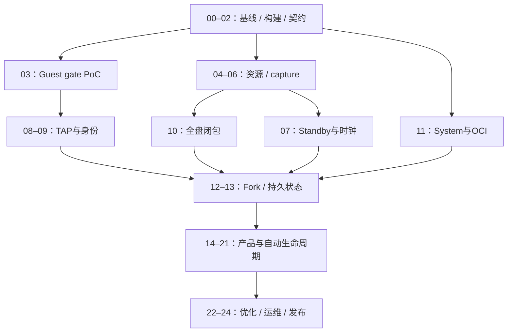

# 实施计划

本计划是跨仓库执行顺序，不是新的研究任务列表。实现以 TECHNICAL_SPECIFICATION 的契约为准；架构中的“新增”能力需真实落地后才宣称支持。普通实现决策无需逐包请用户批准。总体约七成投入功能实现、三成必要验证；内存安全、捕获闭包、fencing和历史恢复的门不能因比例目标省略。

截至 2026-11-26，本地两个主仓均已将实现合入 `deep-runtime/main`，在独立 Worker 安装了带实测证据的候选。WP-22 的数值按实测硬件和样本量报告，WP-24 的账本逐项列出安装版本、结果、待验及项目所有者指定跳过的子项。[候选与源码基线](README.md) · [WP-22 测量](performance-wp22.md) · [WP-24 验收](acceptance-ledger.md)

## 1. 里程碑与交付边界

| 里程碑 | 工作包 | 可验收结果 | 尚不承诺 |
| --- | --- | --- | --- |
| M0：固定环境与契约 | WP-00～03 | 隔离分支/构建、不可变Bundle骨架、双Adapter、Guest gate最小可行性 | 新平台完整Fork已可用 |
| M1：资源与状态核心 | WP-04～07 | 资源DAG/FD再导出、held capture、managed/raw Standby、正确时钟合同 | 所有网络/卷profile均受支持 |
| M2：完整运行时 | WP-08～13 | B/A附件、身份恢复、多块盘、System/OCI、独立live/batch Fork、durable状态闭包 | 未验证外设、跨CPU/Bundle任意迁移 |
| M3：完整产品 | WP-14～21 | 四态API、网络/Volume、授权/Secrets、SSH/桌面、备份/MCP、自动生命周期、原UI增量 | 企业组织、计费、HA、分布式存储 |
| M4：密度与持续维护 | WP-22～24 | 选择性优化、旧状态兼容、运维恢复、完整集成发布 | 未证明的boxd级毫秒指标、定制宿主内核收益 |

这些是完成门，不要求工程严格按编号串行。接口先冻结，独立模块可以并行；每包同时交付受影响的schema/SDK最小变更，不等全部底层结束再做客户端。

### 1.1 关键依赖

关键路径为 `基线/协议 → 资源可独立持有 + Guest gate → 多盘/网络恢复 → 独立Fork与Hibernate → 产品整合`。Guest gate 属于早期可行性门；no-op rebase、raw+reflink、UFFD共享缓存不是关键路径。

### 1.2 并行所有权

- Runtime负责人拥有 smolvm资源/捕获与libkrun状态机；网络/Guest负责人拥有TapFd、control device、kernel/helper；平台负责人拥有Go/SQL/SDK/UI。接口变更先改共享schema与版本，再各自实现。
- 热点 `src/agent/fork.rs`、`src/vmm/src/lib.rs`、`internal/lifecycle/engine.go` 在同一窗口只由一个工作包整合，其他包通过小hook/新模块提交；避免多个agent整文件重写。
- 在独立worktree/feature分支并行。功能依赖提交先进入deep integration branch，再更新submodule gitlink；不把未合并working tree当已固定依赖。
- 每包记录复用来源与共享补丁标签。纯产品/UI/SDK变更可供官方路线cherry-pick；定制Adapter、kernel和VMM私有协议分开提交。

## 2. 工作包

以下代码路径均相对于该仓库根目录；标“新增”的路径是本计划要求创建的模块，并非现存文件。完成标准中的验证复用前置包证据，不重复整套Phase 1功能测试。

### WP-00：仓库、分支、工作目录与现场隔离

**目标：** 建立可以持续开发且不影响另外两条路线的工程起点。

**前置：** 读取全部五文档、用户当前授权、各仓库AGENTS；核对README固定SHA。

**仓库与代码：** platform-smolvm、smolvm、个人libkrun/libkrunfw Fork；新增 docs/deep-runtime/、packaging/deep/。

**接口/数据：** baseline-lock.json；route_id=deep；仓库/分支/remote/submodule和部署实例清单。

**实现要求：** 平台deep-runtime/main从582a6f1；smolvm从5bd7c2f。当前本地分支已建，但在实施机器重新查存在性再创建，不覆盖。确认或建立来源为smol-machines的依赖Fork，在下游分支改.gitmodules为HTTPS并锁定36b084/168e68。检查远端/本地其他分支及未提交改动；单独worktree。现场只读盘点服务、端口、routes/cgroups/目录，不格式化、删除VM或改管理网。

**失败处理：** 无远端权限时先完成本地checkout/补丁和可审查提交；记录具体权限缺口，不声称远端Fork已建，不以其他上游替代。已占branch/path使用新worktree名，不reset。

**完成标准：** 可重现checkout全部源；官方与deep没有共享可写DB/对象目录/端口/IP池；环境隔离清单可审查。

**必要验证：** git状态/gitlink/commit/tree核对；路径、service、port、address pool冲突检查；无VM功能重测。

**后续影响：** 所有包的基础；为未来共享产品提交保留来源链。

### WP-01：可追溯构建与不可变Runtime Bundle

**目标：** 用源代码生成可信定制栈，杜绝旧预编译库混入新包。

**前置：** WP-00。

**仓库与代码：** smolvm scripts/build-libkrun-linux.sh、build-agent-rootfs.sh、build-dist.sh、check-libkrun-provenance.sh；libkrun Makefile/Cargo.lock、libkrunfw Makefile/config-fragments；新增scripts/deep/build-bundle.sh与专用CI。

**接口/数据：** RuntimeBundle/1、toolchain/build lock、artifact SHA256、patch manifest、profile/reader标识。

**实现要求：** 首版Linux x86_64、GPU=0软件桌面；先锁kernel源码/配置与FW，再libkrun/init，再Agent/rootfs，再smolvm/resourced，最后平台包。wrapper先严格核对submodule SHA和工作树，不依赖脚本容忍的submodule失败。Guest gate/内核变化必须重建FW，不用SKIP_LIBKRUNFW。记录解析后的实际工具链/容器digest，不永久用stable/latest；独立产物目录不覆盖原版。

**失败处理：** 任一源码/摘要/导出符号/初始init静态链接不符即停止构建；不能复用旧.so后只更新commit字段。发布manifest有null/placeholder拒绝。

**完成标准：** 一个带全部真实摘要的候选bundle可安装到独立目录；可验证ABI/Agent/Profile匹配；构建步骤复现且保留源码归档与许可证。

**必要验证：** 现有provenance/glibc/export/init静态检查；一个最小OCI boot/exec smoke（隔离KVM Worker）；无跨平台全矩阵。

**后续影响：** 所有底层包增改后走同构建通道；WP-23扩展历史兼容与发布。

### WP-02：协议、Adapter和能力骨架

**目标：** 让平台独立于定制VMM细节，保持旧路线可用。

**前置：** WP-00；Bundle schema由WP-01并行提供。

**仓库与代码：** platform internal/runtime/types.go；新增contracts.go/capabilities.go/resolver.go、customsmolvm/；lifecycle/engine.go、cmd/platformd/main.go、platformapi/server.go；smolvm新增runtime_ext/和smolvm-runtime-protocol crate。

**接口/数据：** ExecutionRef、OperationReceipt、三值Capability、health；WorkerResource/CaptureControl/StatePoint各v1；原生runtime-ext/v1路由。

**实现要求：** 从真实*smolvm.Client方法抽interface，保留原official 1.37.1 gate；ForBinding按存档bundle路由。未知能力不放开按钮；默认/单机/单操作分别求capability交集。Runtime错误映射effect/unknown，workload_error不丢。新增profile/版本列并制定迁移，不直接删旧pause字段。

**失败处理：** unknown handshake或reader不兼容拒绝；HTTP断线查询同operation；不通过改版本比较绕开能力门。

**完成标准：** 官方适配器行为保持，custom可协商schema；新UI/SDK可读取四态、管理健康和明确unsupported。

**必要验证：** 接口contract fixture与一次旧profile关键流；Running+workload_failed、unknown能力、旧execution拒绝；无需重测所有文件/终端功能。

**后续影响：** 跨仓库公共接口起点；后续包不得各自发明epoch、network mode或错误枚举。

### WP-03：Guest gate最小可行性与安全边界

**目标：** 尽早证明无需普通Agent/应用配合即可保存可安全重建身份的执行点。

**前置：** WP-01可构建Guest kernel；WP-02协议。

**仓库与代码：** libkrunfw新增独立kernel patch；核对Linux6.18.60 kernel/power/process.c、include/linux/freezer.h；libkrun新增control device最小stub；smolvm新增静态identity helper crate。

**接口/数据：** GuestIdentity/1、GuestGateState、PrepareGate/GateArmed/Abort/Release；唯一coordinator、预建单线程helper、deadline。

**实现要求：** FREEZER已可用，不启用整套Guest hibernation。先PoC同caller freeze/thaw、UMH_WAIT_EXEC后握手、冻结前预取helper页；再实现内建coordinator+窄helper例外、退出/cancel清理，helper不可随意指定PID或传播豁免。证明普通用户线程含容器在ACK前不运行；识别kernel网络/异步I/O需单独gate。

**失败处理：** D态/FUSE/失联有界失败并确认源thaw；helper死不能永久冻住source。PoC失败继续独立工作包，但B strict clone保持unknown，不自动A/coldboot/NMI改RIP替代。

**完成标准：** 可执行PoC与短决策记录：确切支持配置、失败恢复、source用户停顿指标；无需再做大竞品调研。

**必要验证：** 2 vCPU、多进程/容器计数器、helper杀死、FUSE依赖、取消/超时；检查普通用户态在gate窗口计数不增长；确认Agent停止不影响该通道。

**后续影响：** WP-07/09的前置可行性门；失败如需改变完整Fork语义才触发用户决策。

### WP-04：Worker资源目录、全局准入与重启框架

**目标：** 建立独立于任何VM/Serve生命周期的资源所有者。

**前置：** WP-02；WP-01构建能装新daemon。

**仓库与代码：** smolvm新增crates/smolvm-resourced/{catalog,journal,leases,gc,reconcile,protocol}；src/runtime_ext/client；platform只保存handle。

**接口/数据：** WorkerResource/1；executions/resources/edges/root_refs/operations/writer_grants/fd_providers等；instance/incarnation/epoch和pidfd。

**实现要求：** 一个Worker一个resourced；private DB独立、跨bundlewriter唯一；intent先落盘再动作再回执。UDS peer/launch许可核验，FD分批带CLOEXEC/边界检查。区分RootRef/OperationPin/预算reservation，TTL不得撤销活writer。实现recovering禁止GC和冲突资源授予。

**失败处理：** unknown writer保持占用；host_boot变化volatile标lost；部分接收关闭FD/保留可诊断journal；同op不同hash拒绝。

**完成标准：** 基本操作幂等、跨bundle锁与根引用闭包可查；broker重启能进入恢复/退出安全状态。

**必要验证：** 两个Serve争同卷、异常FD/截断descriptor、op重放、重启未决intent与GC竞争；资源模型单元验证只覆盖真实不变量。

**后续影响：** WP-05及所有网络/卷资源的权威；此包开始做恢复，不能留到最终QA才补。

### WP-05：RAM Generation与磁盘Backing独立化

**目标：** 把共享backing从父机目录/进程归属改为资源ID，保留native CoW数据路径。

**前置：** WP-04。

**仓库与代码：** libkrun layered_restore.rs、retained_fds.rs，新增resource_export.rs；smolvm fork.rs、manager.rs、deletion.rs、db.rs、launcher.rs；对象存储路径映射。

**接口/数据：** RamGenerationDescriptor、ResourceExportRegistry、RegisterGeneration/Acquire/AckAttached、EXPORT_RESOURCE_INVENTORY；immutable disk resource IDs。

**实现要求：** 当前映射所需Arc<File>关联resource_id并可re-export；parent目录只存逻辑引用，磁盘ancestor路径在受控object区。保留per-VM uid/Landlock，不靠全目录0777。旧对象不破坏性搬迁；只有有闭包证明的newprofile移除dependent_clones保护。

**失败处理：** 没有provider且无durable内容标lost；不以零页/原PID/fd号补恢复；handoff未ACK不放旧最后引用。

**完成标准：** 删除逻辑祖先不会删除被使用RAM/盘；broker可重收所有必要FD；没有全RAM落盘/全复制强制步骤。

**必要验证：** 冷页、swap/稀疏页（宿主支持时）、祖先盘读、父退出后孙Fork；brokerkill后re-export；最后一个引用释放才回收。

**后续影响：** WP-06/12的核心；memcg归属不会随FD移动，WP-21须做真实统计。

### WP-06：统一held capture和完整设备/多盘inventory

**目标：** 把内存、设备和盘固定在一个可查询、可提交的捕获点。

**前置：** WP-05；WP-03提供gate接口，完整网络/Volume闭包由WP-09/10补齐。

**仓库与代码：** libkrun src/libkrun/src/lib.rs、vmm/lib.rs、snapshot.rs、device_manager/kvm/mmio.rs、virtio/persist.rs；新增capture_txn.rs；smolvm src/portable_checkpoint.rs、runtime_ext/capture.rs。

**接口/数据：** CAPTURE_PREPARE/EXPORT/QUERY/FINISH/CANCEL；hold_token；StatePoint；CONTINUE/RETURN_STANDBY/KEEP_HELD/EXIT_QUIESCED。

**实现要求：** 单VMM状态actor；所有RAM/device写者pause+drain；保持现有seal/delta/layered RAM；枚举实际全部block role；prepare/validate后整组pivot并留rollbackhandles。移除普通sync/TaskManager作为VM捕获必要前提。pendingresize先reconcile；部分remap不得继续。

**失败处理：** 断连Query；映射或设备不完整FAILED_HELD；失败artifact不发布；不可撤销decision后不autoResume。

**完成标准：** 捕获可与源finish分离；source_after_capture=PRESERVE_SOURCE_STATE；状态blob/FD可重复导出而不再次捕获。

**必要验证：** 每阶段断连/故障注入；设备pendingI/O、全盘枚举、防遗漏disk、RAM remap失败；证明source query准确。

**后续影响：** WP-07、12、13共用；新设备只有声明capture/rebind后可进profile。

### WP-07：原生Standby和时钟合同

**目标：** 提供保持RAM/VMM、无落盘的真实待机。

**前置：** WP-06、WP-03。

**仓库与代码：** libkrun capture_txn.rs、vmm pause/resume和linux/vstate.rs；smolvm runtime_ext/lifecycle；平台先有adapter接口。

**接口/数据：** STANDBY_ENTER/WAKE、clone_ready、clock policy、可序列化暂停上下文。

**实现要求：** managed先usergate后vCPU/deviceshold；raw可nogate但clone_ready=false。Wake同incarnation/epoch；gate与devices按许可恢复；Standby捕获后RETURN_STANDBY，不暗中继续。暂停时钟归一化，不序列化host Instant，不重复扣暂停时间。

**失败处理：** quiesce失败只有证明安全才Running；否则held可诊断；raw strict capture拒绝，不能偷偷wake。

**完成标准：** 无generation/seal/RAM文件；长待机后wake与Standby→Hibernate→Restore时钟/IRQ正常；Agent停止仍可控。

**必要验证：** CPU计数停止、设备写停止、等待timer、长暂停clock、原Standby捕获后不推进用户计数器；避免用SIGSTOP。

**后续影响：** 提供M1实际能力；后续自动闲置不等于低CPU即可触发。

### WP-08：TapFd和Worker私网数据面

**目标：** 实现B/A共用的可重绑定TAP、namespace/IPAM/ACL/DNS基础设施。

**前置：** WP-04，WP-02协议；可与WP-06/10并行。

**仓库与代码：** libkrun include/libkrun.h、src/libkrun/src/lib.rs、devices/virtio/net backend/tap；smolvm krun.rs、launcher.rs；resourced新增network/。

**接口/数据：** krun_add_net_tap_fd_v1；NetworkAttachment/1；namespace/路由域/IPAM reservation/policy digest/FDlease。

**实现要求：** port netns+router netns；B hostroute/proxyARP不私网NAT；A内部地址与VIP映射和hairpin；前置antispoof、独立conntrack域与egress唯一标识。TAP头/offload非阻塞参数与现libkrun一致；未实现IPv6显式关闭。保留upstream网络后端供legacy，不用Named补丁拼凑主路径。

**失败处理：** 地址冲突/权限失败回收已知未发布对象，unknown占用保留；不改PVE管理路由/默认网关，不全局清nft规则。

**完成标准：** 两模式独立coldboot互通；topology和restorebind接口齐备；私网和服务外网地址不冲突。

**必要验证：** A↔B双向源地址、同A内部IP隔离、ARP/MAC/IP spoof、overlap私网、hairpin、MTU/PMTU；检查VNET_HDR规格。

**后续影响：** WP-09身份激活和WP-15服务访问；网络性能只在路径正确后测。

### WP-09：完整身份恢复、网络gate与host-bound管理通道

**目标：** 让新子实例在正确身份和授权下恢复普通用户态。

**前置：** WP-03、06、08。

**仓库与代码：** libkrun新增virtio控制设备/state serializer；libkrunfw patches/config-fragments；新增identity helper；smolvm runtime_ext/identity/attachment；平台guestidentity接口。

**接口/数据：** GuestGateState、GuestIdentity/1、IdentityReady、CommitActivation、ReleaseGate；guest-bound凭据与AttestedGuestContext。

**实现要求：** freeze前helper预建/握手，内建coordinator唯一freeze/thaw；加独立packetgate覆盖受支持netns路径。KernelRNG使用vmfork事件+新host熵；Netlink重配只作用受管NIC，networkd不争uplink；当前hostpeer绑定epoch。身份ACK包含nonce、capture、附件revision、profile/helperdigest。外部vsock/TSI/共享写附件不可继承旧连接许可。

**失败处理：** 旧ACK/token、Agent假ready拒绝；父保持独立，child失败quarantine；缺gate的checkpoint不给strict clone；不会自动restartPID1或用户数据库修缓存。

**完成标准：** B默认/A可选在live restore均完成；Guestroot不能通过复制父token/伪造IP获得父权限；identityready范围明确。

**必要验证：** 身份每阶段失败、重播旧ACK、主/容器进程发包计数、publicAPI guest-boundtoken重放、Agent停止、machine-id/sshd缓存和specificIP监听；核对不越权。

**后续影响：** WP-12/13的发布门；主机身份安全与Guest服务readiness分离。

### WP-10：真实Volume和全盘状态闭包

**目标：** 独立数据盘拥有可克隆代际、排他写权、生命周期和可靠持久化。

**前置：** WP-04/05/06；可与WP-08/09并行。

**仓库与代码：** smolvm storage/disk.rs、launcher.rs、manager.rs、portable_checkpoint.rs；libkrun mmio block inventory/pivot、virtio/block workers/backing；resourced volume/。

**接口/数据：** BlockAttachment/1、Volume/Generation/WriterSet；fork_policy=clone|share_immutable|reject；exact/clone_conflicts恢复策略。

**实现要求：** 所有root/storage/overlay/cache/data设备进同一列表；先Stoppedattach/detach，online独立capability。多盘prepare/pivot后一起发布；独立RW卷Fork建新volumehead；RO只共享immutable代际。扩容分image/VMM/GuestFS，flush绕过relaxed保存保证；真实OFD/FD/I/O收束参与fence。

**失败处理：** 单盘失败整capture失败；不旧RAM接latest；writer未知不移交；不跳过active数据盘或用HostMount假装block；扩容部分成功不可缩回。

**完成标准：** 删compute保留persistent卷；数据盘clone/快照/扩容/backup引用可操作；系统与数据同capture点。

**必要验证：** 双盘交叉标记+RAM序号、RW/RW与RW/RO冲突、全部磁盘role、ENOSPC/fsync失败、旧RAM新盘拒绝、detachunknown；保存GuestAgent关闭场景。

**后续影响：** WP-12/13与产品Volume；初版qcow2不等待reflink实验。

### WP-11：完整System启动和OCI Agent服务化

**目标：** 让systemd真实成为GuestPID1，同时保持OCI轻量路径和完整状态恢复。

**前置：** WP-01；与WP-09共同确定kernel/helperprofile。

**仓库与代码：** libkrun init/src/{main,exec,fs,config}.rs、根块盘接口；smolvm launcher/Agent；libkrunfw配置片段；platform guest/templates/managed与新增system模板。

**接口/数据：** BootProfile oci-v1/system-debian-v1、kernel配置digest、Agent生命周期/发现协议、受管NIC所有者。

**实现要求：** System使用rootdisk切根后exec发行版init，Agent/taskd为systemd服务；OCI supervisor与Agent任务所有权拆开，Agent重启发现现有crun工作负载不再启动一份。保留root；uplink由identityinfra管理，networkd Unmanaged，用户其他NIC不受限。

**失败处理：** 用户关闭Agent只改管理health；不能偷偷重启用户服务/PID1。自定义kernel缺设备/gate只报告对应capability，不以假systemd容器替代。

**完成标准：** 两启动profile共享同capture/volume/network引擎；Docker/Compose、SSH、k3s受测配置能运行；Agent停止后VMM控制可用。

**必要验证：** /proc/1真实systemd、systemctl、Dockerbuild/compose服务、k3s基本集群操作；运行中进程RAM标记Fork/Hibernate；killAgent再接管不重跑workload。

**后续影响：** WP-12/13对两个profile验收；WP-18接SSH/Desktop产品。

### WP-12：独立Live Fork、递归与Batch

**目标：** 默认Fork即可父子独立，保留一次原生捕获和完整进程状态。

**前置：** WP-05/06/09/10；WP-11提供System测试profile，先OCI可增量交付。

**仓库与代码：** smolvm fork.rs、api/handlers/machines.rs、runtime_ext；libkruncapture和FDimport；platform仅契约fixture，产品集成在WP-14。

**接口/数据：** ForkReceipt、BatchReceipt、stablechildIDs、capturepin、sourceclosure；resource_independence证据。

**实现要求：** 预留全批预算→capture一次→发布共享refs→PRESERVE_SOURCE_STATE→释放父锁→有界并发子启动/身份激活。child元数据源信息先保存，不在父删除后回读父。每子独立租约/卷/网络；adoption不延长源锁。

**失败处理：** Partial结果保留已成功子；重试同capture，不重新捕获父；越commit取消不能删已成功子。missingresource不零填；未验证profile保持旧保护。

**完成标准：** 父delete/hibernate/rollback不阻断子，子可继续fork与独立save；batch为同一时点而非N个串行fork。

**必要验证：** 祖先多级删除后的冷页/祖先盘、孙fork、子独立hibernate；batch失败1/N、timeoutretry只一个capture；观察无全RAMartifact必经步骤。

**后续影响：** 核心产品发布门；WP-13复用capture而非另建clone引擎。

### WP-13：Checkpoint、Hibernate、Restore与Rollback

**目标：** 持久完整状态具备明确一致性、失败恢复与历史引用。

**前置：** WP-06/07/09/10；可与WP-12并行开发、联合验收。

**仓库与代码：** smolvm src/portable_checkpoint.rs、checkpoint crate/runtime_ext；resourcedcheckpoint/journal；libkrun restore/builder、clock、capture_txn。

**接口/数据：** CaptureManifest/1、durable commit、STOP_COMMIT、RESTORE_PREPARE、writerfence、rescueStatePoint。

**实现要求：** Checkpoint immutable后台导出后才durable；Hibernate一直hold直到持久化+退出，不执行guestshutdown；同capture_id建立可独立解析的durable资源表示并原子切换checkpoint/hibernate根，源退出确认后释放仅被本次volatile capture/源使用的pins与FD，保留其他分支所需backing。目标纯paused预检后先fence旧写者、授writer，再identitystage。Rollback用新VMM，先保留native rescuepoint；绑定exact磁盘generations和原bundle reader。

**失败处理：** STOP前可安全abort，STOP后只完成exit；导出/校验缺块失败不可见；恢复失败不冷启；新执行已跑后不能自动回旧点丢副作用。

**完成标准：** 完整闭包可在Worker正常重启后恢复；已有快照在source删除后仍有效；从StandbyHibernate不推进捕获点或重复扣clock。

**必要验证：** 每个commit点killServe/broker/VMM、ENOSPC/flush失败、计数器证明Hibernate没有capture后运行窗口、missingchunk/bundle、旧writer不明；验证无活后代与有活后代两种情况下的持久根切换、真实RAM回收和后代冷页可读；旧状态readerfixture。

**后续影响：** 所有高级产品状态操作、备份和旧Bundle承载基础。

### WP-14：平台四态、VM capture与统一Fork操作

**目标：** 用户通过现有API获得真实新语义，不重建平台工作流。

**前置：** WP-02与WP-07/12/13 receipts。

**仓库与代码：** platform lifecycle/{engine,access,monitor}.go、platformapi/{snapshots,rollback,machine_view}.go、registry/{operations,mutation,types}.go、api/openapi.yaml。

**接口/数据：** power_state/health、capture_mode、batchoperationchildren、source_disposition；既有operation journal与binding。

**实现要求：** /standby/hibernate/fork-batches；旧/pause保留持久语义；vm snapshot与managedtasks分派；Taskadoption异步并可降级，进程不重跑。stop/delete/rollback已获丢弃授权时不依赖taskd逐个cancel成功。删除依赖guard只对有independent证据的customprofile。

**失败处理：** 未知副作用reconcile原意图；工作负载失败VM可running但operationeffectapplied；childidentity失败不公开。

**完成标准：** 新旧客户端都得到一致行为；guest不可用仍可VMM控制；从父删除后子adoption无活父依赖。

**必要验证：** 关键APIfixture、legacy pause/clone兼容、同keybatch不重复、任务索引不可用正确显示；底层冷页大测试引用WP-12结果不重复。

**后续影响：** 新UI/SDK的主产品模型。

### WP-15：Network、稳定服务、DNS和唤醒产品

**目标：** 把B/A网络和HTTP/HTTPS/TCP/UDP/SSH入口接入统一授权与访问。

**前置：** WP-08/09、WP-14操作框架。

**仓库与代码：** platform新增networks/及platformapi/networks.go；gateway/forward.go、services.go、service_edit.go、lifecycle/access.go、settings。

**接口/数据：** Network/Endpoint/Service、trustedattachmentdialer、service revision、wake dedupe/预算、协议鉴权。

**实现要求：** B默认设置和createoverride；地址/DNS保留跨休眠。替换loopbackonly拨号为可信attachment，不允许任意URL。保留HTTP不重放业务请求和现有tcp-mtls；新增TCP/UDP的privateACL策略。private直连也要packet-triggerwake，不能只做HTTPwake。更新listener时按service revision重建/查当前配置，撤销策略关闭索引中连接。

**失败处理：** unauthorized不得wake；身份未激活入口不公开；UDP有界TTLbuffer/限速，丢包明确；新连接恢复失败不重放可能已送达应用数据。

**完成标准：** A↔B、多个私网、稳定域名和各服务协议可用；新旧bundle不争同IP/hostport；既有stream revoke策略清晰。

**必要验证：** A/B双向、private直连wake、多请求只一次restore、更新service后新连接、revoke既有连接、HTTPS前后端TLS分离、UDP首包与预算。

**后续影响：** SSH/Desktop和Agent协作；实际TCP/UDP为新增，不能标当前已有。

### WP-16：Volume产品与存储工作流

**目标：** 在现有API/UI中管理独立卷、快照、克隆、扩容与恢复冲突。

**前置：** WP-10、14。

**仓库与代码：** platform新增volumes/、platformapi/volumes.go；registry迁移、snapshots.go、SDK/CLIresource接口。

**接口/数据：** Volume/Attachment/VolumeSnapshot、ownership、lifecycle、source_revision、generationhandles。

**实现要求：** 产品不重新计RAMrefcount；保存runtimehandles及pinreceipts。attach≠mount、onlinecapability单列；Hibernated不改topology；exact/clone_conflicts显式结果含volumemap。

**失败处理：** unknownwriter不能释放；persistent卷不跟机器delete；反向恢复旧RAM配新卷一律拒绝；blockgrowth成功FS失败如实返回。

**完成标准：** 用户可创建/挂接/卸载/扩容/快照/clone/delete独立卷，RBAC/查询/事件覆盖且不遗漏完整capture盘。

**必要验证：** 并发attach、删除compute保留卷、恢复generationconflict、capturepin阻止GC；使用WP-10I/O证据。

**后续影响：** 备份、资源统计和UIVolume页面。

### WP-17：Guest授权、Secrets与凭据代理

**目标：** 允许Agent管理授权范围内其他实例，同时阻断复制凭据越权。

**前置：** WP-02/09；可与WP-15/16并行。

**仓库与代码：** platform auth/{auth,credentials}.go；新增authorization/guestidentity/secrets/credentialproxy；task_secrets.go、事件/ticket/stream授权入口。

**接口/数据：** owner/service/guest principal、grants/limits、AttestedGuestContext、guest-boundtoken、SecretVersion、ProxyPolicy。

**实现要求：** 修Bootstrap LIMIT1为明确owner；逐路由细粒度action含list/events/operations。GuestSDK走hostboundrelay，publicAPI拒guest-bound当普通bearer；child默认不继承父管理权，rollback不恢复revokedgrant。Secret加密/版本/clone披露，代理固定upstream+方法path+流式限额。

**失败处理：** 队列dispatch前重查撤权；不把旧Taskenv明文误称已加密；不宣称已注入任意RAMsecret可被擦除；代理重定向重新校验。

**完成标准：** Guest可受限create/fork/exec授权对象；父token在child无权；真正providerkey只在hostproxy；人类旧token兼容。

**必要验证：** 复制token/publicendpoint/伪造header/IP/CID、revoke后stream和queuedop、quota绕过、多principalbootstrap、秘密不进日志；不做企业租户矩阵。

**后续影响：** Backup/MCP/Desktop共享授权，不各建旁路。

### WP-18：Guest产品适配、稳定SSH与桌面

**目标：** 保持用户完整root和长期Linux体验，管理服务健康与VM状态分离。

**前置：** WP-11/14/15/17。

**仓库与代码：** platformguest/templates、lifecycle/ssh.go、taskbootstrap；新增desktop_sessionshandler；现有Gateway/ticket/leases。

**接口/数据：** SSHProvisioner OCI/runit与System/systemd provider、桌面service/session/lease、profilecapability。

**实现要求：** 只管理自己的sshd drop-in/独立监听，不覆盖用户全部配置。managedSSH身份未验证不发布；父缓存key不是改文件就消失。System软件桌面通过VNC/noVNC等授权WebSocket，Guest状态可恢复、外部浏览器重连；不以GPU直通为前置。

**失败处理：** 用户停止Agent/sshd/桌面只相应health不可用，不强重启用户服务；旧PTY/SSH断线不能触发任务重跑。

**完成标准：** OCI现有路径保留，SystemSSH不调用runit；桌面会话休眠恢复可继续；稳定逻辑入口不连到旧epoch。

**必要验证：** 双profileSSHidentity、Agent关闭、sshd旧key/新key、桌面恢复重连、sessionexpires释放hold；不重复全部终端键盘测试。

**后续影响：** 成熟个人云电脑体验；自动idle必须识别sessionhold。

### WP-19：事件、自动备份与MCP

**目标：** 形成可操作、可恢复、可被Agent安全使用的完整产品工具。

**前置：** WP-13/16/17；MCP基础和事件schema可在WP-02后并行。

**仓库与代码：** platform registry/events.go、maintenance/{backup,restore,sqlite}.go；新增backups/；cmd/sandboxctl/mcp.go。

**接口/数据：** resource-awareoutbox、BackupPolicy/Run/Pins、完整backupmanifest、MCPSDKtransport。

**实现要求：** 沿用SSE cursor和至少一次语义，不引入Kafka。backup先pin已选择capture/vol/bundle再consistentDBcopy和stagingexport，最后manifestcommit；保留last-good，retention按refs。密钥恢复材料单独加密。MCPstdio同SDK权限和capabilities，长任务返回opid。

**失败处理：** 备份失败不覆盖旧有效包；缺bundle/key/盘闭包verifyfail；cursor过期全量resync；未授权secret事件不广播；MCP结果不能改变授权目标。

**完成标准：** 可配置自动备份和恢复验证；Guest可授权使用MCP；运行中RAM是否被捕获由backupscope明确声明。

**必要验证：** backup中并发GC/delete、缺key/块/bundle、retention与hibernatepin、SSE授权、MCP与API同权；不宣称多VM原子组快照。

**后续影响：** 最终灾备与Agent集成门；调度是产品功能实现，不要求本次创建聊天自动化。

### WP-20：SDK、CLI与Daytona WebUI增量闭环

**目标：** 统一客户端体验，不产生第二套SDK或重做前端。

**前置：** WP-02开始随各API增量；最终依赖WP-14～19及WP-21自动生命周期。

**仓库与代码：** api/openapi.yaml；sdk/typescript/src/index.ts、sdk/python/sandbox_platform/__init__.py、cmd/sandboxctl/{main,resources,tunnel,admin}.go；web/src/{api,machines,machine,workspace-actions,branches,catalog,system,layout,main}.tsx及Terminal.tsx。

**接口/数据：** 新method参数/返回类型、三值能力、四态health、Partialbatch与恢复错误；见技术规格§12。

**实现要求：** 保留主题/导航/终端文件任务布局。新create B默认、boot/vol选项；Standby与Hibernate分开；networkmode运行时只读。snapshot显示vm/managedscope，legacyclone放明确高级入口。每次API变化同时更新手写SDK和CLIhelp。新增自动策略全局/实例设置、timeout/常驻/priority/wake条件、lease与blockers展示；新版create不再无条件发送legacy idle_policy，避免覆盖新默认。

**失败处理：** unknown能力禁用新高影响按钮；unsupported不客户端fallback；mutationretry保留key，不能Partial只抛exception丢子ID。

**完成标准：** 同一API支持official/custom两profile；UI可展示VMRunning但Agent/服务未ready；新增主要产品流程可通过SDK/CLI完成。

**必要验证：** web和TS构建、Python新增方法fixture、新页面必要截图/交互检查、单条System+Native+batch+Standby+Volume+Restore闭环；一条official功能准确禁用。

**后续影响：** 最终发布用户入口；纯UI/SDK提交可cherry-pick另一条路线。

### WP-21：统一自动生命周期、压力回收与资源预算

**目标：** 正式交付自动Standby、自动Hibernate、常驻、优先级、运行租约、活动检测和按需唤醒，并管理整个Worker预算；不是只提供后端接口或可选优化。

**前置：** WP-02/04提供协议、actor/准入与catalog骨架；WP-07/12/13提供状态原语；WP-15/17提供可信入口活动与授权。协议和budget骨架应早期并行实现，完整控制器进入M3；WP-20最终验收须包含本包UI/SDK/CLI。

**仓库与代码：** smolvm `src/api/memory_pressure.rs`拆Sampler/Reclaimer，`live_resize.rs/cpu_limit.rs/process.rs/systemd_scope.rs`；resourced新增`lifecycle_controller/{policy,activity,leases,pressure,wake}`；platform `lifecycle/{monitor,access,engine}.go`分official/custom，`platformapi/{settings,leases,machine_view}.go`、SQL/OpenAPI；原SDK/CLI和Daytona设置/实例页。

**接口/数据：** TECH §15的LifecyclePolicy、ActivitySnapshot/ActivityHold/WakeDemand、运行lease v2、policy desired/applied revision、automatic origin/decision journal、wake_pending；新增WorkerResource政策/租约/活动RPC。默认policy在Create时解析，Fork继承有效policy但不复制运行lease/hold/活动时钟。priority按0–100越低越先回收，不是CPUweight。

**实现要求：** custom由resourced内单WorkerLifecycleController统一自动决策，platform保存/授权/同步政策、投影operation；各Serve不独立pause/kill/resume。保留旧guard的PSI/cgroup采样、独立cache reclaim与准入，但移除隐藏20秒kill升级。实例policy/lease获WorkerACK后才成功；customAccess先登记当前execution ActivityHold或逻辑WakeDemand，与autoaccept在同actorCAS；Activation重授权并将demand原子接续到新execution hold后才转发访问。两个idletimeout从同一idle起点算；任务、SSH/PTY/Exec、LLM/proxy stream/直接外向连接、租约和unknown保护优先于回收priority。Standby内Guest collector标controlled_suspended，只在持续hold证据及实时host监测成立时沿用静止活动快照，不因正常冻结TTL到期永久阻断第二级休眠。先准入降压/cache/balloon，再合格Hibernate；Standby不算RAM已释放。

复用CPUgrow/Linuxofflineshrink/RAMgrow/balloon，pendingresize先reconcile。参数化hardcoded smolvm.slice，唯一预算owner，scope含route和全局ID。其他路线未接broker只用独立已知上限/预留。修monitor/Bootstrap首principal错误；v1 suspectlease不静默释放，v2到期只解除lease保护仍检查业务活动。全局/实例策略及blockers/下一动作、appliedrevision在UI/SDK/CLI完整可配可查。

**失败处理：** 缺fresh活动或可证Standby静止快照时保守unknown，不自动睡；实例policy未ACK显示pending不谎报生效；Worker/平台重启重新对账holds/collector sessions。Hibernate已STOP_COMMIT后的需求进入durablewake_pending，完成Hibernate后合并一次restore；未commit可安全abort回原稳定态，原Standby随后另走STANDBY_WAKE，不直接thaw。无合格回收对象、磁盘/内存导出预算不足时拒新资源并报告pressure，不绕过keep_running/lease或自行kill。不得仅关闭旧guard就上线。

**主动Fork隔离：** `CheckAutoSleepEligibility()`只给自动操作；用户Fork/ForkBatch走`CheckCaptureSafetyAndAdmission()`。auto_hibernate=false、keep_running=true、有效lease、任务/SSH/LLM等待都不能成为Fork拒绝条件；queuedauto让位，新执行capture仍需真实权限、闭包、锁与预算。资源不足可以拒绝，不把自动策略禁用当能力不支持。

**完成标准：** 两级idle定时器、全局默认/实例覆盖/显式应用旧实例、常驻/priority、压力回收、wake条件、lease迁移和等待模型保护形成闭环；多个Bundle只有一个调度owner；实际回收量/源状态/失败原因可查；无隐藏guard旁路；所有现有客户端可配置策略。

**必要验证：** A25以及新增A28–A36：低CPU等待LLM、续租/新访问与autosleep竞态、STOP前后wake、v1/v2到期、platform/Worker重启、两个Bundle压力/恢复、关闭自动休眠且有运行lease仍主动nativeFork。CPUshrink/RAMgrowth/balloon不响应和真实memcg计量按改动面补测，不反复跑Phase1。

**后续影响：** WP-20自动策略交互与WP-24稳定发布的硬门；WP-22性能测量依赖预算/活动计量。控制器是现有resourced模块，不引入新daemon或分布式选主。

### WP-22：按瓶颈选择的性能优化

**目标：** 优化实际用户停顿、首任务时间、密度和吞吐，不追虚构延迟目标。

**前置：** WP-12/13正确性门、WP-21计量；可独立推迟。

**仓库与代码：** libkrun layered_restore.rs、vmm/lib.rs、block workers；smolvmfork/source锁/portablehash/lazy；每项独立feature patch。

**接口/数据：** 阶段trace、copiedbytes/extents/FD/layers/lanes；featureflag与同机对照report。

**实现要求：** 先锁跨度/一次batchcapture/预留并行、readlane可配置默认保守；再no-oprebase严格metadata等价；仅有证据时局部remap/dirtyunion/hash复用/共享恢复cache/working-setprefetch。raw+reflink只独立backend实验，不迁移现有盘。

**失败处理：** 收益不足/性能回退/数据风险/热点维护成本高即关闭或移除该优化，不阻塞产品。dirty优化须vCPU+软件写union，不能只KVMdirty。

**完成标准：** 每个进入默认优化有同硬件、同profile、同workload结果与正确性回归；无收益优化不以完成率强合。

**必要验证：** 首次/再fork/深层/并发、clean/dirty、首task；比较p50/p95、峰值内存、线程、I/O和吞吐；只跑受改动面关键风险门。

**后续影响：** 候选Bundle可携feature；不用boxd跨硬件宣传数做验收。

### WP-23：安装、旧Bundle兼容、回退和上游同步

**目标：** 把可维护性变成发布流程和状态生命周期，而非Git建议。

**前置：** WP-01/04/13/21；部署脚手架可早于M2实施。

**仓库与代码：** platform packaging/install、packaging/systemd及status/sockethelpers；smolvm scripts/deep、systemd_scope；新增patch registry、compatibility fixtures、upstream-syncCI。

**接口/数据：** BundleManifest/reader矩阵、bundle引用/security状态、privatedb配置、release索引、schema支持范围。

**实现要求：** 安装只追加bundle目录；每Bundle独立Serve/socket/DB，resourced一个。检查实际VMMscope，不能仅改KillMode假独立。旧状态匹配reader且host/CPU条件通过才恢复；SQLite升级前backup，旧binary拒新schema。上游comparetrees/gitlinks/patchreplacement→candidate→targetedgates→canary；不自动改运行中bundle。

**失败处理：** 缺reader/hostcap mismatch拒恢复；旧包有严重漏洞进入quarantine并给隔离恢复方案，不自动公网运行或删除引用。自动review拒绝具体动作则记录原因/准备结果，不绕过。

**完成标准：** 可并存新旧Bundle、保留历史状态、明确rollback平台DB/运行时界限；Codex可独立生成同步PR/摘要与删除已替代patch。

**必要验证：** 实际Serve/broker重启、两Bundle同卷/地址冲突、schema2fixture迁移、中断回滚、新平台/旧runtime组合、旧checkpointcorpus、原路线保持运行。

**后续影响：** WP-24发布门；后续上游更新只测受影响风险，保持最小历史corpus。

### WP-24：集成收尾、完整性验收与发行说明

**目标：** 交付可自托管的完整产品，清晰列出尚未完成能力。

**前置：** 所有核心包DoD；WP-22可选优化不作为必过依赖。

**仓库与代码：** 全部仓库；platform tests/integration新增deep组、docs/deep-runtime验收记录；不把实验脚本混进业务入口。

**接口/数据：** ACCEPTANCE矩阵、Bundle能力证据、测试profile、已知限制、操作手册、升级/恢复记录。

**实现要求：** 用一个隔离Worker完成代表性端到端；执行改动面必需故障门与历史兼容门；审计CAPABILITY supported与实际证据一致。更新五文档中的基线/已实现状态与release notes；按本地授权可持续修复，发布/影响其他路线按真实授权边界处理。

**失败处理：** 关键门失败不标完成、不以A默认/冷启动/漏盘替代；保留具体原因、已有复现和下一路径。

**完成标准：** 原生独立Fork、B/A、四态、多盘、System、授权、工具、备份、资源与升级形成闭环；部署后具备清晰诊断和回退。

**必要验证：** 只运行验收文档required集；未改变Phase1行为仅窄回归。性能报告明确数据环境/样本/统计范围；未测项留未测。

**后续影响：** 正式稳定release及未来维护的起点。

## 3. 工作包交付格式与自主执行

每个包的PR/提交说明必须写：具体问题、修改后的行为、接口/格式变化、验证结果和未覆盖边界；不以“更新了若干文件”代替功能说明。产出包含代码、对应schema/客户端、必要测试/fixture、patch登记、Bundle能力声明和简短运维影响。若shared模块可复用，给出可cherry-pick提交列表。

Codex每轮先读最近operation/分支状态，接着执行依赖已经满足的工作包。编译/链接失败、局部冲突、测试修复、单模块替代方案、合理超时/并发参数、未达收益的可选优化取消，都可自主处理。不要因每个工作包结束就停下来请求批准；也不要在一个可选优化上反复测量而不交付主能力。

确有不确定点时采用“最小实验 → 记录机制/成本 → 实现或保留明确缺口”。Gate PoC、FD恢复、全盘一致性和时钟是关键正确性问题；不能用featureflag关闭后仍把required产品能力标完成。标准内核上的可选性能优化失败可推迟。

### 人工决策边界

仅当要改变完整状态Fork语义、B默认/A可选、历史兼容承诺、引入定制Worker内核、大规模替换VMM、放弃关键能力、破坏性数据迁移或影响其他并行路线时停下。先完成可逆准备和证据整理，给出具体文件/差异/实验、影响范围与可行选项，再说明为什么必须由用户决定。普通不可逆外部发布仍按当次用户授权处理，不把本计划当成向他人发消息或修改PVE的授权。

## 4. 避免错误捷径的检查点

- 独立Fork验收未通过前，不删除父依赖保护；通过后删除的是资源限制，逻辑谱系保留。
- 不能把clone gate只接LiveFork而漏Checkpoint/Hibernate或Standby后捕获。
- 不能把systemd网络守护进程和identityhelper同时设为受管uplink写者。
- 自动生命周期必须只有一个customWorker owner；不可把旧Runtime压力guard和新policy并行运行，也不可复用自动休眠资格去拒绝用户主动Fork。
- 不能只写Volume API而漏libkrun全部block device捕获；不能仅有SQL锁而允许另Bundle打开同写盘。
- 不能把公开token中的machine_id当host-attested来源；不能只保护relay而允许publicAPI重放guest-boundtoken。
- 不能只覆盖平台操作失败，而不验证Serve、broker、VMM、Worker四种故障。
- 不能仅改`SMOLVM_DATA_DIR`，忽略hardcoded slice、scope名、status helper、产物路径和网络池。
- 不能让RuntimeBundle升级隐式改旧设备布局/状态reader；旧bundle保留成本进入资源引用和安全策略。

## 5. 后续可选方向

vhost/multiqueue、io_uring全覆盖、raw+reflink、跨Worker迁移、实验组一致快照、专用Worker内核CoW import、GPU完整状态、IPv6和运行中A/B切换都需要独立契约与证据。本期保留扩展点但不预造分布式基础设施。若后续工作改变核心承诺，按上述人工边界处理；否则可在既有模块和profile下逐步扩展。
