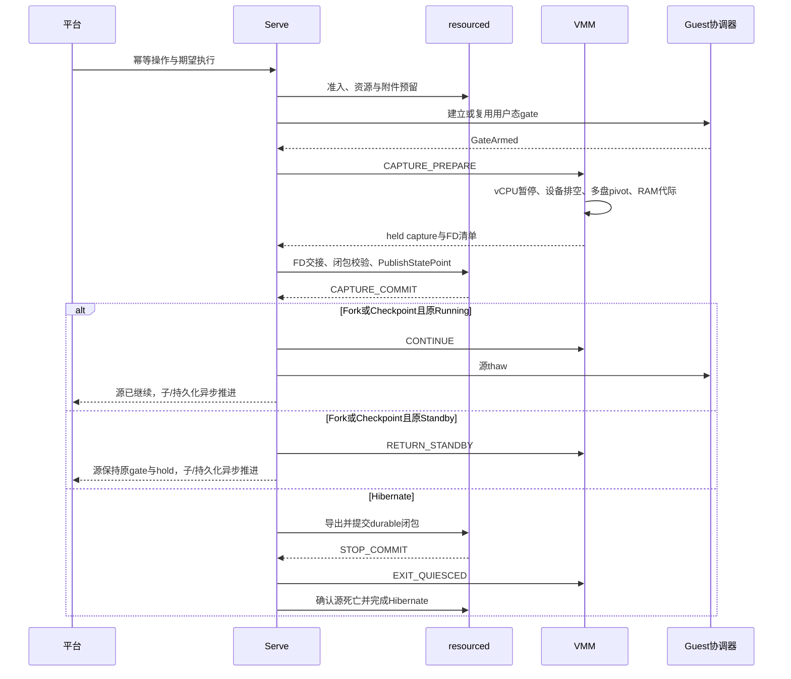

# 技术规格

**本文给出 v1 的设计契约。** 源码基线见 README。结构中的 `...`、UUID 和 digest 是格式示例，发布构建必须替换为真实值。本文的接口命名、枚举和事务不变量优先于架构图中的简写。

每个安装包的 `runtime-bundle.json` 记录源码、产物摘要与 reader。部署时从实际 Serve 和 Worker 的能力握手读取当前实例支持的操作。验收台账按 Guest profile、网络模式与安装版本列出已实测的契约。[安装与能力查询](../../packaging/deep/bundle.md) · [逐项实测](acceptance-ledger.md)

## 1. 约定与协议层次

- 产品 API 保持 `/v1`、既有 session/bearer/CSRF、`If-Control-Epoch`、`Idempotency-Key`、`If-Match`、`expected_generation`。HTTP 202 只表示接受，不表示 VM ready 或 artifact durable。
- 平台操作状态沿用 `queued → dispatching → observing → succeeded|failed|cancelled|recovery_required`；`effect=none|applied|partial|unknown`。Runtime 内部 phase 和 decision 作为 receipt 附加，平台不调度每一个寄存器/队列动作。
- Runtime 跨组件协议是 `WorkerResource/1`、`CaptureControl/1`、`NetworkAttachment/1`、`GuestIdentity/1`、`StatePoint/1`、`RuntimeBundle/1`。major 不兼容即拒绝；unknown required feature 拒绝；minor 仅允许不改变原语义的可选扩展。
- Runtime 内部错误用 `E_*`，平台映射稳定公开 code；两层同时保留 operation_id、effect/outcome 与源/目标状态，不能只返回一个字符串。
- 时间戳用 UTC RFC3339；持续时间用 monotonic clock 的整数纳秒，JSON 可同时提供毫秒展示值。跨进程只拼相关 ID，不直接相减不同 clock domain；Host boot ID 纳入 trace。
- 所有大小使用 bytes/MiB 等明确单位。所有枚举未知值要能展示但不能擅自执行。无测量值为 null/缺省，不填 0。

### 1.1 身份与状态字段

| 字段 | 权威/含义 |
| --- | --- |
| route_id / worker_id / host_boot_id | 部署路线、持久 Worker、当前 OS 启动 |
| machine_id | 平台产品对象；与 Runtime instance_id 建显式映射 |
| binding_id / binding_generation | 平台绑定身份及替换代际，保留既有约束 |
| instance_id / incarnation_id / execution_epoch | 稳定实例、每 VMM 新进程 UUID、同实例单调 fencing 代号 |
| capture_id / capture_seq | 独立捕获点、当前 incarnation 内捕获序号 |
| attachment_id / attachment_revision | 受管附件及 CAS 修订；文中不再混用 attachment_epoch |
| broker_session_id | 资源服务会话；只用于重连，不使活 writer 自动失效 |
| power_state | `running\|standby\|hibernated\|stopped\|unknown`；unknown 为观测缺失，不是第五个产品稳态 |
| health | vm、guest_management、workload、network_identity、services 独立维度 |

worker/broker counters 使用正 int64，禁止回绕复用。执行 epoch 在接受新 incarnation 时原子递增，失败候选可以消耗 epoch，不回退。父 Continue 与 Standby/Wake 不增 execution_epoch。control_epoch 仍用于整个控制面安装/恢复 fencing，不随某 VM 恢复而全局轮换。

## 2. 核心对象

### 2.1 RuntimeBundle/1

```json
{
  "schema": "RuntimeBundle/1",
  "bundle_digest": "sha256:<canonical-manifest-payload>",
  "platform": "linux-x86_64",
  "sources": {
    "smolvm": {"commit": "<40hex>", "tree": "<40hex>"},
    "libkrun": {"commit": "<40hex>", "tree": "<40hex>"},
    "libkrunfw": {"commit": "<40hex>", "tree": "<40hex>"}
  },
  "guest": {
    "kernel_release": "6.18.60", "kernel_digest": "sha256:...",
    "config_digest": "sha256:...", "init_digest": "sha256:...",
    "agent_digest": "sha256:...", "identity_helper_digest": "sha256:...",
    "boot_profiles": ["oci-v1", "system-debian-v1"]
  },
  "build": {"toolchain_lock_digest": "sha256:...", "flags": {}, "patch_ids": []},
  "artifacts": [{"path": "lib/libkrun.so", "size": 0, "sha256": "<real-hex>"}],
  "contracts": {
    "worker_resource": 1, "capture_control": 1, "statepoint": 1,
    "state_reader_id": "<exact-reader>", "guest_identity": 1,
    "network_attachment": 1, "block_attachment": 1,
    "cpu_profile_digest": "sha256:...", "device_profile_digest": "sha256:...",
    "clock_contract_digest": "sha256:..."
  },
  "host_requirements": {"os": "linux", "arch": "x86_64", "kvm_required": true,
    "required_kvm_caps": [], "optional_features": []},
  "verification_profile_digest": "sha256:..."
}
```

digest 计算排除自身 digest/签名字段，采用确定序列化；二进制摘要包含最终 ELF、共享库、init/Agent/rootfs 模板、配置片段和构建产物，不只 hash 源码。Artifact path 只能是 bundle 内相对路径，拒绝 `..`、symlink 越界和重复条目。构建实际 CPU template、CPUID feature masks、MSR/XCR0 要求和支持设备布局写进 contracts；`required_kvm_caps=[]` 只是示例，发布器不得用空数组代替真实探测。

Bundle 含不可变代码和模板基准，不含具体用户 volume head、可变 root disk 或实例 IP。后者在 StatePoint/附件。保留旧 reader 与旧 Bundle 的引用关系，跨版本兼容由明确 reader matrix 证明。

### 2.2 StatePoint/1 与 CaptureManifest

StatePoint 是 live 与 durable 共用的逻辑捕获描述；持久化后外层 CaptureManifest 增加对象内容摘要、压缩/chunk 索引、完整性与提交证明。不得为了得到 live StatePoint 的 ID 先 hash 全 RAM。

```json
{
  "schema": "StatePoint/1",
  "capture_id": "cap_UUID",
  "representation_id": "repr_UUID",
  "source": {"route_id": "deep", "instance_id": "vm_parent", "incarnation_id": "exec_A",
    "execution_epoch": 7, "capture_seq": 12},
  "bundle_digest": "sha256:...",
  "vm_state_resource": "state_UUID",
  "ram_generation_resource": "ramgen_UUID",
  "clock_contract_digest": "sha256:...",
  "clock_state_resource": "clock_UUID",
  "actual_layout": {
    "cpu_created_slots": 4, "cpu_capacity": 8,
    "cpu_mp_state_digest": "sha256:...", "online_cpus_observation": null,
    "boot_memory_mib": 1024, "memory_regions_resource": "layout_UUID",
    "memory_growth_state_resource": "growth_UUID",
    "device_topology_digest": "sha256:...", "dax_layout_digest": "sha256:..."
  },
  "block_devices": [{"device_id": "data0", "volume_id": "vol_parent",
    "generation_id": "diskgen_UUID", "capacity_bytes": 21474836480,
    "sector_bytes": 512, "format": "qcow2", "access": "rw", "slot": "virtio-mmio-3",
    "fork_policy": "clone", "capture_policy": "include"}],
  "attachments": [{"kind": "network", "descriptor_resource": "netdesc_UUID"}],
  "guest_gate": {"protocol": "userspace-frozen-v1", "state": "frozen",
    "session_id": "gate_UUID", "profile_digest": "sha256:...",
    "helper_digest": "sha256:...", "ordinary_userspace_frozen": true, "guest_packet_gate": "closed"},
  "allowed_uses": ["resume_same_instance", "clone_new_instance"],
  "capture_mode": "vm", "external_state_scope": "managed_vm_devices",
  "durability": "volatile"
}
```

所有设备实际 GPA/MMIO/IRQ/queue/feature、virtio-fs export 内容身份、DAX 窗口、rootfs 版本、盘顺序/容量、网络模式和 membership 都必须直接记录或通过受摘要保护的引用覆盖，禁止只存上述示例列表。恢复权威是 CPU blob 的已建 slots/MP state 与 Guest RAM 内状态；Guest root 能自行 online/offline CPU，`online_cpus_observation` 只是带 source/time 的可空观测，不能因 Agent 停止而拒绝完整捕获。pending resize 必须先 reconcile，不能捕获一半的 onlining/topology。

clock contract 由对应 bundle reader 版本化定义，并与 Bundle 中的 contract digest 匹配，覆盖原运行/待机状态、已暂停时长与保存的 KVM clock/TSC 关系。`clock_state_resource` 可以引用带该 envelope 的 VM state，不要求复制一份寄存器。禁止跨进程持久化宿主 `Instant` 后直接继续计时；长 Standby 后捕获必须归一化一次，防止漏扣或恢复时重复扣暂停时间。验证 Standby→Fork/Hibernate、长时间 Wake 和跨宿主重启后的 monotonic/timer/wall-clock 策略。

RAM Generation 描述为 `regions[{gpa,length,extents[{offset,length,backing_id,backing_offset}]}]`。页对齐、GPA coverage、无重叠/越界、最大 extent/FD 数、只读/seal 属性均在注册/恢复检查。资源 ID 是逻辑 UUID；元数据 digest 与内容 digest 分开，volatile RAM content_digest 可以为空。

legacy `guest_gate.protocol=none` 不能自动拥有 `clone_new_instance`。managed Standby 进入时已冻结用户态，可直接捕获待机点；raw Standby 不允许先放行普通用户态再 freeze 后声称原点捕获。

### 2.3 资源状态与引用

资源类型至少为 `ram_backing / ram_generation / disk_layer / writable_head / vm_state_blob / attachment_descriptor / runtime_bundle / checkpoint_index / checkpoint_chunk`。

- state：`creating → available → tombstoned → deleting → deleted`；异常 `lost|corrupt`。
- durability：`volatile|persisting|durable`。DB journal durable 不代表其中 memfd 已 durable。
- RootRef：binding、checkpoint、hibernate、volume head、backup/export pin、bundle 引用，明确释放。
- OperationPin：事务临时持有，直到 commit/abort + 消费者关闭证明才能释放。
- AdmissionReservation：尚未使用的预算预留，可到期；不得把它的到期当作活 writer 消失。

ResourceExportRegistry 在 VMM 保存 `resource_id → Arc<File> + validated descriptor + provider refs`。VMM 当前映射和未决 capture 所需 File 不得仅保留裸 HVA 后丢掉 FD。新 broker 只从注册且核验身份的 VMM 重新接收 SCM_RIGHTS；无 provider/无 durable 内容即 lost，禁止根据旧 FD 数字重开任意文件或补零。

FD 转交只改变持有关系，不自动迁移既有页面的 memcg 计费。Worker 总准入使用受管共同 ancestor cgroup 的实际内存消费/压力，不能把新 holder 的 memory.current 当作全部 shared generation 占用，也不能因父进程退出把仍被引用的页计为已释放。

## 3. Worker catalog 与事务存储

resourced 单写者 SQLite，启用 `foreign_keys=ON`、WAL 和关键 journal 的 `synchronous=FULL`。大文件 I/O、等待 VMM 和网络命令不得在 SQL 写事务内进行。下列是核心 DDL 的起点，字段 enum CHECK、JSON校验、引用索引和迁移版本在 WP-02 一并落地；新 schema 不直接复用 platform 的同名表。

```sql
CREATE TABLE executions (
  incarnation_id TEXT PRIMARY KEY,
  route_id TEXT NOT NULL,
  instance_id TEXT NOT NULL,
  execution_epoch INTEGER NOT NULL,
  bundle_digest TEXT NOT NULL,
  host_boot_id TEXT NOT NULL,
  pid INTEGER,
  pid_start_time INTEGER,
  control_endpoint TEXT,
  phase TEXT NOT NULL,
  guest_gate_protocol TEXT,
  last_operation_id TEXT,
  UNIQUE(route_id, instance_id, execution_epoch)
);

CREATE TABLE instance_bindings (
  route_id TEXT NOT NULL, instance_id TEXT NOT NULL,
  execution_epoch INTEGER NOT NULL,
  incarnation_id TEXT,
  stable_state TEXT,
  active_operation_id TEXT,
  last_checkpoint_id TEXT,
  revision INTEGER NOT NULL,
  PRIMARY KEY(route_id, instance_id)
);

CREATE TABLE resources (
  resource_id TEXT PRIMARY KEY,
  kind TEXT NOT NULL,
  state TEXT NOT NULL,
  durability TEXT NOT NULL,
  immutable INTEGER NOT NULL,
  descriptor_version INTEGER NOT NULL,
  descriptor_digest TEXT NOT NULL,
  descriptor_json TEXT NOT NULL,
  content_digest TEXT,
  size_bytes INTEGER,
  created_by_operation TEXT NOT NULL,
  delete_mark_revision INTEGER
);

CREATE TABLE resource_edges (
  owner_resource_id TEXT NOT NULL REFERENCES resources(resource_id),
  child_resource_id TEXT NOT NULL REFERENCES resources(resource_id),
  role TEXT NOT NULL,
  PRIMARY KEY(owner_resource_id, child_resource_id, role)
);

CREATE TABLE root_refs (
  owner_kind TEXT NOT NULL,
  owner_id TEXT NOT NULL,
  resource_id TEXT NOT NULL REFERENCES resources(resource_id),
  state TEXT NOT NULL,
  created_by_operation TEXT NOT NULL,
  PRIMARY KEY(owner_kind, owner_id, resource_id)
);

CREATE TABLE operations (
  operation_id TEXT PRIMARY KEY,
  kind TEXT NOT NULL,
  request_digest TEXT NOT NULL,
  route_id TEXT NOT NULL,
  instance_id TEXT,
  expected_execution_epoch INTEGER,
  capture_id TEXT,
  phase TEXT NOT NULL,
  decision TEXT NOT NULL,
  source_disposition TEXT,
  result_json TEXT,
  last_error_json TEXT,
  revision INTEGER NOT NULL
);

CREATE TABLE writer_grants (
  volume_id TEXT PRIMARY KEY,
  head_resource_id TEXT NOT NULL,
  route_id TEXT NOT NULL,
  instance_id TEXT NOT NULL,
  incarnation_id TEXT NOT NULL,
  execution_epoch INTEGER NOT NULL,
  grant_id TEXT NOT NULL UNIQUE,
  state TEXT NOT NULL,
  fence_proof_json TEXT
);

CREATE TABLE runtime_bundles (
  bundle_digest TEXT PRIMARY KEY,
  manifest_json TEXT NOT NULL,
  state TEXT NOT NULL,
  protocol_major INTEGER NOT NULL,
  capability_digest TEXT NOT NULL
);
```

统一实现时将内部 `broker_session`/`attachment_epoch` 旧笔记名规范为 `broker_session_id`/`attachment_revision`，资源 enum 按本节小写持久化，Runtime phase 按第 5 节大写。增加 `fd_providers`、`admission_reservations`、`network_identity_grants`、`checkpoint_records` 与 schema migrations。

必须约束：writer_grants 的唯一键只由 volume_id 决定，不包含 bundle；同一 inode/块设备 alias 不能用不同 volume_id 绕开锁。resource_edges 的写入必须检查环；缓存 refcount 可重建，根图才是 GC 权威。创建对象→建立 OperationPin→发布 StatePoint 是可恢复的 journal 流程，不允许未引用对象被 mtime 扫描删掉。

同一 mutable head 不允许跨消费者 RW+RO 并挂，v1 的 RO lease 只能指向固定 immutable generation；需要读当前活跃卷时先建立独立快照代际。`AcquireResourceLease(access=ro)` 不能因 FD 只读就绕过该约束。对同卷的 writer candidate 先记录 reservation，不在旧 writer fence 未完成时授予实际写许可；全组检查与 grant 提交在同一 catalog 事务中完成。

物理对象布局 v1：`objects/<resource_id>/{descriptor.json,data...}`，`transactions/<op_id>/` 仅 staging，`checkpoints/<checkpoint_id>/manifest.json` 是提交入口。文件原子 rename 不能替代整个多对象事务；manifest/catalog 指向的完整 closure 全部验证后才可见。对象存储目录禁止按 instance name 递归删除。

## 4. Runtime 原生接口

### 4.1 HTTP 与 CLI

新增 smolvm Serve 路由前缀 `/api/v1/runtime-ext/v1`，与现有 `/api/v1/machines` 并存。平台 custom Adapter 使用这些结构化契约；legacy Adapter 继续现有路径。native HTTP 不承载 raw FD。

| 路由 | 契约 |
| --- | --- |
| `GET /capabilities` | Bundle、协议版本、设备/profile/capture 能力与约束 |
| `POST /operations` | kind、operation_id、request_digest、ExecutionRef、参数；接受持久意图并返回 receipt |
| `GET /operations/{id}` | phase、decision、source/target disposition、capture/result、最后错误 |
| `POST /operations/{id}/cancel` | 仅可撤销阶段；越过 commit 返回明确错误 |
| `GET /instances/{id}/inventory` | 实际进程身份、RAM/块/网络设备、provider inventory 摘要、health；不向普通产品用户泄漏 FD |
| `GET /captures/{id}` | StatePoint/closure/durability/allowed_uses；访问控制和 pin |

`operations.kind` 至少有 `fork|fork_batch|checkpoint|hibernate|restore|rollback|standby|wake|attach|detach|grow|release`；native capture/export/GC 调试作为管理员专用原语，平台不依赖人工串联多个 CLI 达成 Hibernate。原生 CLI 增 `machine standby --name`、`machine wake --name`、`runtime capabilities`、`runtime operation inspect`、`resource inspect/gc --dry-run`，最终参数与新 HTTP schema 同源；保留现有 pause/checkpoint 语义。

### 4.2 WorkerResource/1

UDS `SOCK_SEQPACKET`，长度受限 envelope + SCM_RIGHTS；接收 `MSG_CMSG_CLOEXEC`，拒绝截断/未知 ancillary/超限 FD。单包最多 64 FD；大量 backing 使用同 transfer_id 的 begin/batch/commit，全部验证前不发布。大 descriptor 可经 sealed metadata memfd 传递，这不是 RAM dump。

```json
{
  "protocol": "WorkerResource/1", "method": "PublishStatePoint",
  "request_id": "req_UUID", "operation_id": "op_UUID", "request_digest": "sha256:...",
  "route_id": "deep", "bundle_digest": "sha256:...",
  "expected": {"instance_id": "vm_A", "incarnation_id": "exec_A", "execution_epoch": 7},
  "fd_table": [{"index": 0, "resource_id": "ram_1", "role": "immutable_backing"}],
  "payload": {}
}
```

SO_PEERCRED + launch permit + pid/starttime/pidfd + bundle 注册共同校验，不能仅删除 retained_fds 当前 same-UID 检查。FD 接收后验证类型/size/seals/读写属性和资源 descriptor；关闭重复/非法 FD，失败不泄漏。数据 FD 交付前先登记 consumer ref，接收者 AckAttached；call timeout 后 QueryOperation，不假定未生效。

immutable RAM memfd 必须具有所需 write/grow/shrink seals；普通文件必须属于 catalog 登记的不可变对象并已撤销其他 writer。O_RDONLY 本身不能证明别处不存在可写 FD。broker 正常只长期持 immutable backings；向 VMM 交付 mutable writer 的同一 open-file-description 副本在 AckAttached 后关闭，不能因 broker 自己的 dup 使 writer 锁永久不释放。

| 方法 | 请求重点 | 响应/不变量 |
|---|---|---|
| `BeginOperation` | op_id、kind、request_digest、expected epoch | 原子取得该 instance 的操作权；同 id 不同 digest 拒绝 |
| `ReserveAdmission` | 预算与目标 fanout | reservation；不能据此宣称启动已完成 |
| `RegisterExecution` | launch permit、实际进程身份、bundle | execution 绑定，初始网络 CLOSED |
| `RegisterGenerationBegin/Batch/Commit` | generation metadata、FD 对象表、operation pin | 验证 seal/readonly/size/coverage；仅完整提交才 AVAILABLE |
| `PublishStatePoint` | 完整 StatePoint、所有根引用、source_hold | 写 journal/metadata 后返回 capture receipt |
| `AcquireResourceLease` | owner、root objects、用途 | 先持引用后交 FD；接收方明确 AckAttached |
| `AcquireWriterSet` | 全盘集合、incarnation/epoch、预期 heads、必要的旧writer fence proof | 一个catalog事务授予整组；预留不等于写许可；不逐盘对外提交 |
| `RecordFenceProof` | quiesce/close/死亡证明、被替代 incarnation | 不能仅凭 timeout 证明写者消失 |
| `CommitActivation` | IdentityReady、writer set、network descriptor、expected binding revision | CAS 决定新 incarnation；返回一次性 gate/network 发布 permit |
| `CommitHibernateStop` | durable checkpoint、held source、expected epoch | 写不可逆 STOP_COMMIT；此后不自动恢复旧源 |
| `FinalizeSourceExit` | pidfd death、设备/FD关闭证明 | 释放执行引用/写权，发布 Hibernated/Stopped |
| `DropOwnerRef` | owner、operation、expected revision | 幂等减引用，不立即强删对象 |
| `QueryOperation` | op_id | 当前权威 phase/decision/source disposition，超时后必查 |
| `ReconcileExecutionExports` | 活 VMM 当前资源 inventory、FD批次 | broker 重启恢复 holder；不是从任意 mapping 猜 FD |

新增 `QueryExecution/QueryResource/QueryWriterSet` 支持独立诊断；任何 grant 改动都用 expected revision CAS。`CommitActivation` 负责唯一执行决定；内核网络规则与 DB 不是原子动作，按 activation receipt 可重放发布/关闭。当前有效 writer 不因 daemon session 变化而失效。

### 4.3 CaptureControl/1

由 VMM 单个状态 actor/互斥域管理生命周期，序列化 capture、resize、balloon、热插与 resume；不让两个控制线程独立决定是否可继续运行。请求携带 op/incarnation/epoch/hash；所有查询可重复，命令结果可查询。

| 命令 | 行为 |
|---|---|
| `CAPTURE_CAPABILITIES` | 返回支持的 profile、设备完整捕获、gate、restore 与 export 协议 |
| `CAPTURE_PREPARE` | 校验 epoch/op；pause vCPU；quiesce 全部写入者；CPU/设备/RAM generation 与多盘 boundary；返回 hold_token；保持冻结 |
| `CAPTURE_EXPORT` | 导出该 capture 的小状态 blob、descriptor 与已保留 FD；可重复，不重新捕获 |
| `CAPTURE_QUERY` | 回答 op 的阶段、capture_id、source disposition、mapping validity |
| `CAPTURE_FINISH` | 仅接受经过资源提交许可的CONTINUE、RETURN_STANDBY、KEEP_HELD或EXIT_QUIESCED；幂等；各自hold释放语义明确 |
| `CAPTURE_CANCEL` | 只在可撤销阶段；明确恢复原状态或保持可诊断 hold，不猜测继续 |
| `EXPORT_RESOURCE_INVENTORY` | 导出 VMM 实际保留、能再次传出的 backing/metadata；给 broker 重启对账 |
| `STANDBY_ENTER` | managed模式校验GateArmed，再pause + device quiesce；raw显式不gate；两者均不capture/落RAM |
| `STANDBY_WAKE` | rearm → clock/同一身份核验 → 基础设施resume → managed gate thaw；拒绝mapping/restore incomplete |
| `RESTORE_PREPARE` | 新进程处于paused，应用CPU/RAM/设备状态；设备workers/queue处理保持inactive，未取得writer前不写目标盘 |
| `START_IDENTITY_STAGE` | 已取得整组writer和必要fence证明后，才对带用户态gate的受支持profile开放基础设施执行 |
| `RELEASE_IDENTITY_GATE` | 仅接受匹配 CommitActivation permit，释放用户态 |

`CAPTURE_PREPARE` 只在已要求的Guest gate成立、profile/实际设备inventory合格时执行。CAPTURE_FINISH四种disposition均携带匹配的broker receipt与hold_token：CONTINUE恢复原Running并thaw；RETURN_STANDBY结束本capture事务但保留稳定Standby的gate/设备hold；KEEP_HELD继续由当前capture操作占有；EXIT_QUIESCED只接受持久STOP_COMMIT。失联不自动Resume，不能沿用旧命令“回复失败即恢复源”的逻辑处理Hibernate。raw standby指vCPU/device hold；managed standby先建立用户态gate，返回 `clone_ready=true`，两者都不seal/copy/persist RAM。

### 4.4 TapFd 与块盘附件 ABI

新增 `krun_add_net_tap_fd_v1(ctx_id, net_spec, tap_fd)` 的 C ABI 入口（最终类型按上游 h 定义）；库内部用 F_DUPFD_CLOEXEC/OwnedFd 保留自己的引用，调用成功/失败均不偷走调用方 FD 所有权。net_spec采用size/version前缀结构体，含device_id、MAC、MTU、queue_count、featuremask、vnet_header_size和attachmentdigest。用TUNGETIFF校验TAP/NO_PI/VNET_HDR、非阻塞及offload参数，不能直接混用当前pod无virtioheader的TAP与libkrun期望12字节vnetheader的TAP。single queue 为 v1，feature 集合进入 profile；multiqueue/vhost 是后续显式版本。恢复入口按稳定 device_id 绑定 FD，不能只依赖调用顺序。

新增枚举实际 block devices 的接口及 `BlockAttachment/1` descriptor；libkrun 多盘 pivot 继续复用 `device_manager/kvm/mmio.rs` 的 prepare/apply/rollback。所有新盘候选先校验，再一次事务切换；回滚失败保持 held。不要把已有 `AttachedDisk` 的配置记录当作设备已进入 capture 支持清单。

写权转移的证据必须关联 `grant_id / head_resource_id / incarnation_id / execution_epoch`：设备已quiesce、已接受I/O已完成、实际write FD已关闭，或旧执行及相关helpers死亡后经后端确认的等价fence。实际backing上的OFD排他锁可补强，但不是强制撤销已有FD的机制；sidecar锁释放不证明io_uring/异步I/O已结束。任何broker/VMM同open-file-description的dup仍存在都可能维持锁。证据不完整保留原grant并返回 `E_FENCE_UNPROVEN`，不能只更新DB epoch或断网络后重授。

## 5. 事务与状态机

### 5.1 内部状态

共用 phase：`NEW, ADMITTED, PREPARING, SOURCE_GATED, SOURCE_HELD, CAPTURE_REGISTERED, CAPTURE_COMMITTED, SOURCE_CONTINUED, PERSISTING, ARTIFACT_DURABLE, STOP_COMMITTED, SOURCE_EXITED, TARGET_PREPARING, IDENTITY_GATED, TARGET_READY, ACTIVATION_COMMITTED, COMPLETED`。异常 `ABORTING, ABORTED, FAILED_RECOVERABLE, FAILED_HELD, FAILED_LOST, OUTCOME_UNKNOWN`。

这些不是每个操作必经的单链。decision 单列 `NONE|CAPTURE_COMMIT|ACTIVATION_COMMIT|STOP_COMMIT|ABORT`；source_disposition 为 `RUNNING|STANDBY|HELD|EXITED|UNKNOWN`。API power_state 只在证据满足后变化；例如 Restore 中继续显示旧 Hibernated + operation identity_gated，不把新候选进程存在显示成已就绪 Running。

Fork/Checkpoint默认 `source_after_capture=PRESERVE_SOURCE_STATE`。原Running走SOURCE_CONTINUED，原Standby返回 `source_disposition=STANDBY` 后直接推进子启动/持久化阶段；不能为凑同一phase串而先thaw。KEEP_HELD是未结束的capture hold，RETURN_STANDBY是已完成捕获后可独立Wake的稳定待机，两者不可混用。

### 5.2 通用捕获路径



捕获前的 inventory 从 VMM 实际设备读取，与平台 spec 比对。等待必要 lazy readiness、完成 pending resize reconcile、预留空间和全组 writer、新 tip 候选，然后进入 gate/pause。所有能写 Guest RAM 或设备状态的后台线程必须 quiesce；不能只停 vCPU。CPU/device blob、小元数据与 FD 即可构成 live capture，禁止以全 RAM export 充当资源登记。

### 5.3 源动作与持久提交

| kind | capture 后源动作 | 成功条件 | 失败后约束 |
| --- | --- | --- | --- |
| fork / fork_batch | CAPTURE_COMMIT后原Running用CONTINUE/thaw，原Standby用RETURN_STANDBY；释放源锁 | 每子自己的writer/network/identity activation；不等Task adoption | 不因子失败回滚父；部分子独立错误；同批重试使用同capture |
| checkpoint | 按原稳定状态CONTINUE或RETURN_STANDBY；immutable export | chunk/index/磁盘closure/manifest/目录fsync，catalog durable | 导出失败保留源当前Running/Standby；完整volatile capture可重试原点 |
| hibernate | KEEP_HELD | ARTIFACT_DURABLE → 持久 STOP_COMMIT → EXIT_QUIESCED → pidfd/写者退出证据 | STOP前可取消回原态；STOP后不得Resume；不得调用Guest shutdown让捕获点继续前移 |
| standby | managed gate + vCPU/device hold，无capture | 可查询 held 状态、设备停止、clone_ready证据 | 失败可证明撤销才回Running，否则FAILED_HELD |
| wake(standby) | 同incarnation rearm、时间处理、同身份确认、thaw | 设备/运行恢复、入口就绪 | 不创建新VMM、不增epoch；失败不冷启 |

batch 在请求接受事务分配稳定 child IDs/ordinal，预算默认 `admission=all_or_reject`。一次 source capture，多子有界并发启动。`best_effort` 是显式请求，响应列获准集合；任何成功子都标同 capture_id。取消 CAPTURE_COMMIT 后只取消未激活子，不能删除已成功子；重试不得从前进的父再 capture 冒充原批。

Hibernate在STOP_COMMIT之前取消，只有原状态Running才resume/thaw；原状态managed Standby保持原gate和hold。任何路径不得在捕获后执行Guest shutdown再丢弃其写入；EXIT_QUIESCED不重新放行Guest代码。

### 5.4 Restore / Rollback

1. 验证 bundle reader/安全状态、CPU/KVM/profile、闭包、allowed_uses、磁盘容量/代际与 gate。未具备 clone gate 的旧状态拒绝 strict new-instance restore。
2. 分配候选incarnation与新epoch。旧执行入口先关闭并进入安全hold；Rollback可先native capture为rescue point并保留全部引用，以便失败时仍有原运行态恢复路径。
3. 从exact captured generations建候选writable tips并预留整组资源；目标仅做metadata/reader预检和paused状态安装，设备workers/队列不得先启动。绝不attach当前已独立修改的latest volume代替，也不把reservation当实际writer授权。
4. 需要转移原卷writer时，先取得旧VMM/相关helper退出、后端I/O完成与写句柄关闭或经验证硬fence证明；随后原子AcquireWriterSet。第一版不能只改DB epoch便认为fenced。
5. 目标取得writer后才START_IDENTITY_STAGE；helper的machine-id/DNS等写入只能进入已授权的新tips。旧执行仍held时可做的预检不包含这种Guest执行。身份失败则关闭候选writer并保留原checkpoint/rescue；若旧进程已经退出，只能从rescue完整恢复，不声称仍可resume原进程。
6. IdentityReady后Worker CommitActivation CAS，绑定已核验的target writer、安装网络/授权，再ReleaseGate并发布目标。新用户态已执行后不得自动回旧点丢弃其副作用。

同实例 Restore/rollback 用当前授权和当前逻辑网络身份，快照不回滚 grant 撤销。若历史 Guest 网络与当前 revision 不符，在 gate 内重配；若无法恢复该 profile，则给具体错误。restore 失败保留旧 snapshot/hibernate root ref；永不 cold boot fallback。

### 5.5 重启、回收与幂等

broker 重启：获取 daemon lock→读取 WAL→新 session→禁止新 writer/GC→核对 host_boot_id→核验活 VMM→收 inventory/FD→逐资源确认 holder→重建refs/处理LOST→执行未决 STOP/ACTIVATION 决策→开放无冲突资源。未知 writer 保持锁定；不必让一个坏实例永久阻塞所有独立资源。

GC：原子 tombstone/阻止新 acquire→确认根图无引用且无存活consumer/未决事务→关闭 FD/删物理对象→记录 deleted。失败可重试，不先删catalog。checkpoint/bundle/volume 共享对象按引用图删除；未引用 orphan 根据 operation journal 对账，不按mtime随便清空。

## 6. 网络附件与 GuestIdentity/1

### 6.1 NetworkAttachment/1

```json
{
  "schema": "NetworkAttachment/1", "attachment_id": "att_UUID", "attachment_revision": 3,
  "network_id": "net_home", "route_domain_id": "rd_UUID", "mode": "native",
  "instance_id": "vm_child", "incarnation_id": "exec_B", "execution_epoch": 1,
  "device_id": "net0", "mac": "<allocated>", "mtu": 1500,
  "guest_addresses": ["<ip/prefix>"], "private_addresses": ["<ip>"],
  "routes": [{"destination": "0.0.0.0/0", "gateway": "<managed-gateway>"}],
  "dns": {"servers": ["<managed-dns>"], "search": ["<private-zone>"]},
  "host_backend": {"kind": "tap_fd", "fd_slot": 0, "namespace_handle": "ns_UUID"},
  "policy_digest": "sha256:...", "gate": "closed", "conntrack_policy": "fresh"
}
```

host_backend 是内部传输结构，不持久保存实际 FD 数值；checkpoint 保存稳定 descriptor 与恢复策略，恢复重建新 FD。Native 的 guest/private 地址一致；Fixed 的 guest 地址来自原受管内部配置，private 是唯一 VIP。拒绝重叠接口路由引起的 ambiguous ownership，多个 independent network 用不同 namespace/route domain 处理重叠 CIDR。IPAM 在 resourced 权威分配，平台保存意图/投影，不有两套独立权威分配器。

附件状态：`reserved → prepared → quarantined → identity_ready → active → draining → released`；异常 `failed|unknown`。reserve IP 时即占唯一键，未知仍占；删除/恢复过程中不因 DNS 记录删除即重新分配地址。逻辑 IP 可跨 Hibernated 保留，物理 TAP 可重建。

设备恢复顺序固定：分配host对象/关闭gate → 从snapshot核对virtio-net queue/features/layout → TapFd按device_id重绑定 → 注入当前GuestIdentity → 身份ACK → CommitActivation → host策略与授权安装 → ReleaseGate → 公布DNS/服务。入口公开与Guest用户态release是可重放小步骤，不是假想跨kernel/DB原子事务；任何未完成阶段由activation receipt reconcile，不能把受限子机返回ready。

Native源路由不变，child使用新身份。Fixed child可保留内部tuple，但host NAT/conntrack全新、共享私网VIP不同；不复制父已建立的外部TCP流。所有UDP/IPv4/ARP/IPv6走统一防欺骗策略；v1不支持IPv6即在tap边界关闭IPv6而非留旁路。对Docker NAT通常只见GuestIP；k3s需额外路由的podCIDR显式delegation和ACL，不允许任意源IP。

### 6.2 Gate 协议与最小可信执行

Guest使用内建 coordinator +预创建单线程identity helper。kernel协调器持有冻结会话、超时、取消和helper退出清理。`CONFIG_FREEZER=y` 在Linux6.18.60已编译相关函数，但新增受控helper例外与host通知仍是补丁。普通Agent/taskd均可被root停止，不作为这个协议的守护者。

状态：`idle → preparing → frozen → identity_applying → identity_ready → released`；源 Continue 路径从 frozen回released；错误 `abort_thaw|failed_frozen`。Guest态不能自己授权host开放网络。helper在freeze之前由driver建立，UMH_WAIT_EXEC返回并握手后才冻结，不用UMH_WAIT_PROC等到自身退出；例外绑定受引用task_struct与session，不继承给fork/exec后代。固定coordinator是唯一freeze/thaw调用者，helper身份来自profile路径/受控启动与当前session登记；不允许Guest消息指定任意PID作为freezer豁免。对该受控task添加窄ptrace/proc-mem/process_vm_writev保护，文件hash/普通mode不能单独防住root改写helper。

```json
{
  "protocol": "GuestIdentity/1", "intent": "fork_child",
  "capture_id": "cap_UUID", "gate_session_id": "gate_UUID",
  "instance_id": "vm_child", "incarnation_id": "exec_B", "execution_epoch": 1,
  "nonce": "<fresh-host-challenge>", "attachment_digest": "sha256:...",
  "identity_profile_digest": "sha256:...",
  "hostname": "<managed>", "machine_id": "<new-id>",
  "entropy_handle": "<non-reusable-host-input>",
  "network_intent": "NetworkAttachment/1 reference",
  "authorization_policy_revision": 12
}
```

nonce/entropy从新的host控制通道获得，不从checkpoint恢复旧消息。ACK必须echo capture/session/nonce/instance/incarnation/epoch/attachment_revision/attachment摘要/kernelprofile/helperdigest；host按实际注册VMM peer核验，不能信复制RAM中的旧ready。包含已完成步骤和错误，保持普通用户态frozen直到host Release。Guest内建packetgate覆盖受支持root/容器netns的loopback、veth/bridge和uplink，捕获已关闭门的状态；未覆盖XDP/AF_XDP等bypass的profile不声明strictgate。所有普通外部I/O通道、credential proxy和外部写附件在gate期间closed；helper只有完成配置所需的窄通道。

冻结可能因D态/FUSE超时；默认有界deadline来自profile配置并计时，取消时确认全部thaw才回Running。helper崩溃/消失不能让内核永久freezing或自动把未验证child开放；source走明确abort，child维持quarantine/销毁。host收不到ACK时不得将切换A、重启网络服务或冷启视为成功替代。

受管字段：内核RNG/reseed、generation事件、hostname/machine-id受管文件、受管NIC/IP/MAC/route/DNS、平台执行上下文、managed SSH身份。程序缓存的nodeID、应用PRNG、已有TLS、第三方secret不承诺普遍修复。必须测试具体IP监听、Docker/CNI内部状态和恢复后的DNS管理冲突；服务readiness失败不等于CPU/RAM未恢复。

### 6.3 源/恢复行为与同态说明

`fork_child / restore_new_instance`：新instance、新执行、新授权主体、新NativeIP或FixedVIP。`resume_same_instance / rollback`：同instance当前逻辑网络身份，新执行epoch，当前授权不回滚；旧通道全部fence。`standby_wake`：同执行，同IP，rearm与时钟处理后thaw。managed Standby保留已冻结用户态，后续capture不推进原点；raw无gate capture只有profile允许的resume用途。

网络对外发布是identity完成的必要门，不能等同“任意应用已经适应新身份”。没有受管helper的自定义Guest仍可以运行；其capability不得宣称完整受管Native clone，已有VM生命周期保持可诊断。


## 7. Volume、块附件与持久闭包

### 7.1 BlockAttachment/1

```json
{
  "schema": "BlockAttachment/1", "attachment_id": "ba_UUID", "revision": 4,
  "device_id": "data0", "role": "data", "slot": "virtio-mmio-3",
  "volume_id": "vol_work", "generation_id": "gen_base", "writable_head_id": "head_exec",
  "format": "qcow2", "capacity_bytes": 21474836480, "logical_sector_bytes": 512,
  "access": "rw", "writer_grant_id": "grant_UUID", "execution_epoch": 7,
  "fork_policy": "clone", "capture_policy": "include", "lifecycle": "persistent"
}
```

平台 attachment 的 `mode=rw|ro` 映射本 descriptor 的 access；fork_policy 统一 `clone|share_immutable|reject`，不要同时实现 snapshot_clone 等同义枚举。include 表示必须进完整捕获闭包；external 表示此profile不能接受要求完整受管存储的capture，不是默许忽略设备。

每个可变 generation 只能有一个 RW owner，且不得同时给其他计算实例挂 RO 读取同一个仍在变化的普通文件系统；多 RO 共享只对 immutable captured generation 开放。writer_set 一次授予全盘集合，任何失败整组不激活。平台 SQL唯一索引只是防同控制面双分配，真正排他在worker catalog+实际后端打开/FD/fence校验。

Volume状态：`creating|available|attached|detaching|snapshotting|resizing|deleting|failed|unknown`；unknown 保持已有排他。Hibernated 的逻辑 attachment reservation 与实际 open writer 分开：VMM退出可释放写FD，capture仍pin历史generation，默认保留该卷对该逻辑实例的attachment，其他实例不能未经显式detach接管。

### 7.2 Attach、detach、grow、snapshot

v1 保证 Stopped 的真实块 attach/detach。在线支持分别声明 `storage.block_hotplug` 和 `storage.block_hotunplug`。缺少能力时，公开操作保留原错误 `code`，并给出可机读的 `error.reason_code=REQUIRES_STOPPED`。运行中需停止当前执行。Hibernated 实例须先 Wake 原执行，再 Stop 确认旧拓扑退出后才可编辑附件。

mount/unmount与设备attach/detach是不同操作；mount依赖Guest管理/用户操作。在线detach需要Guest卸载/停用、block队列drain、VMM设备移除与writer release确认；不以删除平台记录代替。无法安全退出时保持attached/unknown并给诊断，force不自动发生。

grow按 durable intent 执行 `image capacity → VMM capacity → Guest分区/FS`。已经扩大的块设备不能在后一步失败时缩回；同target重试继续未完成阶段，返回 `block_capacity_applied` 与 `filesystem_resize_status`。Guest关闭管理服务可阻止FS扩容，不能影响已实际扩大的报告。

卷snapshot注明 `crash_consistent|filesystem_quiesced|application_consistent`，后两项需确实获得相应协作证据。VM full capture不等于只拿一个crash-consistent盘快照；它还包含相同时点的RAM/CPU和全部设备。父fork的RW持久卷默认生成独立子volume，父子不共写同head。

### 7.3 durable CaptureManifest 与存储顺序

持久导出保留上游chunk/store能力，在外层加完整闭包：

```json
{
  "schema": "CaptureManifest/1", "checkpoint_id": "cp_UUID", "statepoint": "<StatePoint/1>",
  "objects": [{"resource_id": "ramchunk_UUID", "content_digest": "sha256:...",
    "uncompressed_bytes": 4194304, "stored_bytes": 0,
    "encoding": "<none-or-pinned-codec>", "format_version": 1}],
  "required_bundle": "sha256:...", "rootfs_and_exports": [],
  "closure_digest": "sha256:...", "durability": "durable", "commit_id": "commit_UUID"
}
```

顺序：固定不可变资源→写/复用经过验证的chunk和盘parent→flush每个required文件/metadata→写manifest staging并fsync→原子rename和目录fsync→catalog提交durable资源闭包与根引用。所有错误传播，不允许relaxed_sync路径跳过真实持久化。read path验证文件长度、hash、解压上限、extent覆盖、device profile和required bundle；导入归档拒绝路径穿越、重复条目和未知required encoding。

**持久根切换与真实RAM释放：** 同一`capture_id`可有volatile与durable两种表示，逻辑捕获点不变；各表示有独立`representation_id`和不可变descriptor，durable表示的RAM引用必须能由已提交的chunk/extent索引独立解析，不再依赖原memfd仍存活。不能就地改变已经发布的resource ID所指内容。catalog原子建立checkpoint/hibernate的durable RootRef及闭包后，才可结束对应export pin。Hibernate仍要按STOP_COMMIT确认源VMM退出，再释放仅被此次易失capture/源执行持有的OperationPin、RootRef和broker FD。活跃后代、其他capture或未决操作仍引用的原generation/backing必须保留；不能为释放一个父实例而改写共享旧代际或清空其FD。Checkpoint源仍运行时同样只释放冗余export pins，不释放源当前映射。崩溃恢复依journal重放切换与GC，优先泄漏待核实而不是先删最后副本。真正完成Hibernate不承诺释放配置内存大小；报告退出后实际内存变化、仍被共享引用保留的字节以及可回收文件pagecache，不能把“目录标durable”当成物理RAM已经释放。

v1恢复默认共享regular RAM文件/pagecache或已验证native shared backend；lazy/UFFD需单独capability/host配置，不为了速度强开。稀疏洞必须有明确zero语义，缺失chunk是损坏而非零页。压缩算法/级别作为manifest encoding固定，不根据机器当前默认猜测。

### 7.4 卷恢复策略

`volume_restore_policy=exact|clone_conflicts`：exact仅当所有声明volume可安全绑定捕获generation且有授权；当前卷已独立推进时返回VOLUME_GENERATION_MISMATCH。clone_conflicts将捕获代际恢复到新独立卷，返回old→new映射并保留当前卷，不暗中回退他人数据。破坏性原卷head回退需要单独、停止写者后的管理操作，不是普通restore默认行为。

普通Fork不接受drop_attached_disks之类参数；所有已挂接盘必须include、共享不可变或拒绝。盘中的应用与网络远端的状态边界在manifest scope/operation结果中明示。


## 8. 产品 API：现有路由与新增契约

所有以下路径均以 `/v1` 开头；仍使用现有 bearer/session/CSRF、`If-Control-Epoch`、`Idempotency-Key`、`If-Match`、`expected_generation`。异步变更 202 + `Location:/v1/operations/{id}`。严格 JSON unknown-field 拒绝保留；新 SDK 要与 OpenAPI 同步，不能靠服务端静默忽略字段兼容。

### 8.1 确认存在的路由

| 分组 | 当前路由 |
|---|---|
| 控制/认证 | `GET /control`、`POST /auth/login`、`POST /auth/logout`、`GET/POST /tokens`、`DELETE /tokens/{token}`、`GET/POST /ssh-keys`、`DELETE /ssh-keys/{key}`、`GET/POST /client-certificates`、`DELETE /client-certificates/{certificate}` |
| 机器/生命周期 | `GET/POST /machines`、`GET/PATCH/DELETE /machines/{machine}`、`POST /machines/{machine}/{start,stop,pause,resume,wake,forks,clones,rollback}`、`GET /machines/{machine}/{dependencies,metrics}` |
| Snapshot | `GET /snapshots`、`GET/POST /machines/{machine}/snapshots`、`GET/DELETE /snapshots/{snapshot}`、`GET /snapshots/{snapshot}/export`、`POST /snapshots/import`、`POST /snapshots/{snapshot}/verify`、`GET/POST /restores` |
| Exec/PTY | `GET/POST /machines/{machine}/execs`、`POST /machines/{machine}/exec`、`GET/DELETE /execs/{exec}`、`GET /execs/{exec}/output`、`POST /execs/{exec}/{stdin,resize,attach-ticket}`、`GET /execs/{exec}/attach` |
| Task/File | `GET/POST /machines/{machine}/tasks`、`GET /tasks/{task}`、`GET /tasks/{task}/output`、`POST /tasks/{task}/cancel`、`GET/PUT /machines/{machine}/files`、`GET /machines/{machine}/files/list` |
| 访问/保持 | `GET/POST /machines/{machine}/leases`、`PATCH/DELETE /leases/{lease}`、`GET/POST /machines/{machine}/services`、`GET/PATCH/DELETE /services/{service}`、`POST /services/{service}/{preview-ticket,tunnel-tickets}`、`GET /services/{service}/tunnel`、`GET /machines/{machine}/ssh-tunnel` |
| 管理 | `GET /system/metrics`、`GET /system/diagnostics`、`GET/PATCH /system/settings`、`GET/POST /templates`、`GET /operations`、`GET /operations/{operation}`、`POST /operations/{operation}/{reconcile,cancel}`、`GET /events`（SSE） |

### 8.2 新增/扩展路由

| 路由 | 关键输入/输出与语义 |
|---|---|
| `GET /runtime-profiles` | 已安装/准入 profile、bundle、能力与运行/休眠引用计数；不暴露密钥/宿主任意 socket |
| `POST /machines/{id}/standby` | expected_generation、activity_policy；完成时同 execution_epoch |
| `POST /machines/{id}/hibernate` | expected_generation、activity_policy；返回持久 checkpoint_id 与 capture receipt |
| `POST /machines/{id}/fork-batches` | children[]、require_independent、volume_policy；一次源 capture，返回一个父 operation 和稳定 child IDs |
| `POST /machines/{id}/snapshots`（扩展） | `capture_mode:"vm"\|"managed_tasks"`、label、存储 scope；新 `vm` 不要求 clean task barrier，省略字段保持原行为 |
| `POST /restores`（扩展） | snapshot_id、name、network mode 默认为 snapshot 模式、volume_restore_policy；可恢复合法 `vm` snapshot 中活动负载；不以 `task_content=clean` 拒绝 |
| `POST /machines/{id}/rollback`（扩展） | snapshot_id、expected_generation、volume_restore_policy；保持原机网络产品身份、重建 incarnation；旧 RAM 和盘代际必须匹配 |
| `GET/POST /networks`、`GET/PATCH/DELETE /networks/{id}` | 名称、私有 CIDR、DNS 域、ACL 意图；不让普通用户更改宿主默认路由 |
| `GET /networks/{id}/endpoints`、`GET /machines/{id}/network-endpoints` | 稳定 endpoint_id、网络/机器、模式、private_ip、guest_ip、DNS、revision、绑定和 quarantine 状态 |
| `POST /machines/{id}/network-endpoints`、`DELETE /network-endpoints/{id}` | 初期只允许 Stopped 或支持明确热插契约的 profile；禁止在 Running 中以 detach/attach 偷换 A/B 模式 |
| `GET/POST /volumes`、`GET/PATCH/DELETE /volumes/{id}` | 容量、生命周期、归属、状态、revision；PATCH 容量只增不缩 |
| `GET/POST /machines/{id}/volume-attachments`、`DELETE /volume-attachments/{id}` | volume_id、mode=rw/ro、稳定 device_key、fork_policy、capture_policy；底层热插缺失就只允许安全离线流程，不模拟已挂载 |
| `GET/POST /volumes/{id}/snapshots`、`GET/DELETE /volume-snapshots/{id}`、`POST /volume-snapshots/{id}/clones` | 盘单独快照/克隆，明确其非 RAM snapshot；目标 Volume 新 ID |
| `GET/POST /principals`、`GET/PATCH /principals/{id}`、`GET/POST /grants`、`DELETE /grants/{id}` | owner 管理 service/guest principal、动作集合和对象范围；不是企业组织/RBAC 重建 |
| `GET/POST /secrets`、`GET/PATCH/DELETE /secrets/{id}`、`POST /secrets/{id}/versions` | 元数据和只写 secret value；默认不提供 GET 明文；引用固定 version |
| `GET/POST /credential-proxies`、`GET/PATCH/DELETE /credential-proxies/{id}` | 宿主 secret reference、固定 upstream、方法/path allowlist、Guest grant、限额 |
| `GET/POST /backup-policies`、`GET/PATCH/DELETE /backup-policies/{id}`、`POST /backup-policies/{id}/runs`、`GET /backup-runs/{id}` | 调度/保留、受信 destination_id、捕获范围；路径与凭据由管理员预注册，远程调用不传任意宿主路径 |
| `POST /machines/{id}/desktop-sessions`、`DELETE /desktop-sessions/{id}` | 现有服务/ticket/hold 的组合，返回授权预览 URL 和 session ID；桌面软件在模板内，不引入宿主桌面控制 |

MCP 使用同一 SDK 与 `/v1`，不在第一版再建另一套生命周期 API。可通过 `sandboxctl mcp serve` 以 stdio 暴露当前 principal 允许的工具；HTTP 远程 MCP 后续若需要，再增加受相同 authz/限额保护的 transport。

### 8.3 创建、网络与 Volume 示例

```json
{
  "name": "agent-dev",
  "template_id": "debian-system-v1",
  "boot_mode": "system",
  "resources": {"cpu_count": 2, "memory_mib": 2048, "storage_gib": 20},
  "network": {"mode": "native", "network_id": "net_home"},
  "volumes": [
    {"volume_id": "vol_work", "device_key": "data0", "mode": "rw",
     "fork_policy": "clone", "capture_policy": "include"}
  ],
  "lifecycle_policy": {"auto_standby": true, "standby_after_seconds": 300,
    "auto_hibernate": true, "hibernate_after_seconds": 1800},
  "start": true
}
```

新创建显式/默认 `native`（B）；`fixed_internal`（A）是可选枚举。现有记录的网络方式通过 legacy profile 标识，不能因为设置改为 B 就自动转换已有 Runtime 网络。`Fork` 默认继承父模式；restore 到新实例默认采用 snapshot 的模式，跨模式恢复初期 reject，避免把更改 IP 误作任意运行态兼容转换。

平台 `PATCH /system/settings` 增加 `default_network_mode/default_network_id/default_boot_mode/default_lifecycle_policy`；现有 `default_idle_seconds` 继续被理解。所有默认值在 Create 接受事务中解析到持久 spec；幂等重放读取原已解析值，不因默认值后来改变而创建不同实例。

独立 `persistent` 卷随用户独立管理。`machine` 卷在首次可写挂接时确定 Worker 实例归属，解挂和冷启保留归属。已确认退出的实例完成删除后，Worker 退役其 machine 卷的可写头，已保留的快照和 StatePoint 继续保护各自引用的代际。历史 `ephemeral` 保持原生命周期。

Fork 默认对可捕获 RW Volume 的捕获代际创建独立 writable clone；子实例不能再挂同一个普通 RW 文件系统。允许不可变 RO 共享。没有声明 `include` 且无法取得一致版本的外部共享 RW/远程 mount 默认拒绝完整闭包捕获；本期完整 VM API 不提供跳过已挂接块盘的 acknowledge 开关；无法捕获的外部写附件明确返回 EXTERNAL_STATE_UNCAPTURED。若以后增加非完整状态导出，必须另列 scope、allowed_uses 与客户端动作，不能混入本接口。

真实 `attach` 表示 guest 可见块设备；`mount` 是 Guest OS 操作，需要 Agent/SSH/用户执行。API 不能因为一条 HostMount 配置记录就返回块盘 attach 成功。在线扩容分成块容量已增长与 Guest filesystem 是否完成增长两个结果，失败不得回缩块设备。系统模式 ext4/xfs 等差异由 guest helper 能力声明。

### 8.4 Batch Fork 示例与幂等性

```http
POST /v1/machines/m_source/fork-batches
If-Control-Epoch: control-...
If-Match: "18"
Idempotency-Key: batch-once-...
Content-Type: application/json
```

```json
{
  "expected_generation": 3,
  "require_independent": true,
  "children": [{"name": "trial-01"}, {"name": "trial-02"}],
  "volume_policy": {"default": "clone"}
}
```

```json
{
  "operation_id": "op_batch",
  "kind": "fork_batch",
  "state": "observing",
  "stage": "children_identity",
  "effect": "partial",
  "result": {
    "source_capture_id": "capture_...",
    "source_resumed": true,
    "source_lock_released": true,
    "children": [
      {"machine_id": "m_trial01", "state": "ready", "resource_independence": "verified"},
      {"machine_id": "m_trial02", "state": "quarantined", "error_code": "NETWORK_IDENTITY_FAILED"}
    ]
  }
}
```

`AcceptBatch` 在一个 SQLite 事务中验证源修订/授权/预算、分配所有 child machine/binding/endpoint/volume clone intent、记录幂等键和 ordinal。Runtime 只 capture 一次；整个 operation 的请求重放必须返回同一批 child IDs，不能再次 Fork。部分子实例失败可保留成功子实例并标记 `effect=partial`，不偷偷删除已经可用的结果；提供对失败项的显式 reconcile/retry（继续同一个 capture），不能从已前进的父状态再 fork 并冒称同一批。

上例 child `state=ready` 只表示运行态恢复、资源闭包与必要身份 gate 已完成；具体 Guest 管理/workload/service 健康仍从 child Machine 查询，不等于全部应用服务就绪。

源机器锁不持有到最慢 child 的 Task Manager/SSH/服务就绪：在 immutable capture + 共享资源引用可靠发布后，记录 source closure receipt 并释放源锁；子实例后续阶段持有自己的资源锁。资源独立验证未通过的 official profile 必须保留旧 dependency guard。父源描述和 Task adoption 来源应记入持久 operation，不能晚些时候重新查询一个已允许删除的父实例来获得必需信息。

### 8.5 Snapshot 与 Task 管理解耦

旧 `snapshots.go` 完整保留为 `managed_tasks` 工作流；`capture_mode=vm` 调 Runtime capture 事务，不调用 `prepare_copy` 当作业务安全点。新 manifest 增加 `capture_mode`、CPU/设备 profile、Bundle、network mode、exact volume generations、closure status。Task 状态为附属 `task_metadata_status=complete|unavailable|stale`，不能据此拒绝一个正确的原生 CPU/RAM/设备恢复。

Fork 子实例中的任意进程已由 RAM state 复制，Task Manager 只能认领和重新命名索引；不得重跑任务。新 namespace 与 origin task 映射继续复用 `internal/tasks/adoption.go` 的机制。Guest Manager 不可用时核心 Fork 仍可完成（前提是必要基础设施身份闭包已完成），UI 显示任务索引不可用，而不是伪造任务成功/丢弃真实进程。

`restore(vm_snapshot)` 不使用旧 clean task gate；旧 clean clone 的 receipt 必须继续验证，不能顺手删掉旧安全校验。Rollback 的 RAM 与可写盘都指向捕获代际；遇到独立修改过的 Volume，须创建/切换新 writable generation并执行单写 fencing，不可拿旧 RAM 接当前盘。身份/授权策略来自当前控制面，不从 checkpoint 回滚。

## 9. SQLite 增量迁移方向

### 9.1 当前约束需要什么改动

`migrations/001_registry.sql` 有机器、Binding、operations、machine-only `operation_locks`、idempotency、events；`002_product.sql` 有 task/exec/lease/service/port/dependency/snapshot/pin。没有 Network、Volume、principal kind、细粒度 grants、Runtime Bundle 或 batch child 表。`settings_json` 已在 `meta` 中，不应另造配置数据库。

以下是目标名称和关键列，可按工作包拆成 `003_runtime_contract.sql`、`004_network_volume.sql`、`005_authorization.sql`、`006_secrets_backup.sql`；编号只是基于当前两份 migration 的建议，实施时按共享补丁顺序分配，不能两个路线各自占同编号而内容不同。

| 表/字段 | 目标 |
|---|---|
| `runtime_instances` | `id, lane, runtime_bundle_id, endpoint_key, status, revision`；endpoint_key 引用管理员配置，不是用户任意 Unix socket |
| `runtime_bundles` | `id, manifest_digest, manifest_json, verification_status, security_status, created_at`；物理路径由 Bundle manager 管理 |
| `runtime_bundle_refs` | `(bundle_id,owner_kind,owner_id)` 唯一；机器、休眠、snapshot、backup 明确 pin |
| `machines` 新列 | `owner_principal_id, created_by_principal_id`；boot/network mode 可置于已版本化 `spec_json`，不要在列与 JSON 双写两个权威 |
| `runtime_bindings` 新列 | `runtime_instance_id, runtime_bundle_id, runtime_instance_object_id, incarnation_id, execution_epoch, power_state, health_json, capability_profile_id, last_capture_id`；保留原 pause fields 读兼容 |
| `operation_children` | `(operation_id,ordinal)` 主键，`child_machine_id,child_binding_id,state,result_json,error_json`；child IDs 在接受事务中确定 |
| `resource_operation_locks` | 非机器资源 `(resource_kind,resource_id)` 主键、`operation_id,expected_revision,fence_token`；与已有 machine locks 在同一事务中取得 |
| `networks` | `id,owner_principal_id,name,revision,cidr_v4,cidr_v6,dns_zone,policy_json,state`；网络删除必须无 active endpoints |
| `network_endpoints` | `id,network_id,machine_id,mode,private_ip,guest_ip,dns_name,mac,revision,state,binding_id,incarnation_id,execution_epoch,attachment_handle`；IP 唯一约束以 network 为域 |
| `volumes` | `id,owner_principal_id,name,revision,capacity_bytes,lifecycle,state,current_generation_handle,runtime_store_id`；current_generation_handle 为 Runtime 权威对象引用 |
| `volume_attachments` | `id,volume_id,machine_id,binding_id,device_key,mode,fork_policy,capture_policy,state,writer_fence_token,execution_epoch` |
| `volume_snapshots` | `id,volume_id,source_revision,generation_handle,manifest_json,state,created_at`；不把它混入 RAM snapshot |
| `principals` 新列 | `kind=owner\|service\|guest,owner_principal_id,source_machine_id,revision`；保持现有用户名/password 登录字段兼容 |
| `grants` | `id,subject_principal_id,resource_kind,resource_id,selector_json,actions_json,limits_json,expires_at,revision,revoked_at` |
| `guest_identities` | `machine_id,principal_id,current_binding_id,incarnation_id,execution_epoch,state,policy_revision`；当前控制面持有，不从 Guest claims 自报 |
| `secrets` / `secret_versions` | metadata+key_id+密文引用+摘要+版本；不将明文存 operation request_json |
| `secret_bindings` | secret_id/version、consumer/resource、injection mode、clone disclosure、授权 grant |
| `credential_proxies` | upstream 固定 spec、secret version ref、policy revision、rate/byte limit |
| `backup_policies` / `backup_runs` / `backup_pins` | 调度 revision、destination_id、scope/retention、run operation、已验证 manifest、对象 pin |
| `desktop_sessions` | machine/service/principal/lease、expires_at、state；ticket secret 使用原 one-use 机制，不写明文 |
| `events` 扩展 | `resource_kind,resource_id,schema_version`；增加 network/volume/backup/secret/identity 类别，payload 不含敏感值 |

### 9.2 关键 DDL 示例

```sql
CREATE TABLE operation_children (
    operation_id TEXT NOT NULL REFERENCES operations(id),
    ordinal INTEGER NOT NULL CHECK (ordinal >= 0),
    child_machine_id TEXT NOT NULL REFERENCES machines(id),
    child_binding_id TEXT NOT NULL REFERENCES runtime_bindings(id),
    state TEXT NOT NULL,
    result_json TEXT CHECK (result_json IS NULL OR json_valid(result_json)),
    error_json TEXT CHECK (error_json IS NULL OR json_valid(error_json)),
    PRIMARY KEY (operation_id, ordinal),
    UNIQUE (operation_id, child_machine_id)
);

CREATE TABLE resource_operation_locks (
    resource_kind TEXT NOT NULL,
    resource_id TEXT NOT NULL,
    operation_id TEXT NOT NULL REFERENCES operations(id),
    expected_revision INTEGER NOT NULL,
    fence_token TEXT NOT NULL,
    PRIMARY KEY (resource_kind, resource_id)
);

CREATE UNIQUE INDEX volume_one_rw_writer
ON volume_attachments(volume_id)
WHERE mode='rw' AND state IN ('reserved','attaching','attached','detaching','unknown');

CREATE UNIQUE INDEX endpoint_one_address
ON network_endpoints(network_id,private_ip)
WHERE state IN ('reserved','quarantined','active','releasing','unknown');
```

这些 SQL index 只防单 platformd 控制面中的双分配。多 Runtime/Bundle 共存的真正 Volume writer fencing 必须由 Worker 全局资源管理和 Runtime open/attach 校验执行；不能因为两个 platformd 分别有自己的 SQLite，就认为两张单写索引能相互约束。网络 IPAM 也要通过跨 lane 的预留地址池/统一底层分配器保证不冲突，不能合并两条独立 platform DB。

`volume_one_rw_writer` 也不是完整排他条件：普通文件系统的 RW attach 必须排斥同一可变代际上的其他 RO/RW attachment。RO 共享须绑定不可变 generation/snapshot；不能允许多个 Linux 各自缓存同一正在被另一方修改的普通文件系统，并称为安全只读共享。接受 attach 时在 volume resource lock 内检查所有 active/unknown attachment，Runtime 同样核验 generation 与 writer fence。

机器锁继续复用已有 `operation_locks`；非机器锁通过新的 helper 与机器锁同事务、排序取得，不同时引入第二张机器锁。`unknown` writer 必须阻止新 RW attach，直到证明旧执行已 fenced；不是超时自动释放。删除逻辑机器后还存在的 snapshot/Volume/resource refs 不能因为 SQL cascade 自动消失。

SQLite 中已有 CHECK enum 如 `events.type`、`credentials.kind`、`guest_management_status`，新增枚举有需要时应使用受控新表复制/校验/换名，并保留索引和外键。不可直接写“ALTER CHECK”或删库重建。owner 回填首先用现有创建 operation principal / bootstrap owner 的可证明关系；无法确认的记录留 migration report，不随意变成 guest principal 的资源。

新 profile 的 power_state 回填须读旧 pause artifact/identity evidence：`paused + valid durable pause` 才映射 Hibernated；pressure pause 需要 Runtime 证据区分，未知标 unknown。迁移不执行 VM resume、网络改造或数据盘替换；这些由后续明确 operation 完成。

## 10. Guest Agent 跨实例管理与防克隆继承授权

### 10.1 当前范围不足

`internal/auth/auth.go` 的 Scope 只有 `read/manage/tunnel` 与可选单 machine_id。无 scope 的 manage 还能调用 admin/tokens。现有 `/forks` 对 scoped principal 直接拒绝创建其他实例。因此“把 Guest token 的 machine_id 去掉”会授予过大控制权，不能作为跨实例管理实现。

采用个人项目足够的模型：一个 owner 管理其资源；service/guest principal 只拥有显式 grant。`owner_principal_id` 表示归属，`created_by_principal_id` 表示来源；资源归属不因 Fork 改成父 Guest。Guest 可被授予 `machine.create` 及“读取/管理由自己创建、且仍属于同一 owner 的资源”等受控 selector。额度包含 child count、总内存、并发操作、模板/网络/Volume allowlist，不让 Agent 用创建子实例绕过配额。

动作建议从产品动词取名：`machine.read/create/start/standby/hibernate/fork/delete/exec`、`volume.read/create/attach/snapshot`、`network.join`、`service.expose`、`snapshot.restore`、`secret.use`、`credential_proxy.use`。避免独立维护巨型 RBAC role hierarchy。旧人类 token 的 read/manage/tunnel 继续通过兼容策略映射，不自动给 Guest `tokens/admin/grants.write`。

实施时逐路由将 `p.Authorize("manage", id)` 替换/包裹为对应资源动作，例如 `RequireAction("machine.fork", source)` 并额外核验 child create intent；不能只新增 grants 表而仍让所有 handler 使用粗粒度 manage。`auth.Bootstrap()` 当前以 `SELECT ... FROM principals LIMIT 1` 识别唯一 owner，加入 service/guest principal 后必须按明确 owner kind/安装 owner ID 查询。当前 `password_hash` 允许 NULL，可用于非人类 principal；登录/session 签发显式只允许有登录资格的 owner，不为 guest principal 生成密码登录入口。

### 10.2 不能只签一个含 machine_id 的 JWT

完整 RAM Fork 会复制所有 Guest 内凭据。即使 token 含 `machine_id=parent,epoch=7` 且签名正确，子 VM 仍能拿它冒用父身份；服务器仅验证 claims 和当前 parent epoch 无法知道请求来自 child。

必须让身份上下文来自无法由 Guest root 伪造的宿主通道：Guest SDK 经本地 `/run/sandbox-platform.sock` 调用一个很薄的 bridge；bridge 通过 Runtime 管理的 vsock/已有受信 Guest 通道发请求。Runtime 在宿主端根据实际 VMM/附件句柄解析 `(instance_id,incarnation_id,execution_epoch)`，再通过受保护 UDS/内部调用把 `AttestedGuestContext` 交给 platformd。Guest payload 中同名字段不参与身份认证；公共 HTTPS 的 `X-Sandbox-*` 不可冒充这份上下文。具体使用哪个已验证 transport 与底层 Guest Agent 协议一致，不能仅以网络来源 IP 代替执行绑定。

若使用短期 Guest bearer，它只是会话/授权限制的一部分，必须与上述真实 transport context 共同验证。每次代理请求都验证当前 execution，旧连接在 fencing/epoch 更换时关闭；不能只在首次 TCP 握手鉴权后无限信任继承流。

```json
{
  "principal_id": "gp_child",
  "machine_id": "m_child",
  "binding_generation": 1,
  "incarnation_id": "0190-child",
  "execution_epoch": 1,
  "actions": ["machine.read", "machine.create"],
  "resource_selector": {"created_by_principal_id": "gp_child"},
  "limits": {"max_children": 4, "max_total_memory_mib": 8192},
  "expires_at": "..."
}
```

上例是控制面已授权上下文的展示，不是允许 Guest 随便提交即生效的 token payload。新 child guest principal 默认没有父的跨实例管理 grant；owner 可选一个已注册且不扩大调用方权限的 child authorization policy。`Fork` 把内存里的父 token 复制过去也无效，因为 child 宿主上下文与父 principal 的绑定不符，父本身继续有效。

同实例 Standby/Wake：同 execution，不重置授权。Hibernate restore：同逻辑 machine/当前 policy，新 incarnation/epoch，重建会话。Rollback：使用当前控制面 grant/revocation，不恢复旧权限。新 child/从 snapshot 创建新实例：新 guest principal，默认不继承平台权限。授权拒绝必须发生在 wake、分配资源和执行副作用之前，队列等待后 dispatch 再检查是否被撤销。

边界必须写清：平台防的是平台发出的 Guest 身份被克隆后跨执行滥用。用户自己将 owner token、第三方 API key、SSH 私钥放进 Guest RAM 后，完整 Fork 不能神奇地“从所有任意用户进程里擦除副本”。不能一面承诺任意运行态完整复制，一面声称任意应用的原始 secret 自动不存在。平台默认不向 Guest 注入全局 owner bearer。

### 10.3 对跨实例行为的 API 约束

- `machine.create/fork` 的 child 在 owner 名下，同时写入 creator guest principal；所有列表、operation result、events 都按有效 grants 过滤。
- Guest root 等同于该 Guest 的平台 principal；同一 Guest 内不承诺防 root 窃取其他进程的平台会话。跨 Guest/控制面边界必须成立。
- 新建子实例后可以拥有明确授予的管理能力，不可从 `origin_machine_id` 推导授权；origin 只是谱系。
- 请求一个资源的 `exec` 等价于该资源 Guest 的指定用户权限，必须作为独立动作；read/事件订阅不隐含 exec。
- API token 的 revoke 和 grant revoke 触发已有 stream reauth 逻辑及 Guest/proxy session fencing；操作取消不能撤销已经产生的 Guest/外部副作用。

## 11. Secrets、凭据代理、事件、MCP、SSH、Desktop 与备份

### 11.1 Secrets 和 credential proxy

`task_secrets.go` 把 Task env 从 SQL 分离为 `StateDir/secrets/task-env/<sha256>`，是值得保留的去日志方向，但文件内容仍是明文 JSON。新模块改用 versioned Secret store：`secret_id/version/key_id/ciphertext_ref/digest`，加密主密钥由安装级文件/受控秘密存储提供；数据库、诊断和事件只包含引用。Task spec 可继续支持原 `env_digest` 兼容读取，同时新写入只产生加密 ref。不能声称迁移后旧 snapshot RAM 中的明文已消失。

两种使用方式需要在 UI/SDK 清楚区分：

1. **Guest 注入**：env/file 等方法让应用直接见到值；完整运行态复制会继承值，secret 轮换不保证抹去已有 RAM。授予与 clone disclosure 必须明确。
2. **Credential proxy**：真正密钥只在宿主；Guest 按当前 attested identity 请求一个预注册 upstream，宿主注入认证。每个请求重新授权，子实例不继承父 grant，适合平台控制的 LLM/API 凭据。

代理配置必须是固定 upstream scheme/host/port 和受限 path/method，而非任意 URL 转发。删除调用者的 Authorization/Proxy-Authorization 后由宿主注入；校验 upstream TLS；重定向重新验证目的地与授权；保护控制面/metadata 等宿主私有目标，确需私网服务由 owner 明确注册。设字节数/速率/并发/超时预算；审计只记 service、方法、结果与用量。代理要支持正常流式响应和取消；不能为了密钥隐藏把整段 LLM 响应缓冲到内存。

### 11.2 事件与 MCP

沿用 `GET /v1/events` SSE、`control_epoch:seq` cursor、事务 outbox 和 cursor expired410，不引入 Kafka。当前默认普通事件保留 7 天、audit 90 天来自 `registry/events.go`；新策略可配置但不改事件安全过滤。增加 `resource_kind/resource_id/schema_version`，不能只依据 machine_id 过滤 Volume/Secret 事件；无机器归属的敏感事件默认不向 guest 发送。

推荐事件 payload 使用稳定 event_name，例如 `machine.power_changed`、`operation.stage_changed`、`snapshot.ready`、`volume.generation_changed`、`network.identity_ready`、`credential.revoked`。SSE 外层 legacy category 可保留以免旧 UI 事件失效。事件至少一次投递，消费者用 cursor 去重；不能把通知当成唯一权威状态，收到后读取资源 revision。

`sandboxctl mcp serve` 复用 SDK Client、同一授权与 operation wait，不新增 owner bypass。首次范围覆盖 machine list/get/create/fork/standby/wake、task、snapshot、service/Volume 查询及权限内操作；工具清单按能力和 grants 裁剪。日志只写 stderr，stdio 用协议消息；长操作返回 operation_id，提供 poll/cancel，不长时间占住一次工具调用。MCP 服务处理工具结果为不可信数据，不从 Guest 返回的文字增加权限或改变目标实例。

### 11.3 SSH 与桌面

稳定 SSH 入口继续使用逻辑 machine_id/service endpoint，服务代理在拨号前检查当前 binding + incarnation + revision。当前 `lifecycle/ssh.go` 为每台逻辑机器在宿主保存 ED25519 key，写入 Guest 并跑 runit；保留其“先验证身份再暴露”的原则，扩展 `SSHProvisioner` provider：managed OCI/runit 与 System/systemd。System 模式不要覆盖用户所有 `/etc/ssh/sshd_config`、root authorized_keys 或全局 sshd；使用受管理的 drop-in/独立监听实例，用户关闭它就明确报告管理 SSH 不可用。

Fork 子实例的新 endpoint 和 managed SSH identity 独立；同机器恢复保留稳定外部身份，只有旧 execution 已 fenced 才发布。完整 RAM 中可能留有父旧私钥，重写 key 文件不等于擦除任意旧内存；平台权限不能依赖 Guest 宣称的 SSH host key。现有 SSH 会话也不承诺随 Fork/Hibernate 无缝搬迁，客户端重连。

桌面采用 System template 中的软件桌面 + VNC/noVNC（或同类软件渲染协议）作为现有 HTTP/WebSocket 服务暴露，不为第一版引入 GPU passthrough 或宿主桌面操作。Desktop session 创建由平台做鉴权、必要 wake、短期 preview ticket 与 lease/hold；关闭会话释放 hold。主机 RAM/设备可以保存桌面进程，浏览器/外部视频连接必须重连。模板 profile 明确桌面服务和软件渲染支持，不能泛称所有图形设备可完整 checkpoint。

### 11.4 自动备份

当前 `maintenance.Backup` 已做一致 SQLite copy、配置、ready snapshot 文件及摘要/签名，值得复用；它不自动 capture 运行中实例、不包含新 Volume/Bundle/Secret 闭包，也没有调度器。新 `internal/backups` 负责以下顺序：

1. 接受 run operation，解析 policy 与授权，固定目标集和 scope；先取准入预算，不因备份压垮交互 Fork。
2. 按 policy 对运行中机器发原生 `checkpoint(vm)`，源完成捕获后继续运行，不要求应用 clean；Standalone Volume snapshot 要标注单盘一致性而非多 VM 事务。
3. 取得所有 immutable manifests/volume generations/runtime bundles/secret key references 的稳定 pins；数据库快照须反映这些引用，避免 DB 指向复制过程中被 GC 的对象。
4. 向已注册 destination 写 staging，流式复制并校验闭包；写完整 manifest 后原子提交 backup index，再释放临时 pins。失败保持上一份有效备份，垃圾 staging 可按 op recover 清理。
5. Retention 删除先移除 backup 引用，再由各权威资源 GC 判定是否可回收；不能按“文件日期旧”删除仍被 Hibernated VM 使用的资源。

备份不等于跨多个运行中 VM/外部数据库的分布式一致快照。跨机器 group checkpoint 是独立能力，第一版 backup manifest 明确每台捕获点和外部依赖，不伪装原子组快照。备份目的地配置及恢复保留本地 admin 的边界；远程 API 不能接受任意 host path。密钥材料需要明确的加密恢复包或外部备份流程，不能只有加密 Secret ciphertext 而没有可恢复 key，也不能把主密钥明文塞进普通 manifest。

## 12. SDK、CLI、WebUI 文件级复用

### 12.1 SDK / OpenAPI

`api/openapi.yaml` 当前为 3.1.0、产品 info.version 0.1.0；TS 与 Python Client 是手写实现，不是假定自动生成。以 OpenAPI 为产品 schema 权威，新增类型/枚举与手写 helper 同步修改；本次不为了生成器迁移重写所有客户端。

| 文件 | 增量 |
|---|---|
| `sdk/typescript/src/index.ts` | `Capability.status`、Machine power/health/execution/spec；`standby/hibernate/checkpoint/forkBatch/listNetworks/createNetwork/listVolumes/attachVolume/...`；保持 `fork/clone/capture/machineAction` 旧签名和语义 |
| `sdk/python/sandbox_platform/__init__.py` | 同等方法；保留 `Mutation(epoch,key)` 供调用者可预测重试；增加 `Client.from_guest_socket()` 或独立 transport factory，复用同一资源方法 |
| `api/openapi.yaml` | 全部新 endpoint/schema/error、三值 capability、profile/epoch、batch result、Volume/network/grants/secret/backup 元数据 |
| `cmd/sandboxctl/main.go` | 新 command groups，不改现有 URL/token/intent/retry 模型；保留输出 control_epoch/idempotency_key 提示 |
| `cmd/sandboxctl/resources.go` | `standby/hibernate`、`fork-batch`、`volumes/networks`；create 增 `--boot-mode`、`--network-mode native\|fixed-internal`、`--network`、`--volume`；网络 mode 到 API enum 的映射只在解析层 |
| `cmd/sandboxctl/tunnel.go` | 复用 ssh-proxy 与 ticket；desktop/open/service 仅连接已有授权机制 |
| `cmd/sandboxctl/admin.go` | 复用本地 backup/verify/restore/upgrade；新增 bundle/policy 管理时区分远程 API 和宿主本地维护 |
| 新 `cmd/sandboxctl/mcp.go` | SDK-backed stdio MCP；不复制生命周期客户端 |

新 SDK `checkpoint()` 默认显式发送 `capture_mode:"vm"`；旧 `capture(purpose=clone)` 保持原语义。`fork()` 增加可选的 `require_independent` 约束：保持旧调用省略字段时的兼容行为，新 UI 默认显式 true；后续客户端 major version 才可修改旧方法默认。对定制 Runtime 支持 independent 的 profile，普通 Fork 本来就独立，不增加另一种用户可选复制引擎，也不新增另一个 Fork 产品模式；该参数只是跨 profile 调用时的能力断言。

批量 SDK 的 `forkBatch` 必须调用一次新 endpoint；不能内部 `Promise.all(fork())` 冒充一次 capture。若 capability 不支持直接返回错误，让调用者另选不同时间点的多次 Fork；不得静默切换。

旧 pause/resume 添加文档和 deprecation 提示，不将 Python `pause()` 改成 Standby。所有 mutation retry 都复用原 key/epoch；unknown effect 返回 operation，SDK 不自动换 key 再发。返回 Partial batch 应保留每个 child result，不能抛一个无上下文 exception 丢掉成功实例 ID。

### 12.2 Daytona UI：原位增量清单

| 真实文件 | 具体改动 |
|---|---|
| `web/src/api.ts` | 继续引用现有 TS SDK；补新查询 hooks，能力/health typed 访问，不调用 VMM private API |
| `web/src/main.tsx` | 保留 hash route 与 SSE 刷新/operation 跟踪；增 Volume 子页面/路由，复用 mutation intent 缓存 |
| `web/src/layout.tsx` | 保留 DaytonaShell/主题/主要导航；需要时仅增加 Volume 项，网络入口继续使用原位置 |
| `web/src/machines.tsx` | 列表 `power_state` 四态、guest/workload 小状态；create dialog 增 boot/network/Volume，默认 B；旧 paused fallback 兼容 |
| `web/src/workspace-actions.tsx` | 独立 Standby/Hibernate，主 Fork 要求 independent，批量 count/命名；旧 managed clean clone 只放说明清楚的兼容入口 |
| `web/src/machine.tsx` | 沿用 overview/terminal/files/tasks/snapshots/branches/networking/activity；补 Volume、runtime profile/Bundle/health/resource 栏，不另做新 Workspace |
| `web/src/branches.tsx` | 谱系只显示来源；资源面板解释共享 backing 的保留/回收，不把逻辑父边当删除限制 |
| `web/src/catalog.tsx` | 原 Networking 实际主要管理 services；扩展 Networks/Endpoints/Services 子页，共用表格/空态/对话框。Snapshots 显示 capture_mode、scope、profile、恢复兼容性 |
| `web/src/system.tsx` | 默认网络 B/A、默认 boot/idle、Runtime capabilities、Secrets/代理/backup policy 按现有设置分组增量 |
| `web/src/Terminal.tsx` | 既有 PTY 与复制/resize 行为保留；Guest 不可用/standby/wake 时呈现真实状态，不以 UI 重连重新启动用户任务 |
| `web/src/daytona/*`、`style.css` | 不更换组件库、主主题或布局；新控件沿用已有 Button/Dialog/Table/Sidebar 等，保留来源与许可证 |

新状态显示以用户决策为中心：VM Running + Guest Agent 不可用 + 服务未就绪，应三项独立显示；不能绿色 Running 就展示“服务已可访问”。Fork 完成可显示已复制运行态、身份已就绪、任务索引待恢复；避免用户误以为 adoption 是重跑应用。网络 Native/Fixed internal 用解释性帮助文字，不把 VMM FD/epoch 等实现细节塞进普通创建流程；详细诊断页可展示。

新增高影响按钮按明确 `status=supported` 开启；legacy 基础功能由兼容 adapter capability 保持。网络模式在创建和设置可选，运行中实例详情只读，初期不提供会误导为无损迁移的 toggle。Volume detach 在活动挂载下显示 Guest 卸载必要条件；不伪装“平台断开设备”与“文件系统安全卸载”相同。


## 13. Capability、错误与跨版本客户端

### 13.1 Capability 的权威


保留现有 `Capability.supported:boolean` 以兼容旧 TS 类型，增加三值 `status`。旧布尔仅在 `status=supported` 时为 true：

```json
{
  "status": "supported",
  "supported": true,
  "verified_profile": "linux-x86_64-system-tap-multiblock-v1",
  "contract_version": 1,
  "constraints": {"network_modes": ["native", "fixed_internal"]},
  "reason_code": "VERIFIED_PROFILE"
}
```

`unknown` 与 `unsupported` 分别表示没有足够证据、已知不能实现。新 UI 不采用现有的 `supported !== false` 开放新高影响功能；缺字段/unknown 显示未验证并禁用。为了兼容，官方旧 profile 已有且已验证的基础功能可由 adapter 明确提供，不能全部因为旧 Runtime 不返回新 capability 字段而停用。

建议稳定能力键：

| 键 | 必须代表什么 |
|---|---|
| `lifecycle.standby` | vCPU 和受支持设备完整收束/恢复，不是单纯 `pause_vcpus` |
| `state.live_fork` | 原生 RAM CoW 完整运行态 Fork，不是磁盘恢复 |
| `state.independent_fork` | 父删除/休眠、后续 Fork、冷页/祖先盘读取和 GC 闭包均成立 |
| `state.fork_batch` | 一次 source capture、多子资源分配；不是客户端循环 N 次 fork |
| `state.checkpoint` / `state.hibernate` | 当前设备/盘/附件配置具备声明的完整持久闭包 |
| `storage.block_attach` | 块设备附件能力；不能据此推导 multi-disk capture |
| `storage.multidisk_capture` | 所有纳入范围的盘与 CPU/RAM 同一捕获点 |
| `network.tap` / `network.tap_restore` | 分开声明普通数据路径与设备恢复能力 |
| `network.native` / `network.fixed_internal` | 对应模式创建能力 |
| `network.native_reidentity` | 新实例恢复时可靠身份重建与网络 gate |
| `boot.system` / `boot.system_state_restore` | 分开声明真实 PID 1 与完整运行态支持 |
| `guest.exec` / `guest.tasks` / `guest.files` | 依赖 Guest 管理协议；不可影响 Standby/VM checkpoint 能力 |
| `resources.balloon` / `resources.cpu_limit` | 当前 Bundle、设备、宿主可落实的控制项 |

`GET /v1/control.capabilities` 是当前默认 profile/宿主级能力；`GET /v1/machines/{id}.capabilities` 是该机器 Bundle×启动模式×盘与网络配置×宿主条件的交集。临时繁忙或任务进行中使用 `available_now/blockers`，不要将“目前有 operation 锁”误报为功能不支持。Profile evidence 记录验证套件/工件摘要和适用配置；不能从 README 声明生成 verified 状态。


增加 `state.clone_ready`：受管Running具备gate准备能力，受管Standby已存gate证明；raw Standby返回false。增加 `resources.cpu_grow/cpu_offline_shrink/memory_grow/block_hotplug` 等精细项；Guest Agent临时离线用available_now解释，不把可用状态和底层功能混淆。最小能力证据来自协议握手、宿主检查和指定profile验证；未经验证的新Bundle不自动继承旧验证标志。

### 13.2 健康与成功

```json
{
  "machine_id": "m_demo", "power_state": "running", "observed_state": "running",
  "health": {"vm": "running", "guest_management": "unavailable", "workload": "failed",
    "workload_error": {"code": "WORKLOAD_START_FAILED", "message": "entrypoint failed"},
    "network_identity": "ready", "services": "unknown"},
  "execution": {"instance_id": "vm_demo", "incarnation_id": "exec_UUID", "execution_epoch": 7,
    "runtime_bundle_id": "sha256:..."},
  "task_metadata_status": "unavailable"
}
```

create/start明确要求workload启动却收到workload_error：operation failed/effect applied，保留已运行VM供修复。正确Fork/Restore中可选Task adoption失败：核心operation成功，health降级；不得重跑被复制的进程。必要network identity失败：目标quarantine，不能成功公开入口。

原生 Fork 的每个子尝试可在 Worker 回执中携带 `activation_decision`。`none` 表示该执行尚未持久化放行决定，`commit` 表示已请求放行，旧 Worker 可省略此字段。平台按操作、子执行身份及代次核对回执。同一尝试已确认 `commit` 后发生证据回退，或收到未知值，操作进入 `recovery_required`。没有子机发布时，若任何已围栏退出的尝试记录过 `commit`，公开终态为 `failed`、`effect=unknown`。退出前可证明尚无放行决定时为 `failed`、`effect=none`。另有子机已发布时保留 `effect=partial` 和各子机结果。显式重试沿用原公开操作并保留此前尝试的不确定结果。独立 Restore 和同机保存状态启动同样区分围栏退出前的放行决定。

用户明确请求Stop/Delete/Rollback并允许结束旧运行态时，不能强制一个已关闭的Task Manager逐任务cancel成功；VMM可直接完成原生停止/替换，任务索引按实际证据标interrupted/unknown。自动闲置策略仍应遵守activity保护，不能混用手动授权与自动破坏。

### 13.3 错误信封

```json
{
  "code": "RESOURCE_LOST", "runtime_code": "E_RESOURCE_LOST",
  "message": "所需易失RAM没有存活provider", "operation_id": "op_UUID",
  "stage": "target_preparing", "effect": "none", "retryable": false,
  "runtime_outcome": "not_committed", "source_disposition": "RUNNING",
  "target_disposition": "NOT_PUBLISHED", "recovery_action": "select_durable_checkpoint"
}
```

| Runtime code | 产品 code / HTTP | 正确处理 |
| --- | --- | --- |
| E_IDEMPOTENCY_CONFLICT | IDEMPOTENCY_CONFLICT / 409 | 同key参数冲突，不生成第二个资源 |
| E_STALE_EXECUTION | EXECUTION_EPOCH_CHANGED / 409 | 重新读binding；旧请求不自动应用到新执行 |
| E_PROFILE_UNSUPPORTED / E_GUEST_GATE_UNSUPPORTED | CAPABILITY_UNSUPPORTED / 409 | 不切模式或冷启降级 |
| 无profile证据 | CAPABILITY_UNKNOWN / 409 | 指出缺失证据，UI禁用新能力 |
| E_GUEST_GATE_TIMEOUT / E_IDENTITY_NOT_READY | NETWORK_IDENTITY_FAILED / 409 | 返回具体guest_gate或identity阶段、source/child状态；冻结失败不打开入口 |
| E_QUIESCE_INCOMPLETE / E_RAM_REMAP_INCOMPLETE | RECOVERY_REQUIRED / 409 | FAILED_HELD保持；不能强Resume |
| E_VOLUME_WRITER_CONFLICT / E_FENCE_UNPROVEN | VOLUME_WRITER_CONFLICT / 409 | 未证明旧写者停止不能再授writer |
| generation不匹配 | VOLUME_GENERATION_MISMATCH / 409 | exact拒绝；明确请求可clone旧generation |
| E_RESOURCE_LOST / E_RESOURCE_CORRUPT | RESOURCE_LOST / RESOURCE_CORRUPT / 409 | 无自动补零或冷启动 |
| E_BUNDLE_UNAVAILABLE / E_STATE_INCOMPATIBLE | BUNDLE_INCOMPATIBLE / 409 | 保留历史引用；选择匹配reader |
| E_HOST_CAPABILITY_MISMATCH | HOST_CAPABILITY_MISMATCH / 409 | CPU/KVM不匹配，拒绝执行 |
| E_ADMISSION_DENIED | RESOURCE_EXHAUSTED / 429或503 | 调用方额度429，宿主压力503；准入前effect none |
| E_RESOURCED_UNAVAILABLE / E_CAPTURE_OUTCOME_UNKNOWN | RUNTIME_UNAVAILABLE / 503 | 已发送请求时effect unknown；先查同operation |
| E_OPERATION_COMMITTED | OPERATION_COMMITTED / 409 | 不可cancel，读取结果后另发新意图 |
| Guest管理通道不通 | GUEST_MANAGEMENT_UNAVAILABLE / 503 | 不改变VM power_state，不阻止无Agent依赖的原语 |

401/403/404保持现有授权与防枚举策略。旧平台把所有Failure变409的路径需改成类型化映射；不能把失败一律解释effect none。operation结果对每个child保留错误，Partial不是一个丢失成功子ID的exception。

### 13.4 兼容期规则

- `/pause`继续旧持久pause/Hibernate语义，新增`/standby`；旧SDK pause不改变含义。旧paused记录只有在持久artifact有效时映射Hibernated，pressure pause/未知必须reconcile。
- `/clones`保留managed clean用途；新主Fork在custom profile天然独立，UI显式`require_independent=true`。旧SDK省略该字段保留旧profile行为；不额外维护一条“为独立而全RAM复制”的引擎。
- 新`checkpoint()`显式发送capture_mode=vm；旧capture/snapshot调用省略字段保留managed_tasks规则。恢复根据snapshot类型分派，不能全局删除旧clean校验。
- 新profile/Bundle能力与存档绑定，不因当前默认升级而改写旧实例。跨A/B的运行态restore初版拒绝，冷创建可选择模式。
- API新增字段不改变既有basic方法返回shape；SDK至少保留当前主版本兼容适配直到下一次明确major发布。移除legacy语义须有使用统计、迁移指南及用户决策，不预设时间到即删除历史状态。

## 14. 代码来源与实现位置

事实核对以 README 固定提交为准。Runtime核心入口是 smolvm `src/agent/fork.rs`、`src/portable_checkpoint.rs`、`src/agent/manager.rs`、`src/agent/launcher.rs`、`src/agent/krun.rs`、`src/deletion.rs`、`src/db.rs`、`src/systemd_scope.rs`；libkrun `src/libkrun/src/lib.rs`、`src/vmm/src/{lib,snapshot,layered_restore,retained_fds}.rs`、`src/vmm/src/device_manager/kvm/mmio.rs`、`src/devices/src/virtio/{block,net,persist.rs}` 和 `init/src/`。新增目录统一为 smolvm `src/runtime_ext/`、`crates/smolvm-runtime-protocol/`、`crates/smolvm-resourced/`，libkrun `src/vmm/src/capture_txn.rs`、`resource_export.rs`，libkrunfw `patches/` 与 `config-fragments/`。

平台接口与当前能力来源：[Engine](https://github.com/Zhenyu-Sun-86587/platform-smolvm/blob/582a6f141fedd7381acd54ff2cb11ae7a6e0f899/internal/lifecycle/engine.go)、[API router](https://github.com/Zhenyu-Sun-86587/platform-smolvm/blob/582a6f141fedd7381acd54ff2cb11ae7a6e0f899/internal/platformapi/server.go)、[OpenAPI](https://github.com/Zhenyu-Sun-86587/platform-smolvm/blob/582a6f141fedd7381acd54ff2cb11ae7a6e0f899/api/openapi.yaml)、[Auth](https://github.com/Zhenyu-Sun-86587/platform-smolvm/blob/582a6f141fedd7381acd54ff2cb11ae7a6e0f899/internal/auth/auth.go)、[现有产品迁移](https://github.com/Zhenyu-Sun-86587/platform-smolvm/blob/582a6f141fedd7381acd54ff2cb11ae7a6e0f899/migrations/002_product.sql)、[Gateway](https://github.com/Zhenyu-Sun-86587/platform-smolvm/blob/582a6f141fedd7381acd54ff2cb11ae7a6e0f899/internal/gateway/forward.go)、[备份](https://github.com/Zhenyu-Sun-86587/platform-smolvm/blob/582a6f141fedd7381acd54ff2cb11ae7a6e0f899/internal/maintenance/backup.go)。


## 15. 正式产品功能：统一自动生命周期

本节依据用户后续明确要求补充，是必须交付的产品能力，优先于前文对旧 idle_policy 的概括。自动待机、自动休眠、压力回收、按需唤醒由同一策略与活动模型执行，并在现有WebUI、SDK和CLI中完整暴露。

源码核对：平台已有IdlePolicy(enabled/timeout_seconds)、keep_running、运行租约、5秒monitor、startup guard和wake_pending；auto_hibernate/reclaim_priority在当前固定平台提交尚无字段，需把约束第二阶段的方向正式落地。旧lease到期进入suspect仍保护，不能按普通TTL擅自迁移。上游已有独立压力guard会pause/kill/resume，必须统一改造。[平台monitor](https://github.com/Zhenyu-Sun-86587/platform-smolvm/blob/582a6f141fedd7381acd54ff2cb11ae7a6e0f899/internal/lifecycle/monitor.go)；[Runtime压力guard](https://github.com/smol-machines/smolvm/blob/5bd7c2f8e8e2d29869226a91f766bf4147b5e693/src/api/memory_pressure.rs)。

### 15.1 选定一个 owner：resourced 内 WorkerLifecycleController

**定制路线采用现有新增 `smolvm-resourced` 内的单 WorkerLifecycleController，复用它的 SQLite journal、实例 actor、全局预算和资源 pins，不新增 daemon、不做分布式选主。** 它统一负责所有 custom Bundle 的自动 Standby、Hibernate、压力回收与策略允许的按需 wake。不同 Bundle 的 Serve 仅执行带 expected execution 的命令，不再各自挑选受害者/自动 resume。

- **platformd**：权威保存用户默认/实例策略、授权和产品对象；提交策略 revision、运行租约和活动事实；展示 operation/event 投影。custom monitor 只采样/刷新管理健康，不再发 `idle_pause`。官方 adapter 继续其旧 monitor，保持旧语义和隔离运行。
- **resourced**：保存已应用 policy shadow、host lease/hold、collector session 和 freshness；基于宿主预算/活动证据做决策，经同一实例 actor CAS 与状态事务执行；auto operation 先 journal 后动作，结果通过 outbox 投影到平台。
- **Runtime guard 改造**：保留 proc/cgroup telemetry、独立 cache reclaim 线程、资源 admission 和底层执行原语；去除独立自动 victim selection、pause/kill/resume。可拆 `pressure::Sampler/Reclaimer` 供 controller 使用；不能同时运行旧 guard 与新 scheduler。
- **platformd 暂离**：使用最后已确认 policy，不发未经授权的新资源操作；缺失/过期活动证据记 unknown，不自动睡眠。现有 wake 若已由受信入口授权且当前 policy、活动、执行和预算完整可处理，否则明确 unavailable，不能盲目恢复全部机器。活动连接断开不等于业务已结束。

**双 SQLite 的一致性**：策略在平台写 desired revision 后，通过 durable operation `ApplyLifecyclePolicy(expected_applied_revision, new_revision, effective_policy)` 下发；resourced journal 成功返回 receipt 才标 applied 并向客户宣告生效。Acquire/Renew/Release lease 同样有幂等 host receipt；不能平台返回 keep_running/lease 已生效，Worker 尚不知道并同时睡眠。

所有 custom Access/Exec/文件/服务/私网 wake 先向 resourced 注册受保护需求，再判状态/准入。Running/Standby 使用绑定当前`instance_id,incarnation_id,execution_epoch,request_id`的ActivityHold；Hibernated/Stopped没有活VMM时，或Hibernate已STOP_COMMIT且旧源尚待退出时，通过RequestWake按稳定`instance_id,request_id,expected_binding_revision`、保存的statepoint（若有）和调用方授权登记WakeDemand，不伪造新的incarnation/epoch。WakeDemand持续保护本次被准入的唤醒；CommitActivation按当前principal/grant/入口策略重新授权，将仍有效的demand在同一actor中接续为绑定新execution的ActivityHold，确认后才向Guest转发访问。仅允许接续到该wake operation创建的目标binding，不把旧请求应用到不相关的Rollback/替换；授权已撤销则取消该请求的demand，不能转发，旧Guest执行租约也不因此复活。现有平台进程内`e.holds`可保留作连接统计，但不是跨进程睡眠互斥的唯一依据。新活动和automatic transition在同一instance actor内排序；不存在“平台读到idle后另一进程刚好开始任务仍睡”的空窗。

平台 schema 1017 将每次策略投递绑定到目标 binding、完整策略、原请求 ID、旧 revision 和执行引用。更换 binding 时保留机器的期望策略，清除旧 Worker 的 applied 回执、活动状态和事件游标，同时终结旧 binding 上未交付的租约请求。新 Worker 在全新的实例上可用 `initialize_replacement=true` 一次初始化到机器当前 revision。之后仍须逐版比较并确认。历史 Worker 逐版接收同一份当前策略，第一步起就执行当前的保护设置。响应丢失时，平台用原请求或该实例的实际策略回执继续核对。

### 15.2 LifecyclePolicy 与默认值/实例覆盖

统一通过 `GET/PATCH /v1/system/settings` 的 `default_lifecycle_policy` 字段和机器对象的 `lifecycle_policy` 字段表达。示例是可采用的初始产品配置，不是性能实测结论：

```json
{
  "schema_version": 1,
  "auto_standby": true,
  "standby_after_seconds": 300,
  "auto_hibernate": true,
  "hibernate_after_seconds": 1800,
  "keep_running": false,
  "reclaim_priority": 50,
  "pressure_reclaim": "idle_only",
  "wake_conditions": {
    "api_access": true,
    "service_access": true,
    "private_network_packet": true,
    "allow_cold_start": false
  },
  "activity": {
    "protect_running_tasks": true,
    "protect_exec_sessions": true,
    "protect_inbound_connections": true,
    "protect_outbound_connections": true,
    "protect_running_leases": true,
    "unknown": "block_auto_sleep"
  },
  "min_running_after_wake_seconds": 60,
  "retry_backoff_seconds": 60
}
```

明确语义：

1. `standby_after_seconds` 和 `hibernate_after_seconds` **均从同一次连续无活动起点计算**。不是“先等 300 秒待机，再额外等 1800 秒”。两者启用时 hibernate timeout ≥ standby timeout；只启用 Hibernate 就允许 Running→Hibernate。Stage 完成不重置 idle 起点。
2. `auto_hibernate=false` 禁止**所有自动 Hibernate，包括压力驱动**；不会禁止手动 Hibernate、Checkpoint、Fork、Restore。`auto_standby=false` 同理。`pressure_reclaim=disabled|idle_only` 控制是否允许压力将已满足无活动条件的实例提前 Hibernate；提前动作仍必须 auto_hibernate=true。第一版不自动中断活动任务/连接来腾内存。
3. `keep_running=true` 阻止自动 Standby/Hibernate/压力选中，不阻止显式用户动作。它不是免疫 Linux OOM、硬件故障或无限内存使用的保证。`reclaim_priority` 范围 0–100，**越小越先回收，越大越保护**；不是 CPU 权重。运行租约和 hard activity protection 优先于优先级。
4. wake_conditions 控制隐式 wake；显式有权 `/wake` 不受这些触发器开关约束，仍受 capability/预算约束。`allow_cold_start=false` 只禁 Stopped 的隐式冷启动；Hibernated 恢复失败永远不转冷启。
5. Guest listening socket/常驻系统 daemon 本身不是“有活跃用户任务”。已建立外向连接即使长时间无字节，也默认保护；不能用 TCP idle timeout 或低 CPU 推定 LLM 响应已经不再等待。
6. 新机器在 Create 接受事务中取平台默认 revision 并叠加实例 override，保存 effective policy；后续更改全局默认默认只影响新机器。需要批量应用已有机器时使用明确选择、各机器 If-Match 和策略下发 ACK，不能隐式改变正在运行机器。保存 `source_defaults_revision`、`overrides`、`effective`、`desired_revision/applied_revision`，不依赖不断变化的 settings 重新解释旧 intent。
7. Fork 默认复制源的有效 policy（含 keep_running/priority），允许调用者显式覆盖其获准字段；**不复制运行 lease/Access hold、旧活动时间、旧自动 operation**。子实例活动时钟从创建/激活重置，至少获得 min_running grace；平台权限也不随策略复制。

新 profile 缺 Standby/Hibernate、活动探测覆盖不够或 snapshot storage 不可用时返回 `effective_status=blocked` 及原因，不把配置 quietly 改成别的电源动作。

### 15.3 兼容迁移与租约到期

#### 15.3.1 旧策略

- 旧 `idle_policy.enabled=true,timeout_seconds=T` → `auto_standby=false,auto_hibernate=true,hibernate_after_seconds=T`，保留 keep_running。旧 enabled=false → 两种自动动作均 false。默认压力自动回收先 disabled；用户明确采用新 policy 后再启用，避免给旧实例增加未授权的休眠途径。
- 保留旧 `/pause`、`/resume` 语义。新增 lifecycle_policy 与旧 idle_policy 同一请求出现时拒绝歧义输入；旧 PATCH idle_policy 明确映射为旧“仅自动 Hibernate”配置，不偷偷激活 Standby。旧 keep_running PATCH 映射同一 canonical policy，并等待下发。
- 读取 `idle_policy` 作为兼容投影保留，新客户端看 lifecycle_policy；不继续独立运行两套可冲突策略。数据库可沿用现有 keep_running 列作为 canonical 字段/索引，但不得同时维护值不同的两份权威。
- 初次部署和 controller/Worker 重启后进入 startup guard、freshness 检查；持久 wall-clock 时间不能在时钟大跳/boot 变化后直接触发大批休眠。运行中时长使用 monotonic；跨重启恢复需重新建立证据并保守重置保护窗口。

#### 15.3.2 Lease

现有 suspect 不释放是必须显式处理的兼容差异。增加 lease `semantics_version`：存量及旧客户端默认 v1，保持 suspect 等待 renew/release，并在 UI 显示阻塞原因；新 SDK 明确创建 v2。

v2 使用真实有限 TTL：到期标 released、`release_reason=expired`，**但 lease 到期不证明任务空闲**，仍要满足任务/网络/unknown 检查。这样无需修改现有 lease state CHECK 就可实现到期；增加 `semantics_version,last_renewed_at,incarnation_id,execution_epoch,release_reason` 即可。v2 renew/release 必须验证当前 principal、token、revision 与 execution，过期后不允许凭旧 lease 再复活，重新 acquire 新 lease。Fork 子内复制 token 不能续期父 lease；Hibernate/rollback 新 epoch 下旧 execution lease 不自动复活。

v2 create/renew 必须等 Worker ACK 后返回成功；TTL 依据 Worker 当前时间/boot epoch 执行，NTP 回拨或证据缺失时保守保护并记录 reason。profile/Bundle 切换不伪造 lease 持续性。已有调用方可通过明确转换操作将 v1 转 v2，不在迁移时无声释放遗留 suspect 租约。

### 15.4 活动证据与“等 LLM 响应”

Worker 保存 `ActivitySnapshot{instance_id,incarnation_id,execution_epoch,activity_seq,observed_at,valid_until,collectors[],blockers[]}`。collector 每个 session 有递增 seq，迟到的旧 execution、旧 collector session 或较小 seq 不覆盖新证据。计数要区分 0 与 unknown。

| 证据 | 睡眠条件/来源 |
|---|---|
| 显式 running lease、keep_running | 直接保护；不是靠 CPU/包速率推断 |
| API/PTY/SSH/文件/Service 连接 hold | 受信入口先登记；连接关闭才释放，controller 重启以 active registration 对账，不能将未知视为 0 |
| Task Manager nonterminal/unknown task | 运行中的 Agent 即使睡眠等待外部调用仍保护；unknown 默认阻止 auto sleep |
| Credential proxy in-flight 请求/stream | 从发请求到完整响应/取消均保护；SSE 一直开着也保护。空闲 keepalive 可由代理明确区分，不把所有池连接都当 in-flight |
| 任意直接外向 TCP/UDP | 使用 host attachment/network backend 归属的连接/流记录；TLS 内部请求不可见时已建立 TCP 默认保护；UDP 按配置的可信活动窗口，无法证明请求已结束则 unknown/显式 lease |
| Guest CPU、块 I/O、网络字节变化 | “忙”的正证据；**低使用率不是空闲的充分证据**；只纳入低频汇总，不扫描每个内存页判断闲置 |
| 任意未受 Task Manager 管理的工作负载 | 根据当前 profile 的宿主/Guest 活动覆盖报告；覆盖缺失不是“进程不存在”，默认阻止自动睡眠，手动操作仍可用 |

长期普通系统服务和 SSH 监听不能简单作为永不休眠条件。对于确需忽略的连接池/heartbeat，允许 owner 注册明确的 quiescent activity policy；默认不自动猜测。协议感知 proxy 能证明无 in-flight 请求时可减少保守性；任意加密连接没有同样保证。自动休眠可以保守不触发，不能丢掉真实等待中的任务来达到密度数字。

**Standby的受控采集暂停：** managed Standby会冻结Guest collector，因此不能让其普通Running freshness到期后永久阻止Standby→Hibernate。进入Standby时保存活动快照及`incarnation_id,execution_epoch,activity_seq,standby_hold_id`，将确实被该gate暂停的collector标为`controlled_suspended`。只有同一执行的Guest gate与vCPU/设备hold持续可证、宿主Access/网络/lease/wake-demand监测仍实时有效、且没有新活动时，才可沿用这份静止Guest证据及连续idle起点。该规则不把快照中的busy/unknown清为idle：手动将有任务/租约的VM置于Standby后，自动Hibernate仍受原活动保护。任何hold失联、未解释的运行、broker重启后未重建证明、活动序号变化或新demand均使候选失效；Wake后collector开启新session并恢复fresh采集，不能复用旧idle证明。host demand与租约时效不因Guest暂停而停止监测。验收必须等待超过普通collector TTL，证明合法的自动两阶段睡眠仍可继续，同时证明丢失hold证据会阻止它。

`GET /machines/{id}` 增加 `lifecycle_status:{applied_policy_revision,idle_since,next_action,next_eligible_at,blockers,last_auto_operation_id}`。UI 必须说明为什么没自动睡（例如 LLM stream / suspect lease / activity unknown），否则用户会误以为定时器坏了。

### 15.5 Scheduler CAS 与竞态处理

一个自动 intent 保存：`operation_id,origin(auto_idle|auto_pressure),instance_id,incarnation_id,execution_epoch,policy_revision,activity_seq,budget_revision,target,reason`。幂等键可由上述实例/epoch/policy/activity/target 组合导出；同一候选只接受一次。

1. **Observe**：采样 host pressure 与 fresh activity，不持久化每个包；活动状态由低成本内存计数+必要事件持久化，丢失时降为 unknown。
2. **Select**：满足有效策略、fresh idle 证据、min-running/grace、无正在进行的状态事务、存储/恢复兼容性与资源预算。先取 hold/pin 与预算，不在已无空间时开始写巨大 checkpoint。
3. **CAS Accept**：在 instance actor + resource journal 原子检查 exact execution、policy revision、activity_seq、holds/lease、当前稳定电源态，写 auto operation。任意变化取消候选并重新观察；不把失败当休眠成功。
4. **Dispatch 再核验**：开始不可逆步骤前再验证新 demand。queued 自动操作可取消；已进入 capture/quiesce 的操作按 Runtime 事务允许的安全 abort 点处理，不强行 thaw 或 SIGCONT。
5. **并发 wake**：新已授权 demand 若先到 actor，auto sleep 失效；若 Hibernate 已 STOP_COMMIT，则记录 durable wake_pending，先完成该捕获点的 Hibernated，再合并为一个 restore。若未到commit且可安全撤销，先返回Hibernate开始前的稳定态：原Running继续并thaw；原Standby保留原gate/设备hold，再由独立`STANDBY_WAKE`执行rearm、时钟检查和thaw。不得把取消Hibernate直接当成Wake。不能睡到一半丢掉请求、重复restore，或绕过capture事务；跨execution的demand按§15.1接续保护。
6. **Complete**：写最终状态与实际资源回收量，发 outbox event；platformd 用 worker operation ID 幂等投影，不再发第二次自动动作。对象策略改变/明确手动 Stop 后，旧 wake_pending 需重新授权并检查当前 intent，不能自行把手动停止的 VM 唤醒。

自动失败返回原稳定态（若事务证明安全）或 recovery_required/held，指数退避且有上限；同原因连续失败显示自动策略 degraded，继续维护运行状态并拒绝无法满足的新资源需求。不是每 5 秒重复写一次失败 checkpoint。保持最小 running 时间和恢复 cooldown，防止刚醒就睡及压力抖动。

### 15.6 压力回收与唤醒准入

压力来源统一采 PSI、Worker MemAvailable、全局 VM ancestor slice/cgroup memory.current/max/events、存储余量/IO pressure；不能重复计算 slice 和 host headroom，也不能把全部 VMM RSS 相加当物理 RAM。PVE L1 Worker 指标不冒称 L0 物理宿主全局可用量。

执行顺序：**节制新 create/fork/restore 与并发 I/O → 独立线程有界 cache reclaim / 经过验证的 Balloon → eligible 机器 Hibernate → 保持 admission closed / 返回 RESOURCE_EXHAUSTED。** Standby 可降 CPU，但 RAM 仍保留，不能将它当内存已释放；已经 Standby 且允许 Hibernate 的实例优先进入持久化回收候选。

候选先排除 keep_running、有效运行 lease、活动任务/连接、unknown、事务未完成、auto_hibernate=false、压力回收 disabled。其余按 `reclaim_priority` 升序，再按可实际释放内存与 Hibernate/未来恢复成本排序；同分可用最长 idle。估算必须考虑共享 generation 最后引用，父 Hibernate 可能只释放 private RAM；不能用配置内存或 RSS 预测全部可回收。每次完成后重采样，只做到回到低水位，不按旧结果一次睡完很多机器。

采用明确 high/low watermark 与 cooldown，阈值由部署配置提供，不能照搬云端 guard 的固定百分比当个人 PVE 最优值。为 checkpoint/restore control buffers 保留预算；无磁盘空间/带宽时不启动注定失败的 Hibernate。授权 wake 仍需内存/IO预算，多个请求合并一次 restore，唤醒 Storm 按全局并发预算排队或返回可重试错误。

**不保留“20 秒没有降压就自主 kill”作为隐藏路径。** 新自动 controller 不越过 keep_running/leases/priority 任意 Hibernate/Kill；若无合适回收对象就拒绝新增需求、告警并保持受保护 VM。宿主保留内存与每 VM/cgroup hard limit 提供最后边界；真实 OOM/限额终止需明确 `FAILED_MEMORY_LIMIT`/host failure 事件，不能包装成成功 Hibernate。资源超分配不可能承诺所有运行中 VM 同时无限写 RAM 仍无故障，运维必须保留合理 headroom。

custom 生产发布门槛：旧 guard 的自主动作关闭/替换，统一 controller 的 pressure/admission/reclaim 已接通并验收。不是先设环境变量 `SMOLVM_MEMORY_PRESSURE_GUARD=0` 就上线，等将来再补 OOM 防护。

### 15.7 主动 Live Fork 完全独立的资格路径

拆分 `CheckAutoSleepEligibility()` 与 `CheckCaptureSafetyAndAdmission()`，禁止复用前者来检查用户 Fork。

- 用户 Fork/ForkBatch **不检查** auto_hibernate/auto_standby/keep_running、活动任务数、SSH/PTY/Exec/外连或普通运行 lease 是否为 0，不要求应用安全点，不等待任务结束。
- Fork 仍检查授权、当前执行身份、受支持 capture profile、盘/网络闭包、capture 事务锁和真实资源准入。资源不足可以报错，不能因“禁止自动休眠”报 Fork unsupported。
- 与 queued 自动睡眠冲突时，主动 demand 在实例 actor 中取消尚未执行的自动候选；与已开始的事务冲突则等待其安全结束并按产品电源态继续/明确冲突，不重放应用、不偷偷改成磁盘 Restore clone。
- 普通 running lease 表示不自动睡，**不是禁止复制**。备份 pins/Volume writer locks/正在提交 capture 的互斥是另一类资源正确性约束，必须区分。
- Runtime 支持从 managed Standby 捕获时直接 Fork，不先唤醒推进用户态；raw/legacy Standby 缺相应 gate 时如实报告 capability，不借自动生命周期绕过。


### 15.8 协议、API、数据与客户端落地

WorkerResource/1新增 `ApplyLifecyclePolicy`、`GetLifecycleStatus`、`AcquireActivityHold`、`ReleaseActivityHold`、`AcquireRunningLease`、`RenewRunningLease`、`ReleaseRunningLease`、`ReportActivity`、`RequestWake`。全部带operation/request_id、对应policy/lease/activityrevision与幂等hash；执行相关请求携exactexecution。无活执行或Hibernate已STOP_COMMIT时，RequestWake以稳定instance/request/expected_binding_revision及保存的statepoint做CAS，返回可幂等查询/撤销的WakeDemand；策略修改使用instance与policy revision，不要求尚未创建的新incarnation。WakeDemand记录调用principal、授权revision、入口/service revision和所归属wake operation；Activation重新授权并在同一actor内接续ActivityHold后，平台/入口才开始转发。v2 running lease只在已确认的当前execution签发；需唤醒的客户端先持WakeDemand，激活后再acquire，接续期间保护不中断。hold注册与automatictransition共用instanceactor；通道断开标suspect/unknown，不在还未对账时自动释放保护。

平台新增policy desired/applied/source_defaults revision与effective/overrides JSON；保留keep_running唯一canonical值并给旧字段投影。resourced持久化instance_policies、running_leases和controller自动意图；活动采样用内存计数+session/sequence/freshness，重启变unknown并重建，不每包写SQLite。自动operation记录origin、reason、eligible证据、policy/activity/budgetrevision，已有operations/activity页可查，不另做第二套用户操作日志。

继续扩展现有 `GET/PATCH /v1/system/settings`、`GET/POST /v1/machines` 和 `GET/PATCH /v1/machines/{machine}`，不另造客户端体系。实例策略PATCH沿用异步operation，只有Worker applied ACK后才标成功；GET显示desired/applied差异。仅修改全局默认时沿用settings的同步元数据mutation：返回已保存的default revision，不要求不存在的单实例ACK，也不宣称现有机器已改变。新增 `POST /v1/lifecycle-policy-applications` 用显式machine_ids、各expected_revision和default_policy_revision批量应用全局默认到既有实例，逐实例等待Worker ACK并返回结果，不能悄悄修改全部正在运行的VM。

旧idle_policy与新lifecycle_policy同请求拒绝；旧CLI的--idle/--idle-seconds继续旧Hibernate映射。新版CLI默认create不再无条件发送旧idle_policy，而让服务端使用新默认；用户显式使用legacy flags才发送兼容字段。新增便捷flags：`--auto-standby`、`--standby-after`、`--auto-hibernate`、`--hibernate-after`、`--keep-running`、`--reclaim-priority`、`--wake-on`；`settings patch`和`machines patch`继续支持完整JSON策略。优先级0–100越小越先回收；若另一分支已有priority，迁移时明确映射为该含义，不能混成CPU权重。

CLI使用Cobra `Flags().Changed(...)`区分未指定与显式false/0，仅序列化用户指定的override；不能用flag默认布尔值覆盖服务器默认。legacy idle flags与新lifecycle flags混用时在本地报参数冲突。新增fixture核对无flag创建不含idle_policy、显式`--idle=false`走旧映射、显式`--auto-hibernate=false`保留false且不影响主动Fork。

SDK新增set_default_lifecycle_policy/update_lifecycle_policy/get_lifecycle_status及运行租约v2和activity context，沿用同一Mutation/幂等模式。提供覆盖一次LLM请求/stream的activity/lease上下文示例，但捕获正确性和主动Fork不要求应用使用它。WebUI全局设置及实例设置都有两级定时器、常驻、优先级、压力回收、wake条件、默认来源/覆盖、applied状态、租约、idle_since/下一动作及blockers说明。

activity保护的禁用只允许owner明确设置受测例外，不能默认忽略未知加密连接；有效运行租约、keep_running和已注册AccessHold不属于可被普通流量忽略规则绕过的证据。当前policy版本要求`protect_running_leases=true`，需要结束保护时显式release/revoke对应租约。低CPU、短时间无包、租约自然到期均不是自动idle的充分证明。用户手动Fork即使keep_running=true、auto_hibernate=false、存在运行租约/SSH/等待LLM也必须走正常native capture；仍须遵守真正的资源准入和设备一致性边界。
