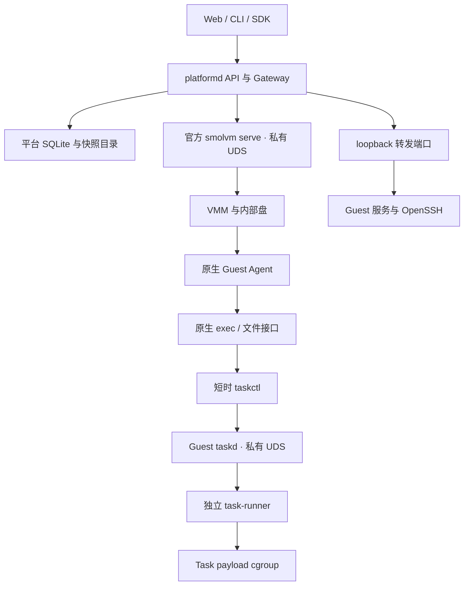
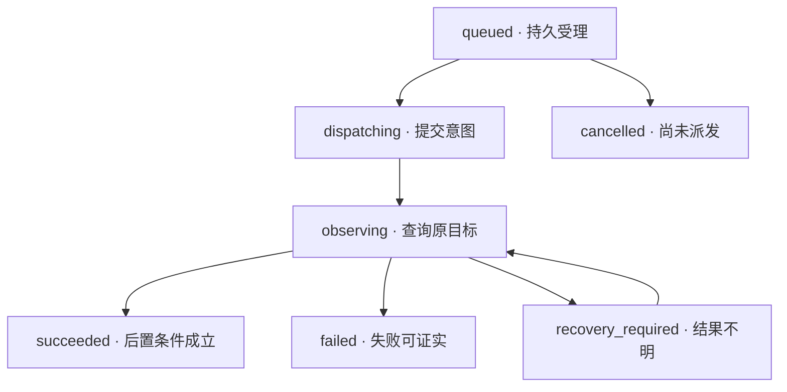
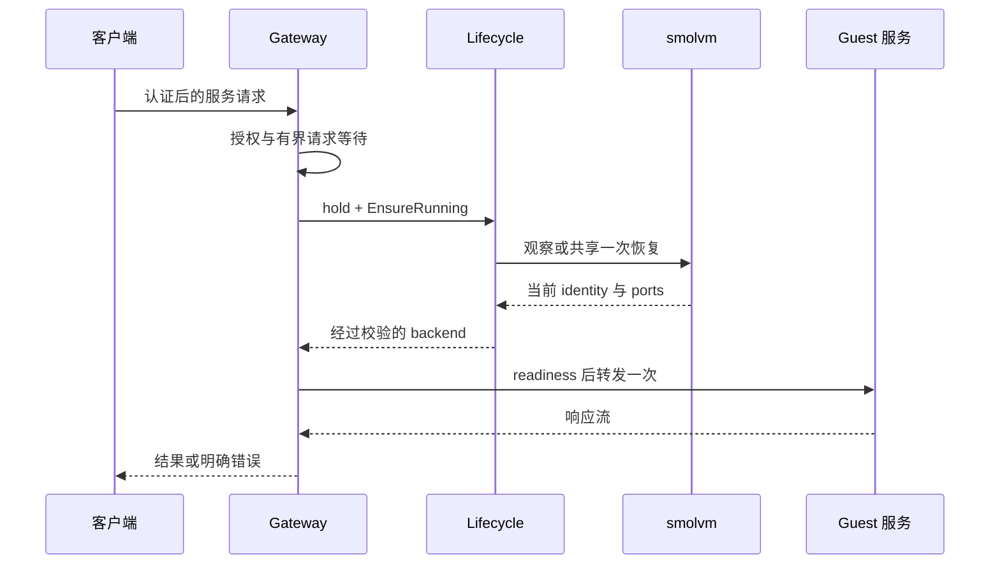
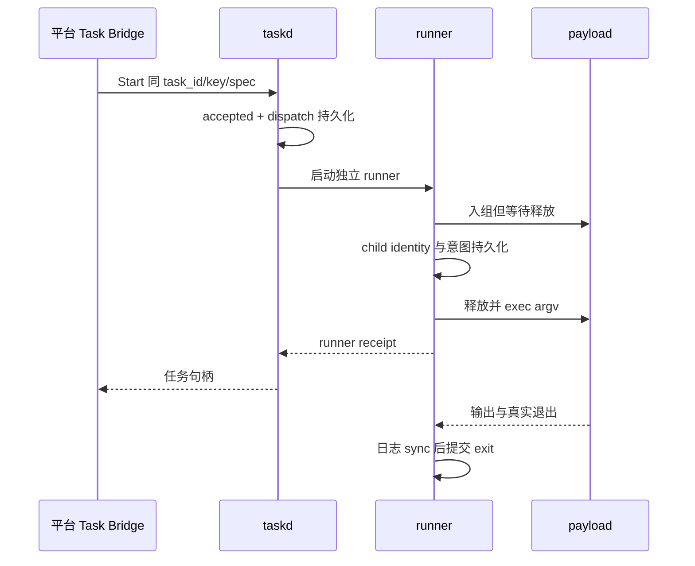

# 第一阶段工程架构与模块设计

> 2026-11-25 修订版：默认 Guest root；Live Fork 仅使用原生实时复制，不处理或提供应用安全点，活动工作负载不构成额外准入限制。Independent Clone/同逻辑 recovery 的既有捕获策略保持独立。

<a id="design-status"></a>
## 1. 设计定位与固定边界

本方案交付一个可长期使用的单节点开发环境平台：用户从 Web、CLI、Python 或 TypeScript 创建机器，运行普通命令与持久任务，通过稳定地址访问 HTTP/TCP/SSH，管理休眠、分支、独立副本和快照。所有操作由同一个平台协调器管理，运行时仍使用官方 smolvm。

本文规定实现结构、模块责任及故障处理理由；公开字段、错误码和状态枚举以 [SPECIFICATION.md](SPECIFICATION.md) 为唯一契约。工作顺序见 [IMPLEMENTATION_PLAN.md](IMPLEMENTATION_PLAN.md)，安装、验收和故障处置见 [ACCEPTANCE_AND_OPERATIONS.md](ACCEPTANCE_AND_OPERATIONS.md)。这五份文档是计划，不表示平台已经实现或本轮已重跑 PVE。

两条不变条件贯穿第一阶段：

- 不修改 smolvm、libkrun、libkrunfw、内置 Guest Agent、Guest kernel、私有数据库或控制协议；缺少可证明语义时限制操作或报告 `recovery_required`。
- 不实现高级资源调度。复用原生 cgroup、balloon、准入、压力保护和指标，只增加简单磁盘余量检查、一个重型操作并发上限及有界日志/连接缓冲。

实施基线为官方 v1.37.1，commit `9d3ab4c82756456565544558ac2ea5412afa84ef`；用户提供的实机材料属于 v1.37.0，commit `9b476839f529f3a4971f38f9999fb499a0309f8a`。新版本源码复核与旧版本实测分开记录，不宣称 v1.37.1 已通过同样实验。依赖包的具体 patch 版本在初始化工作包中写入 lock 文件，不在此猜测最新版本。[官方 v1.37.1 Release](https://github.com/smol-machines/smolvm/releases/tag/v1.37.1)

### 1.1 最终技术栈

| 层 | 确定选择 | 原因与边界 |
|---|---|---|
| 管理服务 | Go `platformd`，模块化单体 | API、操作协调、Gateway、任务桥接、事件、静态 UI 共一个主要服务，减少恢复边界 |
| 运行时 | 独立官方 `smolvm serve`，HTTP over Unix socket | 避免嵌入 SDK 改变 runtime 所有权；Adapter 只访问公开 API/CLI |
| 元数据 | SQLite，`database/sql` + `mattn/go-sqlite3`，显式 SQL | WAL、FULL、外键、版本迁移和单写者；不引入独立数据库进程或 ORM |
| Web | React、TypeScript、Vite、xterm.js，静态资源嵌入 Go | 浏览器只访问平台 API；不直接连接 smolvm |
| CLI/SDK | Go+Cobra 的 `sandboxctl`；Python `httpx`；TypeScript `fetch/WebSocket` | 共同遵守平台 OpenAPI、操作与错误契约，不把 smol cloud SDK 当本地 serve 客户端 |
| Guest 持久任务 | Go taskd、taskctl、task-runner；runit 服务监督 | 与原生 Agent 独立；短时原生 exec 仅作控制桥，runner 持有真实退出与输出 |
| 交互 | 原生 Exec Session/PTY；Guest OpenSSH | 不自研终端协议或 SSH server，不要求所有命令经过 taskd |
| 接入 | Go TLS Gateway，`coder/websocket`，用户已有 wildcard DNS | 无常驻独立 Gateway/DNS/Node 服务；可选 Caddy 仅作边缘 TLS/反代 |
| 运维 | systemd、journald、受控文件目录、结构化 `slog` | 平台与 serve 独立重启；备份和迁移由本地管理员命令执行 |

首个部署目标是 Linux x86_64、Ubuntu 24.04、PVE 内嵌套 KVM，参考现场为 8 vCPU/12 GiB。此配置是已知环境起点，不是实例容量承诺。

<a id="system-layout"></a>
## 2. 进程、数据与信任边界



平台 SQLite 保存逻辑机器、授权、操作、任务索引、快照目录和配置；smolvm 保存自己的机器与运行资源。两边状态通过公开观察协调，平台不读写 runtime 私有 DB，也不删除 runtime 的 backing、golden 或内部共享 cache。

Guest 保存任务原始状态、输出和真实退出记录。平台保存的是已观察结果和授权索引；Guest 失联时不能用平台上一次状态伪造当前进程结论。Guest 返回的数据需要 schema、大小、身份和授权校验；Guest 自报的 machine ID 从来不是访问另一台机器的凭证。

### 2.1 宿主布局

部署选择非 root `platformd` 和 root 身份的官方 `smolvm serve`，启用当前官方独立 systemd VM scope 路径。runtime 的 VMM 降权、seccomp、Landlock 继续按原生实现工作。serve 的 UDS 最初为 0600，由固定 root-owned ExecStartPost helper 校验 socket 类型、owner、路径后设为专用平台组 0660；父目录受限。平台获得完整 runtime 控制权限，仍处于宿主特权边界，不能因其进程非 root 就宣称已形成强安全隔离。[scope 前提](https://github.com/smol-machines/smolvm/blob/9d3ab4c82756456565544558ac2ea5412afa84ef/src/systemd_scope.rs#L421-L450)、[UDS 权限](https://github.com/smol-machines/smolvm/blob/9d3ab4c82756456565544558ac2ea5412afa84ef/src/cli/serve.rs#L1047-L1074)

安装程序负责 `/dev/kvm`、socket group、目录权限和官方二进制路径，具体 unit 配置须通过真实 systemd 重启验收。必要 CLI 补口经固定 allowlist wrapper/oneshot 执行，不给 platformd 任意 sudo shell，也不把同一父 systemd cgroup 中的 detached 进程误当作已独立受保护的 VMM。

运行时配置明确使用普通 virtio-net，发布端口绑定 loopback，设置 `SMOLVM_PUBLISH_ADDR=127.0.0.1`、`SMOLVM_EGRESS_FLOOR=strict`。严格 floor 不自动阻断宿主所有公网地址，安装时另保护该节点对外地址与管理入口。原生 lease rollout listener 与完整控制 API 是不同通道，不能把前者的存在解释为可向 Guest 暴露后者。[网络启动与 floor 选择源码](https://github.com/smol-machines/smolvm/blob/9d3ab4c82756456565544558ac2ea5412afa84ef/src/network/launch.rs#L390-L417)

### 2.2 平台身份的三层区分

| 标识 | 谁拥有 | 什么情况下改变 |
|---|---|---|
| `machine_id` | 平台逻辑对象 | 新建机器或新独立副本；普通 Pause/Resume 不变 |
| `binding_generation` + `runtime_name` | 平台到 runtime 的绑定 | rollback/同逻辑机器换成新 runtime 时增加 generation；runtime 名永不复用 |
| `runtime.pid/startTime/bootId` | 公开观察到的执行身份 | VMM 重建、恢复等可能变化；不等同逻辑机器换代 |

原生 `MachineInfo.runtime` 已暴露执行身份，第一阶段不需要先补一个 B1 API。平台在派发前和完成观察时比较公开 identity；不单独凭 PID 判定“还是同一次执行”。不是所有原生写接口都接受 identity CAS，因此平台独占控制、生命周期串行化和前后观察仍然必要。管理员直接用 CLI 改机器时，应进入维护模式并重新协调，不能宣称双控制方具有线性一致性。[MachineInfo](https://github.com/smol-machines/smolvm/blob/9d3ab4c82756456565544558ac2ea5412afa84ef/src/api/types.rs#L1508-L1535)、[RuntimeIdentity](https://github.com/smol-machines/smolvm/blob/9d3ab4c82756456565544558ac2ea5412afa84ef/src/agent/live_resize.rs#L13-L54)

`control_epoch` 是平台控制历史 UUID，正常 platformd 重启保持；受控恢复旧平台 DB 时更换。客户端 mutation 带当前 `If-Control-Epoch` 和幂等键，旧控制历史的请求不得自动补发。它不声称能检测任意外部工具对整台 PVE VM 的隐式时间回退。

需要替换 runtime 的操作在首个 RPC 前分配 `MAX(历史 generation)+1` 作为候选，允许因失败留下空号；失败候选 generation 和 runtime 名永不复用。当前 binding 只在切换成功时改为预先分配的值，不在确认结果后临时猜一个“当前值加一”。

<a id="repository"></a>
## 3. 仓库结构与依赖方向

以下是计划创建的单仓库结构；本阶段文档工作不生成或部署这些程序。

```text
cmd/
  platformd/
  sandboxctl/
  sandbox-taskd/
  sandbox-taskctl/
  sandbox-task-runner/
internal/
  api/             auth/            registry/
  operations/      lifecycle/       runtime/smolvm/
  gateway/         execbridge/      filebridge/
  tasks/           snapshots/       copies/
  idle/            metrics/         events/
  diagnostics/     maintenance/     config/
guest/
  taskprotocol/    journal/         runner/
  cgroup/          bootstrap/       services/
  templates/
web/
  src/api/         src/pages/       src/components/
sdk/
  python/          typescript/
api/
  openapi.yaml     examples/
migrations/
packaging/
  systemd/         templates/       install/
tests/
  contract/        integration/     scenarios/
```

`api` 层只做鉴权、校验、对象授权和调用应用服务，不直接拼 smolvm 请求。`lifecycle/copies/snapshots` 使用 `operations` 与 Adapter；Gateway 通过 `EnsureRunning` 获取受校验的 backend，不自行调用 Resume。`tasks` 是控制面桥接，`guest/*` 是独立 Guest 二进制；二者共享明确版本的 JSON 协议模型，不共享宿主文件路径或 smolvm 私有类型。

依赖方向为 UI/CLI/SDK → 平台 API → 应用服务 → Registry/Adapter。Guest 程序不能反向持有宿主管理 token。Adapter 不依赖 UI、Task 产品状态或业务授权，便于官方 runtime 升级时只调整接口边界。

<a id="module-contracts"></a>
## 4. 模块实施契约

每个模块均明确复用能力、新代码、输入输出、状态所有者、正常路径、失败路径及验收结果。接口字段详见规范；这里强调调用和责任。

### 4.1 Runtime Adapter

| 项目 | 契约 |
|---|---|
| 复用 | 官方 serve HTTP UDS，公开机器/identity/exec/files/ports/network/checkpoint/Branch/指标；明确缺口才用官方 CLI argv |
| 新代码 | 版本能力表、类型化请求、camelCase/snake_case 编码差异、流式传输、错误归类、Observe 结果 |
| 输入/输出 | 平台已授权的 runtime 名和操作参数 → 原生收据、观测 identity、运行状态、typed error |
| 所有者 | 不保存业务真相；版本/profile 能力缓存归 Adapter，操作收据归 operations |
| 正常 | 限时调用 → 保留原生 operation/identity → 查询公开状态验证后置条件 |
| 失败 | 区分明确拒绝、传输前失败、可能已派发、后置条件不明；后两者交协调器，不自动换名重试 |
| 验收 | 固定版本实际 API 合同、权限/路径错误、超时后查询、字段空值和 restore/ports 语义可重现 |

### 4.2 Registry、操作与事件

| 项目 | 契约 |
|---|---|
| 复用 | SQLite 事务、WAL、FULL、外键、唯一约束、版本化 migration |
| 新代码 | 逻辑对象、幂等受理、操作锁、stage、runtime 收据、引用保护、事件游标 |
| 输入/输出 | mutation+actor+key+control epoch → operation；读取返回已提交对象/观察时间 |
| 所有者 | 平台 SQLite 单写者；大日志、RAM、checkpoint 不进 DB |
| 正常 | 短事务受理、提交意图、事务外 RPC、再用短事务提交观察和事件 |
| 失败 | DB 提交失败不发新 RPC；RPC 后 DB 失败按原 runtime 名观察；未知保留操作锁 |
| 验收 | 同 key 同 spec 一次受理，冲突 key 拒绝；进程重启后未决操作可定位，旧 DB 恢复不自动重放 |

### 4.3 Lifecycle 与 EnsureRunning

| 项目 | 契约 |
|---|---|
| 复用 | 原生 start/stop/pause/resume、公开 identity、依赖拒绝和 pressure reason |
| 新代码 | 单机器 mutation gate、共享 wake operation、pause/访问竞态、启动后 reconcile |
| 输入/输出 | 机器、目标动作、期望 revision、来源 → operation、稳定可用 backend 或具体 blocker |
| 所有者 | desired state 与 operation 在 DB；observed state 来自 runtime；内存 singleflight 只负责等待通知 |
| 正常 | 确认 current binding → 协调实际状态 → 需要时派发一次 → 验证 identity/Guest/目标服务 |
| 失败 | 不明 capture/start 保持锁与重操作许可；压力暂停不反复唤醒对抗原生保护 |
| 验收 | 并发访问只共享一次恢复；pause 派发前后的新访问处理不同；重启后继续观察原操作 |

### 4.4 Gateway、服务、SSH 与 TCP

| 项目 | 契约 |
|---|---|
| 复用 | 原生 loopback published ports、Go HTTP/TLS/WS、Guest OpenSSH、已有 DNS |
| 新代码 | 稳定服务授权、鉴权先于 wake、动态 backend 缓存、请求转发边界、SSH/TCP 隧道、连接 hold |
| 输入/输出 | 已认证 service/SSH/tunnel 请求 → 经当前 runtime/port 核验的流，或可解释唤醒/就绪错误 |
| 所有者 | 服务定义归 DB；连接计数、route cache 归内存；机器状态和恢复归 lifecycle |
| 正常 | 鉴权 → hold → EnsureRunning → readiness → 校验 binding/identity/port → 单次转发 |
| 失败 | 超时取消等待者，不取消已派发恢复；backend 可能已收到请求时不自动重放 |
| 验收 | 未授权请求不启动 VM；端口复用/rollback 不串机；HTTP POST 无重复；真实 SSH/SFTP/WS 重连通过 |

### 4.5 原生执行与文件桥接

| 项目 | 契约 |
|---|---|
| 复用 | 原生 exec/execs/PTY/stdin/resize/输出游标、files PUT/GET；短时无状态文件 helper |
| 新代码 | 平台 session 授权映射、单上游 reader、有限 fan-out、UI 终端适配、Guest 路径/大小校验 |
| 输入/输出 | argv/env/cwd、stdin/resize 或 Guest path → 原生结果、输出 gap、文件流 |
| 所有者 | 原生 session 在 serve 内存；平台不把它伪装成持久任务；文件在 Guest 内部盘 |
| 正常 | 平台取得 operation/activity 准入 → 原生会话 → 逐序分发；文件不依赖 taskd 存活 |
| 失败 | serve 重启导致 exec 丢失时报告结束未知/会话丢失；不重跑 argv；上传失败不隐瞒部分状态 |
| 验收 | 真实 stdin/resize/Ctrl-C、二进制输出、两观察者、gap、路径越界与大文件背压 |

### 4.6 Persistent Tasks 与 Guest 管理程序

| 项目 | 契约 |
|---|---|
| 复用 | background exec 引导、短 native exec、Guest UDS、runsv、Linux wait/cgroup/filesystem |
| 新代码 | taskd/taskctl/runner、幂等启动、状态/日志、cancel、bootstrap、分支任务归属、可选捕获协调 |
| 输入/输出 | task namespace+task ID+spec/key → 持久受理、真实退出/unknown、日志游标、取消进度 |
| 所有者 | runner 持有进程/日志/exit；taskd 持有准入/绑定；平台持有用户授权和查询索引 |
| 正常 | 持久 intent → 独立 runner → 入组/以请求用户（默认 root）释放 payload → 日志与 wait → durable exit |
| 失败 | taskd 重启接回旧 runner；runner 证据缺失不补跑；cgroup cancel 不能证实则保持 unknown/hold |
| 验收 | platformd/serve/taskd 各自崩溃无重复任务；输出可续读；后代 setsid 仍能收尾；VM 恢复有身份裁决 |

### 4.7 Snapshot Catalog 与复制

| 项目 | 契约 |
|---|---|
| 复用 | 原生 full checkpoint、公开导入/start、Branch、父依赖保护、原生内部 CoW |
| 新代码 | 平台快照目录/manifest/hash、独立克隆和 recovery 捕获协调、原生 Live Fork、来源关系、新实例/rollback 协调 |
| 输入/输出 | 机器/快照+purpose+任务策略 → 独立制品、分支/副本、恢复 operation、明确依赖 |
| 所有者 | 平台拥有自己的制品目录与逻辑引用；runtime 拥有其共享层；GTM 拥有可选捕获协调和任务映射 |
| 正常 | 原生 Live Fork：锁与兼容检查 → native Branch → 观察 → 子绑定/任务接管/发布；Clone/recovery 按各自捕获策略执行 |
| 失败 | 不明结果保留 artifact/引用/锁；不能绕 native parent 拒绝；新恢复不明时不重启旧 runtime |
| 验收 | 运行中 root 进程与 Task 实时复制并各自继续；Branch 与独立 Clone 可区分；移走源资源后的独立恢复闭包通过 |

### 4.8 Activity、lease 与 idle

| 项目 | 契约 |
|---|---|
| 复用 | 平台已有连接/任务/会话状态、原生 pause、Guest Task 状态 |
| 新代码 | keep-running/短 lease、activity_seq、保守 idle 判断、pause 最后检查、suspect 处理 |
| 输入/输出 | 活动事件、租约、任务状态、用户 idle 配置 → 最早 idle 候选或 blockers |
| 所有者 | 显式 lease 和配置在 DB；瞬时连接在内存；Task 状态按持久查询协调 |
| 正常 | 所有 blockers 清空且连续空闲满足阈值 → lifecycle 复核 → Pause |
| 失败 | 过期 lease 先 suspect、Guest 不可达阻 idle；重启先 reconcile，不用空内存计数直接睡眠 |
| 验收 | 长时等待模型的低 CPU Task 不被睡眠；新连接与 Pause 竞态正确；轮询 UI 不制造 activity |

### 4.9 Metrics、简单容量保护与诊断

| 项目 | 契约 |
|---|---|
| 复用 | 原生资源配置/指标/错误、Host free space/inodes、pressure/cgroup 观测 |
| 新代码 | 采样标注、低空间拦截、重操作并发计数、诊断包、有限日志/WS buffer |
| 输入/输出 | 公开指标与文件系统状态 → UI 图表、准入错误、非敏感诊断 |
| 所有者 | runtime 决定实际资源保护；平台只保存有限历史与阈值配置 |
| 正常 | 显示有效值/观察时间，空间不足拒绝会扩大占用的动作；默认重型操作并发 1 |
| 失败 | 指标缺失显示 unavailable；未知 operation 保留许可；不按 RSS 相加推断 CoW 真实占用 |
| 验收 | 节点空间阈值生效、已有任务查询不被封死、日志有界；没有隐含 reservation/预测调度 |

### 4.10 Auth 与安全边界

| 项目 | 契约 |
|---|---|
| 复用 | TLS、标准密码/token 哈希、Cookie/Origin 校验、OpenSSH 用户密钥、mTLS |
| 新代码 | 管理登录、scope token、对象授权、短 stream ticket、host-only cookie、受控管理命令 |
| 输入/输出 | 用户凭据+对象请求 → actor/scope/允许操作或拒绝；Guest 无宿主凭据 |
| 所有者 | 平台 DB 存公钥、哈希与授权；私钥/服务秘密在受保护宿主目录；不放进日志 |
| 正常 | 每 API/WS/下载/服务访问先认证授权；认证本身不启动机器 |
| 失败 | 不把 Guest 自报身份升级为权限；ticket 失效重取，不暴露长效 bearer URL |
| 验收 | 跨机器越权、来源混淆、service→management CSRF/WS、token 泄露和 Guest 访问宿主入口被覆盖 |

### 4.11 UI、CLI、SDK 与事件消费

| 项目 | 契约 |
|---|---|
| 复用 | 平台 OpenAPI、同一 operation/error/event 模型、xterm.js |
| 新代码 | 完整页面、CLI 命令、Python/TS 封装、进度和 blocker 展示、断线事件补读 |
| 输入/输出 | 用户动作 → 相同 API 契约；机器/任务/快照状态 → 带时间/来源的视图 |
| 所有者 | 服务端是对象与操作真相；客户端只缓存，不各自发明 retry/恢复逻辑 |
| 正常 | action 返回 operation → 事件/轮询显示进度 → 最终对象刷新；无需一直保持页面开启 |
| 失败 | 客户端断线后按 operation ID 查询；显示 unknown、输出 gap、依赖 blocker，不自动二次派发 |
| 验收 | 同一真实场景可从 Web/CLI/Python/TS 完成；没有仅 mock 可用的核心页面 |

### 4.12 安装、备份、升级与维护

| 项目 | 契约 |
|---|---|
| 复用 | 官方发行资产/checksum、systemd、SQLite backup、平台原生 artifact 与文件权限 |
| 新代码 | 幂等安装检查、version manifest、配置迁移、备份清单、维护模式、受控恢复、默认留数据卸载 |
| 输入/输出 | 本地管理员配置/版本/备份包 → 明确的安装或维护结果；远程 API 不接受任意 Host 路径 |
| 所有者 | 管理员决定维护窗口/目标目录；平台维护自己的元数据，runtime 资产继续官方管理 |
| 正常 | 检查环境→安装官方包→验证配置/权限→启动协调→可用；升级先备份与兼容检查 |
| 失败 | DB/格式不能回退则维护模式；不只降 binary 就宣称回滚完成；诊断不默认收集 RAM/秘密 |
| 验收 | 真 systemctl restart、SIGKILL、升级失败恢复、完整备份恢复与卸载留数据有实测记录 |

<a id="lifecycle"></a>
## 5. 生命周期与操作协调

### 5.1 状态只承担自己的职责

`desired_power` 表示用户目标，限 running/paused/stopped/deleted；`observed_state` 缓存 created/running/stopped/paused/frozen/unknown/deleted；`availability` 说明 ready/not_ready/blocked。长动作进度放在 operation，不把 cloning/resuming/restoring 等所有阶段堆成机器永久状态。

操作序列为 `queued → dispatching → observing → succeeded/failed/recovery_required`。只有未派发操作可以 cancelled。客户端取消等待、浏览器关闭或 HTTP 超时都不等于已派发 native 操作取消。



每台逻辑机器至多一个活跃 mutation operation，依赖多对象的动作按稳定 ID 顺序取锁。锁记录在 SQLite `operation_locks`；进程级 flock 保证只有一个 platformd 写者。不要跨 RPC 持有 SQLite 写事务。

### 5.2 一次 mutation 的骨架

```text
accept(actor, machine, key, spec, expected_revision, control_epoch):
  authorize actor and validate complete spec
  begin short transaction
    verify control_epoch and revision
    find same idempotency key; return it or reject spec mismatch
    acquire ordered operation_locks
    allocate immutable operation_id and never-reused runtime_name if needed
    persist queued operation and protected artifact references
  commit
  enqueue operation worker

dispatch(op):
  inspect public runtime identity and current binding
  check simple disk floor and heavy-operation permit when applicable
  persist dispatching + exact outgoing request fingerprint
  call native public API outside database transaction
  persist any receipt; observe same name/identity until postcondition known
  commit terminal result and release locks only when safe
```

明确的验证错误可以 failed；收到超时、断流或 process crash 后，应查询原不可重用 runtime 名和公开 identity。存在对象不自动等于所需后置条件；不存在对象的一次观察也未必足以证明请求从未到达。Adapter 针对可证明幂等的同名/同 token 操作提供 retry，其余保留 observing/recovery_required。

### 5.3 Pause、Resume 与访问竞态

平台自己发起 Pause 时保存原生 pause operation ID 和前后运行身份，Resume 优先使用匹配的原生 ID。原生压力保护触发的 Pause 可能没有平台已知 ID；只按当前版本公开契约和 fresh observation 继续，缺少足够前提时报告 recovery_required，不能伪造令牌。

Pause 派发前的新用户活动可撤销 idle 候选；开始 capture 后只记 `wake_pending`，等待 Pause 的结果被确认，再用同一协调器恢复。不能在 capture 仍进行时另起一次 Start/Resume。

运行中但服务未 ready 的机器只做就绪等待，不为了“修复服务”再 Resume。普通 Pause/Resume 不增加 `binding_generation`，但新的 runtime identity 必须使 route cache 失效并重新读取实际发布端口。

### 5.4 重启顺序

platformd 启动先校验 installation marker/control epoch，再读取未决 operations、锁、机器绑定和保护引用。通过公开 API 协调 runtime；暂不允许 idle、破坏性清理或未经核对的 mutation。恢复中可提供只读诊断与状态查询。

重型操作 permit 默认全节点 1，覆盖 start/resume/import/checkpoint 等实际重 I/O/恢复动作。permit 持有情况从未决操作重建，不能依赖空内存 semaphore 误判没有在途操作。它只是计数限制，不计算 RAM reservation、共享页归属或每租户预算。

serve 重启、platformd 重启、taskd 重启、VMM 重建和 Guest cold boot 分别处理。已有实验只证明某些 Serve 重启能接回 VMM 和新 exec；不能由此声明所有任务或所有 systemd stop 模式都无损。

<a id="gateway"></a>
## 6. Gateway、稳定地址与连接生命周期

### 6.1 稳定的是服务身份

服务记录把 `service_id`、`machine_id`、协议、Guest 目标端口、访问策略和 readiness 绑定。用户访问稳定 hostname/服务 ID；Gateway 每次依据当前 binding 和 runtime 公开返回的 Host 端口选择 backend。没有稳定 Guest 私网 IP、Named Network 或私网 DNS 的承诺。

首阶段使用用户已有 wildcard DNS 指向 Gateway。平台创建服务绑定和显示需要配置的 DNS，不部署 CoreDNS，不把服务域名当作 Guest 之间直接互联地址。

backend cache key 是 `(machine_id, binding_generation, runtime_identity, service_revision)`。缓存仅在内存；platformd 重启、runtime identity 变化、服务修改、rollback 时清空对应项。不能把旧 Host port 持久化后跨重启直接复用，也不能只凭“127.0.0.1:某端口能连”证明目标仍属于该机器。

### 6.2 请求流程与重放边界



转发内部区分 `not_started / may_have_started / completed`，与 SPECIFICATION 的 forwarding 字段一致。首次尝试 backend write 之前即进入 may_have_started；只有明确尚未派发才可在同一用户请求中重试建立 backend。一旦可能送出数据，就不能因为断连、唤醒超时或路由切换自动重放 POST 等副作用请求；completed 只表示完整响应传输结束。对容易触发标准 transport 自动重试的路径，使用明确不重试的 RoundTripper/新连接策略并验证行为，不能仅设置 DisableKeepAlives 后宣称已经解决。

body、排队请求数、等待时长和流量缓冲均有上限；不能在 VM 恢复时无限把客户端数据堆进内存。请求超时只取消该等待者，持久 wake operation 继续观察。后台恢复完成后不能偷偷重新发出已经向用户返回失败的业务请求。

### 6.3 HTTP、WebSocket、TCP 和 SSH

| 入口 | 认证与 wake | 保持运行条件 | 恢复边界 |
|---|---|---|---|
| HTTP | 平台服务授权先完成，再 wake | 活跃请求持有短 activity hold | 新请求可唤醒；不自动重放可能已发出的请求 |
| WebSocket | 校验 Origin、单次短 ticket，再 upgrade/wake | 双向连接一直持有 hold，含空闲 WS | Pause/进程重启后需要新连接，不保证原 socket 续接 |
| 普通 TCP 客户端 | `sandboxctl port-forward` 在本地监听，经认证 HTTPS WS 隧道连接服务 | 隧道存活持有 hold | 旧 TCP 断开后客户端自行重新连接 |
| 稳定外部 TCP 端口 | mTLS 在触发 wake 前识别 actor，并校验 service scope | 已授权连接持有 hold | Source CIDR 只是附加限制，不代替身份认证 |
| SSH/SFTP | OpenSSH `ProxyCommand sandboxctl ssh-proxy --machine <id>`，先认证 WS，再 Guest SSH 用户认证 | tunnel/SSH 会话持有 hold | 新连接唤醒；host key 校验照常生效 |

SSH 采用 Guest sshd；平台只传输受授权字节，不实现 SSH 握手或自建宿主 bastion。CLI 使用认证 header 建立 WS；浏览器使用已登录 API 领取的短期单次 stream ticket，通过约定子协议传递，不把长效 bearer 放 URL。

Live Fork/新独立副本必须使用新的 SSH host key 并重启 sshd 后才发布。同逻辑机器 rollback 可从独立的平台秘密存储恢复已批准 host key，或明确轮换并提供新指纹；不能关闭 StrictHostKeyChecking 解决冲突。host key 处理不等于所有应用凭据已经换新。

### 6.4 入站隔离不等于外部副作用隔离

隐藏 Gateway 路由只阻止平台新入站请求，不能阻止已复制线程主动外联。运行态 API 没有通用的首次指令前 fence 或立即撤销全部既有连接的原语。Live Fork 明确允许这类原生行为；Gateway 不提前发布子服务，既有外部副作用和连接恢复由应用负责。独立 Clone/recovery 则按各自捕获协调策略处理。[网络 policy 限制](https://github.com/smol-machines/smolvm/blob/9d3ab4c82756456565544558ac2ea5412afa84ef/src/api/handlers/machines.rs#L7764-L7833)

<a id="native-exec-files"></a>
## 7. 普通命令、终端与文件

普通短命令、临时执行和交互终端始终走原生 exec/Exec Session；Persistent Task 是用户明确选择的独立功能。产品 UI 同时呈现“命令/终端会话”和“持久任务”，不通过重命名掩盖生命周期差异。

原生 Session 在 serve 的内存 registry 中，默认有输出窗口和 detach/exit 保留策略。`after` 同时表示确认并释放旧输出，因此平台每个 session 只允许一个上游 reader，由它做有限 fan-out；用户终端和旁观者不能分别随意推进同一原生 ack。客户端收到保留起点和 gap，显示内容不完整；serve 重启丢 session 后不重跑原命令。[registry 与输出协议](https://github.com/smol-machines/smolvm/blob/9d3ab4c82756456565544558ac2ea5412afa84ef/src/api/exec_sessions.rs#L15-L38)、[进程内存储](https://github.com/smol-machines/smolvm/blob/9d3ab4c82756456565544558ac2ea5412afa84ef/src/api/exec_sessions.rs#L799-L809)

Web Terminal 通过 xterm.js 接真实 PTY，明确 stdin、EOF、resize、Ctrl-C 和会话关闭规则。原实验只做了 `test -t 0`，不能把它当作这些交互已经验收。Task 首版是非交互后台命令；需要持续输入的工作使用原生终端或 SSH，不扩出第二套持久 PTY 协议。

文件 API 的输入始终是 Guest path，不接受 Host path。平台校验路径、大小、用户权限和符号链接行为；字节传输复用原生 files，目录操作和安全提交用固定无状态 Guest helper，经原生 exec 调用，不依赖 taskd。helper 不能接受任意 shell 片段。

默认 Guest root 文件 API 覆盖 Guest 文件系统，`/workspace` 是默认工作目录而非权限边界。复用 native files 字节流；有需要时用固定无状态 helper 完成目录列表/原子提交、权限和 owner 设置。路径必须限定目标 Guest，绝不拼接宿主路径或任意 shell；上传到 Guest 自有 staging 时限制空间与并发，校验目标类型和清理范围。系统文件可按用户意图读写，不额外提供宿主文件能力。

staging 位于内部盘并有大小、并发和过期清理限制。root 可以修改 Guest 内服务、配置及 GTM 数据，这属于正常权限；对相关组件的健康与证据重新观察，无法确定时显示 degraded/unknown，不因 root 文件操作禁止 Live Fork。

原生文件上传支持 mode/uid/gid，下载会调用 ensure running，且当前没有直接的输出 offset 接口。平台先通过生命周期协调和 activity guard 决定是否唤醒，不把 files 当只读健康探针，也不虚构 files 的 autoStart 参数。GTM 日志采用自己的 `output` RPC。大文件传输流式处理，原生未提供的覆盖/原子语义不能由平台伪称已有。[file metadata](https://github.com/smol-machines/smolvm/blob/9d3ab4c82756456565544558ac2ea5412afa84ef/src/api/handlers/files.rs#L28-L86)、[download 行为](https://github.com/smol-machines/smolvm/blob/9d3ab4c82756456565544558ac2ea5412afa84ef/src/api/handlers/files.rs#L275-L319)

<a id="persistent-tasks"></a>
## 8. 独立 Guest Task Manager

### 8.1 程序和监督关系

Managed OCI 模板固定 digest，包含 Go taskd、taskctl、task-runner、runit、OpenSSH 和权限整理工具。普通容器已有原生 keep-alive PID1/reaper，因此直接让 `runsvdir` 监督基础服务即可；不必用自有 Go 程序充当 PID1。若模板保留 tini，应明确其 subreaper 模式，不宣称已替换原生 PID1。[keep-alive 行为](https://github.com/smol-machines/smolvm/blob/9d3ab4c82756456565544558ac2ea5412afa84ef/crates/smolvm-agent/src/main.rs#L5138-L5152)、[child reaper](https://github.com/smol-machines/smolvm/blob/9d3ab4c82756456565544558ac2ea5412afa84ef/crates/smolvm-agent/src/process.rs#L18-L55)

引导由原生 `POST /machines/{name}/exec` 的 `background:true` 启动自有 bootstrap。正常 image 路径使用 `crun exec --detach`；三个 stdio 不挂在前台请求上。bootstrap 用独占锁保证重复请求只有一个 supervisor，随后以短时 taskctl Hello 确认版本、namespace 和健康，不能只认后台返回的 PID。源码有 fallback，健康握手还须确认 supervisor 位于与普通 exec 相同的 workload namespace。[public exec](https://github.com/smol-machines/smolvm/blob/9d3ab4c82756456565544558ac2ea5412afa84ef/src/api/handlers/exec.rs#L117-L165)、[detached Guest 路径](https://github.com/smol-machines/smolvm/blob/9d3ab4c82756456565544558ac2ea5412afa84ef/crates/smolvm-agent/src/main.rs#L7683-L7721)

taskd 常驻并监听 `/run/sandbox-taskd/control.sock`，root-only。taskctl 是短命客户端：读取结构化 JSON、调用 UDS HTTP、写 JSON 回复并退出。任何原生 exec timeout/disconnect 只影响该 taskctl；已由 taskd 受理的任务不绑定 taskctl 或 HTTP request context。

控制面在 lifecycle 已确认机器运行后调用 bootstrap/taskctl，原生 exec 显式 `autoStart:false`，并给短 bridge 设置 timeout。状态轮询不借 taskctl 隐式唤醒；需要唤醒的用户动作先进入 EnsureRunning。

runsv 自动恢复 taskd，taskd 不自动恢复用户 argv。runner 是独立进程，taskd 退出后仍由 Guest 的子进程回收体系管理，继续持有任务父子关系、输出管道和 wait。`setsid` 只解决 session/终端关系，`nohup` 只解决特定信号，二者都不是持久 Task 协议。[setsid](https://man7.org/linux/man-pages/man2/setsid.2.html)、[subreaper](https://man7.org/linux/man-pages/man2/PR_SET_CHILD_SUBREAPER.2const.html)、[runsv](https://smarden.org/runit/runsv.8)

### 8.2 配置与能力探针

GTM 持久目录为内部盘上的 `/var/lib/sandbox-taskd`，工作目录 `/workspace`。`/run/sandbox-taskd` 只保存 socket/临时控制数据；不能在那里保存唯一任务 journal。模板须验证持久目录在 cold start 后仍存在、在 full checkpoint 中被包含，并记录实际文件系统归属。

强取消和活动任务恢复快照要求：

- cgroup v2 可创建 payload 子树，可安全把测试进程放入；`cgroup.events`、`cgroup.freeze`、`cgroup.kill` 可用。
- payload 默认 UID/GID 0，允许显式指定 Guest 普通用户；继承官方 workload profile 支持的能力，不额外强制 no-new-privileges 或清除 root 所需能力。
- taskd/runner/service supervisor 仍独立于 payload cgroup；默认 SSH 公钥登录 root，关闭密码登录。
- freeze/kill 能对 detached/setsid 子进程生效，freeze 状态跨当前版本 checkpoint 恢复已验。

固定源码默认 OCI 具备 rw cgroup2，`unprivileged` profile 为 ro；Guest 根委派也仅 best effort。因此能力探针是正式准入门槛，不能仅因 kernel 版本较新就假设通过。[cgroup mount](https://github.com/smol-machines/smolvm/blob/9d3ab4c82756456565544558ac2ea5412afa84ef/crates/smolvm-agent/src/oci.rs#L1459-L1469)、[boot delegation](https://github.com/smol-machines/smolvm/blob/9d3ab4c82756456565544558ac2ea5412afa84ef/crates/smolvm-agent/src/main.rs#L996-L1052)

Guest root 可修改 taskd、journal、cgroup 和基础设施；GTM 是可信个人环境中的合作式管理工具，不承诺对故意破坏/逃离 cgroup 的 root 进程仍可强取消。取消或冻结无法核实即返回 unknown 或未完成。Task cgroup 只用于任务集合管理，不另建资源调度。

平台使用 `guest_management_status=ready|degraded|unknown` 和当前 evidence 记录 GTM/活动探针健康，按实际检查更新，不记录永久 root 污染。helper 缺失/失联不影响原生 Exec、文件、Live Fork；仅影响依赖它的任务查询、受控 snapshot 和自动 idle 判断。新副本绑定后独立观测，不能把父的上次探针当作子的实时事实。

### 8.3 文件布局与写者

| 路径 | 写者 | 契约 |
|---|---|---|
| `installation.json` | bootstrap | 格式版本、模板/程序 digest、能力报告引用 |
| `binding.json` | taskd | host 提供的 machine_id、binding_generation、task_namespace、绑定 nonce |
| `barrier.json` | taskd | operation、目的、关闭 gate 的序号、冻结清单和确认状态 |
| `namespaces/<ns>/tasks/<task_id>.json` | taskd | task→物理 run_id 的映射、origin_machine_id/origin_task_id、spec hash、受理 key |
| `runs/<run_id>/request.json` | taskd，创建后不变 | argv/cwd/env、控制预算；root-only，可能包含用户秘密 |
| `runs/<run_id>/dispatch.json` | taskd，写一次 | 可能已派发 runner 的意图 |
| `runs/<run_id>/state.json` | taskd | 从 runner/result 推导的查询缓存；不覆盖 result，不作为终态唯一证据 |
| `runs/<run_id>/runner.json` | runner | PID/starttime/Guest boot ID、child identity、cgroup、状态序号 |
| `runs/<run_id>/owner.json` | taskd | 当前 owner binding 与 adoption 请求；runner 确认写单独 receipt |
| `runs/<run_id>/result.json` | runner，终态写一次 | 真实 exit code/signal、结束原因、最终输出 committed cursors |
| `runs/<run_id>/stdout/`、`stderr/` | runner | 有界 segment、原始字节 offsets、校验与持久水位 |
| `history/<origin_ns>.json` | taskd | 来源索引，只供查询；不进入启动队列 |

物理 run 目录在 namespace adoption 时不移动，避免复制出来的 runner 继续使用旧路径却写不到终态。逻辑 namespace 用索引映射；history 的只读性质由 Task API 与明确的 namespace 写入规则实现；Guest root 可直接修改内部文件，不能把 API 只读当作 Guest 防篡改承诺。

单文件只有一个写者。taskd 重启重新从 runner.json/result.json 推导 state.json，不让旧 cache 覆盖新的 runner receipt。状态更新采用同目录临时文件 → 写入 → fsync(file) → rename → fsync(directory)；输出及其 index 由 runner 单写，允许批量 sync，但明确区分已观察 offset 和已持久 offset。最终 result 在输出提交后写入。文件内容 sync 与目录项 sync 是不同保证，仍需存储栈验收，不能仅凭调用 fsync 宣称 PVE 物理断电零丢失。[fsync](https://man7.org/linux/man-pages/man2/fsync.2.html)

### 8.4 启动幂等和真实执行窗口

`Start` 的身份是 `(task_namespace, task_id, request_key, spec_hash)`。同 key 同 spec 返回同任务，不同 spec 冲突。taskd 先校验绑定/gate/磁盘余量，再持久 accepted 和 dispatch 意图，最后才启动 runner。

runner 获取自己的独占锁、建立日志与 payload cgroup，启动一个尚未释放的 launch shim。shim 先入目标 cgroup、等待控制管道；runner 记录自身和 child identity 并提交释放意图，才允许 shim exec 用户 argv。可用 Go `SysProcAttr.UseCgroupFD`，不支持时由独立 shim 写 cgroup.procs；显式指定普通用户时可复用 setpriv；默认 root 保持原生 workload 权限。多线程 Go 中不手写 raw fork 后继续跑 Go runtime。[Go os/exec](https://pkg.go.dev/os/exec)、[SysProcAttr](https://pkg.go.dev/syscall#SysProcAttr)、[setpriv](https://man7.org/linux/man-pages/man1/setpriv.1.html)



dispatch 与真正执行之间仍有 crash window。若已经可能启动、但无法确认 runner/child，不自动补发命令；返回 starting/unknown，由用户显式处置。禁止“发现没有 terminal 文件就重跑”，也不能把请求超时当作尚未启动。

### 8.5 退出码、后代与取消

runner 是主命令的父进程，负责两路并行输出和 wait。taskd 重启后通过持久文件及 runner UDS 重新接管，不直接对旧 PID 调 wait；非父进程无法据 PID 补出 exit code，pidfd 也不改变 wait 的父子限制。[wait](https://man7.org/linux/man-pages/man2/waitpid.2.html)、[pidfd_open](https://man7.org/linux/man-pages/man2/pidfd_open.2.html)

Task 定义为有限进程树。主命令结束后若 payload 仍有后代，runner 记录主退出码并收尾后代；空 cgroup、输出收尾和持久 exit 都成立才报告 succeeded/failed。想长期运行的服务命令必须以前台形态作为 Task；`daemon &` 不能令后台工作继续却把 Task 报成完成。

Cancel 先持久取消意图并设 cancelling，然后发 TERM；grace 到期向 payload `cgroup.kill` 写 1，等待 `populated=0` 和 runner 终态。runner 位于 payload 外，取消不会先杀掉唯一退出记录写者。setsid/double-fork 后代不会仅因改变进程组逃离 cgroup；若 cgroup 权限/成员归属无法确认，报告取消未完成及 unknown，不返回假成功。[cgroup v2 kill/freeze](https://docs.kernel.org/admin-guide/cgroup-v2.html)

runner 不绑定 taskd 的父死亡信号，否则 taskd 重启会杀掉任务监督链。PDEATHSIG 绑定的是创建线程死亡，且受 fork/凭据变化影响，不是全树取消替代品。runner 自己被杀且没有 exit receipt 时，taskd 保留 unknown，收敛仍在的 payload；不能新建 runner 再伪造旧命令结果。[PDEATHSIG](https://man7.org/linux/man-pages/man2/PR_SET_PDEATHSIG.2const.html)

### 8.6 输出和有限保留

每个流用独立原始字节 offset；RPC 返回 base64、next offset、retained-from、committed-to 和 gap。UI 增量解码 UTF-8；不能用字符数推进 byte cursor。两个流可按观测时间合并展示，但不声称存在严格跨流全序。

日志 segment/每任务/Guest 总容量均有上限。规范初值为 8 MiB segment、256 MiB 每任务总输出；默认 `output_policy=truncate` 在达到限额后继续排空但丢弃后续字节，报告 dropped/gap，或按显式 `cancel` 策略取消。不能为了保留日志无限阻塞 taskd 或把全部 stdout 放平台 SQLite。退出元数据保留期与大日志独立。

磁盘 ENOSPC、同步失败和日志损坏都可见。不能提交真实 exit 时保留 unknown；新 Task 受理被空间门槛拒绝。诊断导出默认不含完整任务输出、env 或 RAM，用户需要时通过单独授权下载。

### 8.7 重连和身份

常规重启保留 task_namespace；taskd 的 manager instance ID 可变，runner identity 保持。Guest `boot_id`、PID、starttime 仅帮助同一 Guest 内识别，完整 VM clone 会复制它们。新的绑定 nonce 和 namespace 由 host 产生并经目标 runtime 的原生 exec 发放，不能依赖已经存在于 Guest RAM 的 UUID 自动去重。[proc starttime](https://man7.org/linux/man-pages/man5/proc_pid_stat.5.html)

| 情形 | Task 裁决 |
|---|---|
| 客户端、platformd、serve 重启 | 查询既有 runner/journal，不重发 argv；原生 session 丢失不改成 Task 失败 |
| taskd 重启 | runsv 恢复，重新关联 runner，继续查询/取消 |
| Live Fork | 源 Task 不变，子按本地捕获记录接管新 task_id/namespace；保留 runner、进程、日志和 origin；unknown 不重跑 |
| 原生 Pause/Resume | 同 task_id/namespace；重新核对 runtime 和 Guest 记录，保持逻辑任务连续 |
| VMM crash 后 cold boot | 原 RAM 已丢；未终态任务依据证据变 unknown/interrupted，不自动重跑 |
| runner 死亡 | 不能补出 exit，收敛 payload，保留 unknown/部分日志 |
| rollback/旧 snapshot 恢复 | 新 namespace 与来源关联；先执行显式 captured-task 策略，不能当常规重连 |

Task public enum保持 accepted/starting/running/cancelling/succeeded/failed/cancelled/unknown/interrupted。Pause 或 cgroup frozen 是执行观察/屏障属性，不新增混杂的 Task terminal 状态。

<a id="copying"></a>
## 9. Live Fork、Independent Clone 与任务归属

### 9.1 两种复制保留不同承诺

| 模式 | 原生机制 | 产物 | 第一阶段依赖政策 |
|---|---|---|---|
| Live Fork | 公开 Branch | 运行中的 CoW 子机器 | 展示 parent 与底层依赖；接受原生 pause/delete 拒绝 |
| Independent Clone | standalone full checkpoint + import + start | 新逻辑机器和新 runtime | 验证所需制品闭包独立，不依靠原父的必要运行资源 |
| 同逻辑 rollback | 恢复到新 runtime，再切绑定 | 原 machine_id，增加 binding_generation | 确认旧 runtime 停止后才启动新恢复，不能双开试跑 |

不实现“就地修改 parent 字段即可脱离”、平台直接 unlink backing 或自动拆完整分支树。Independent Clone 可付出额外存储、capture 和恢复成本；代价在 UI 显示，实际时间依工作集测量，不承诺常数毫秒。

### 9.2 原生实时分支的默认语义

Branch 源码先启动恢复内存中的进程，再 rejuvenate hostname/machine-id/SSH key 等；不保证任意应用进程会等待身份刷新。任意 cron、后台线程、Task、随机数状态和内存 token 都可能被复制，不能假定它们会等平台 hook。[Branch 启动顺序](https://github.com/smol-machines/smolvm/blob/9d3ab4c82756456565544558ac2ea5412afa84ef/src/api/handlers/machines.rs#L5696-L5760)

Live Fork 只有原生实时复制一种语义：源 running 且满足 smolvm 原生分支条件时直接复制当前完整状态。root、活动/未知 Task、原生 Exec/SSH、HTTP/WS/TCP、应用服务、未登记进程、自定义镜像或 GTM 不可用均不构成平台额外拒绝理由。平台不实现应用安全点，也不提供 `hold`、`waitReady`、branch-ready/worker-ready 或其他协作式分支选项，不冻结任务或停止服务；仅运行时自身为一致捕获所需的短暂停顿。平台必须保留原生错误和真实资源依赖。

### 9.3 Live Fork 生命周期

1. 鉴权、检查兼容 profile/branchable、资源和生命周期锁；预分配唯一 child runtime 名、machine_id、namespace 和 operation，锁只协调冲突的生命周期变更，不要求关闭既有任务、会话或服务。
2. 派发官方 Branch；直接使用原生运行态语义，不设置 `freeze-source` 或分支安全点相关参数，不调用 branch-ready/worker-ready，不等待任何应用协作信号。
3. 观察预定 child 与公开 parent/identity；不因超时换名重发。父按照原生行为继续执行；不能为等待子 GTM 接管而人为暂停父或关闭其活动服务。
4. 子执行已可能开始；仅控制平台新任务受理及 Gateway 发布，绝不将此称为 Guest 执行屏障。子 taskd 在可用时以新绑定接管已复制 runner，未知或不完整任务标 unknown；无 GTM 也保留原生子实例并提供已可用的管理入口。应用内进程不重启、不清空、不自动取消。
5. Independent Clone 的 clean capture 与同逻辑 recovery 继续使用合作式 PrepareCopy/冻结流程。此流程可核对任务、关闭新启动、要求用户自行结束不适合复制的工作，持久保存清单及收据；它不用于 Live Fork。root 身份本身不构成拒绝理由，报告无法核实的证据；不将 /proc 盘点当作对任意 Guest 的绝对证明。

### 9.4 Branch 的端口和 child 发布

原生 Branch `ports:[]` **保留源 Guest 端口集合并分配新的 Host 端口**，不等于没有端口。child 初始端口保持 loopback，Gateway 尚不发布；按子服务配置确认实际映射，需要清空时使用公开 PUT /ports 后 GET 核实。不能停止源服务来保证子未执行，也不能把事后网络调整包装成首次指令前 fence。[Branch 端口语义](https://github.com/smol-machines/smolvm/blob/9d3ab4c82756456565544558ac2ea5412afa84ef/src/api/types.rs#L2113-L2117)

子机器使用新 machine_id/task_namespace/nonce；taskd `adopt_live_fork` 在子内原子建立新命名空间和每个已复制活动任务的新 task_id、origin_machine_id/origin_task_id 与本地 run_id 关联。父原 Task ID/runner/输出不改。runner 保留进程、管道、日志与真实结果，更新子 owner 后 ACK；已终态记录仅作来源历史。对于复制点附近启动/结束竞态，按子 Guest 真实 journal/receipt 接管，不能凭父列表补 spawn；不可核实则 unknown，并保留任务 hold。ACK 不证明进程此前未执行。子 SSH host key 独立，按原生身份刷新结果核实，必要时仅重载子 sshd；子路由在各自身份与服务 ready 后发布。GTM 接管失败只降级任务管理，不抹掉已经创建的子或返回虚假的未执行结果。

Fork 不复制平台层的显式 lease、权限票据、连接句柄或调度任务；继承 Guest 内真实运行态和活动任务本身，子活动独立计算。源端 SSH/Exec/HTTP 会话不必关闭，但子不继承可用的平台会话 ID 或保证外部 TCP/TLS 连续；用户可重新连接。应用 env、SSH 用户公钥、内存 token 与随机池可能复制，机器身份刷新不是秘密擦除、凭据撤销或外部请求去重。UI、CLI、SDK 默认提供非阻塞风险说明；不要求逐次强制确认。

### 9.5 Independent Clone 的 pre-start 窗口

公共 `PUT /machines/{new}/checkpoint` 导入并注册 created 对象，然后另行 Start。利用该窗口设置标签/端口/网络策略；restore query 的 snake_case 与 create/Branch body 的 camelCase 由 Adapter 封装。restore `ports=[]` 也不能当作清空承诺，导入后在 created 状态调用 `PUT /ports {ports:[]}` 并确认。[Restore query](https://github.com/smol-machines/smolvm/blob/9d3ab4c82756456565544558ac2ea5412afa84ef/src/api/handlers/machines.rs#L1692-L1724)、[import 入口](https://github.com/smol-machines/smolvm/blob/9d3ab4c82756456565544558ac2ea5412afa84ef/src/api/handlers/machines.rs#L2339-L2357)

首期 managed profile 从创建即使用基础 CIDR allowlist，不使用 arbitrary egressRules/外部 interceptor。默认允许公共 CIDR `0.0.0.0/0`、`::/0` 仍受 strict floor 与宿主地址保护。导入时显式 `allowed_cidrs=[]`、`allowed_hosts=[]` 限制新出口/DNS；之后以非空 CIDR allowlist 恢复。不要写一个随后无法 live 移除的通用 deny rule，也不要把继承空 rules 当作清空已捕获规则。

Independent Clone 继续采用合作式 clean 捕获与导入前网络限制；它与 Live Fork 的不受工作负载限制语义不同。root 可参与该协调，证据不足则不宣称 clean。

独立性验证分两个层级：版本/profile 发布门槛在隔离的干净 runtime 数据目录检验“源通过 API 删除/不可访问后，全部 RAM 与文件 canary、cold restart、再次 checkpoint/restore 均成立”；每次 clone 检查自身 public dependency、绑定、制品与 readiness。相同节点现有 cache 命中不等于闭包已经独立，换名称也不等于解除依赖。

<a id="snapshots-recovery"></a>
## 10. 快照、活动任务恢复与安全回滚

### 10.1 快照目录和内部磁盘

平台默认管理 standalone full native checkpoint，不自行实现 delta/CAS 引擎。历史表现为多个不可变 snapshot 对象及元数据；runtime 内部 CoW/增量格式继续由 runtime 拥有。只有公开 API 已证明完整依赖闭包时才增加可选增量导出，不让它阻塞首阶段完整产品。

每个 snapshot 有独立 UUID 目录、原始 artifact、不可变 manifest、SHA-256、来源机器/版本/profile、purpose 和 task_content；验证时间等可变状态保存在平台目录记录中。写入 staging，完整接收及来源/完整性校验后才 ready；不完整、来源不明或不兼容进入 quarantined。`closure_verified_at` 与 `restore_verified_at` 分开，校验 hash 不冒充实际启动验证。

`task_content=clean` 与捕获协调证据不能从导入文件自报值直接继承。平台 capture 保存来源 binding、runtime identity、`guest_management_status` 与 barrier/freeze receipt，并将摘要、checkpoint SHA-256、版本/profile、purpose、task_content 写入不可变 manifest，由宿主 Ed25519 私钥对实际 manifest 字节签名，另存 manifest.sig。签名证明来源记录，不证明 Guest root 无法更改其内部状态。验证时间留在 catalog。

Independent Clone/recovery 导入只在以下证据成立时继承对应捕获分类：与本平台既有 capture 记录及 digest 完整匹配，或签名由管理员预先配置的可信公钥验证通过并满足当前版本/profile策略。配置是小型显式 signer 列表，不建立企业 PKI。SHA-256 证明内容一致，不证明声明可信；任意 native artifact 或未知 signer 的“clean”文件保持 quarantined，不自动 Start，也不通过在线启动来“试着验证”它是否安全。

导出包带原 artifact、manifest 原始字节、签名和必要兼容信息；读取/验证顺序固定，拒绝歧义或不受支持格式。只有通过来源和复制/恢复准入的制品才允许进入隔离运行验证；签名也不取代闭包恢复试验或模板能力探针。

运行中的 export/restore/verify 和用户 pin 保护 artifact。删除只作用于平台自有目录，经状态和引用再检查；唯一目录名不复用。原生 Resume 可能消费的 pause artifact 不是平台 last-good backup；不得删除 runtime 私有文件来实现 retention。

### 10.2 两种 snapshot purpose

| purpose / task_content | 捕获前要求 | 允许用途 |
|---|---|---|
| clone / clean | 合作式 clean capture：无已知活动任务，用户协调不适合复制的工作，保留证据 | Independent Clone、新机器 restore、同逻辑 rollback；不限制 Live Fork |
| recovery / active | 所有 owned Task payload 已冻结并记录完整 manifest；其他用户进程清空 | 同逻辑恢复，默认取消 captured tasks；显式 gated resume |
| recovery / unknown | 不完整身份或未知进程 | 离线保存/诊断，不自动启动为可联网副本 |

如果当前模板不能保持 frozen cgroup 跨 checkpoint，仅降级对应 active recovery 功能；Live Fork 不依赖此能力，clean snapshots 与 Clone 继续实施。不得私改 runtime 或伪造支持。

### 10.3 活动 Task 的捕获屏障

先关闭新工作并停止会话/受管服务，然后将每个 owned Task 的 payload cgroup 写 `freeze=1`，等待 `cgroup.events frozen=1`。taskd 和 runner 留在 payload 之外，只 drain 已有输出、写持久身份与游标，不执行业务外联。冻结集合、run_id、Task/owner identity、barrier 必须 sync 后才 capture。

冻结不能只写开关就立即认为完成，也不能只冻结主 PID 忽略所有后代。内核文档定义 freezer 为整个 cgroup 树并提供完成观测；完整 VM 内核快照应保留该状态，但这个跨层组合仍须专项实测。未确认 capture 完成，源不自动解冻；源恢复由同一 operation 明确释放 barrier。[Linux cgroup freezer](https://docs.kernel.org/admin-guide/cgroup-v2.html)

### 10.4 恢复策略

同逻辑 rollback/灾难恢复先根据旧 runtime 的实际状态完成阻止其再次执行的步骤，才启动新的导入对象。不能只检查“现在没有 VMM PID”：pressure-paused 机器可能被原生保护机制再次恢复；存在 saved pause 的对象也不能一律 Stop。产品不能通过“旧还在跑，先试启动新副本”验证恢复。

| 旧 runtime 状态 | candidate Start 之前必须完成 | 失败与回退材料 |
|---|---|---|
| Running | 公开 Stop，观察已 Stopped 且旧 identity 退出；operation gate 不再唤醒旧对象 | Stop/退出不明则阻断新启动；保留已确认 snapshot |
| Created / Stopped | fresh GET 验证状态、identity 和平台独占所有权 | 观察冲突/不明则 recovery_required |
| Paused，存在 saved execution | 先公开导出并 pin 当前 native pause checkpoint，作为 preservation artifact；然后公开 Delete，`cascade=false`，确认旧对象不存在 | export/delete/依赖检查不明则阻断；删除后回退依靠已保存 artifact，不保留可再 Resume 的旧对象 |
| Frozen / Unknown / 依赖阻塞 | 按依赖与公开状态先协调，不能推断已停止 | 不创建第二份运行执行，返回具体 blockers |

Paused 分支的 UI 必须说明旧 runtime 对象将删除，保留的是受保护恢复制品；不得继续显示“旧机器原地保留，随时 Resume”。此过程不绕过原生依赖保护。导入前后引用、operation lock、binding generation 与 artifact pin 都保持明确；新启动结果不明时不重启旧 runtime 或盲目恢复 preservation artifact。

preservation artifact 可能来自原生压力 Pause，并不天然带有本平台的 frozen-task/barrier receipt。它只继承已有来源证据和 task_content，不能因为“由本地导出”就自动标 clean。后续若需要运行恢复，仍检查受管任务和来源门槛；证据不足时保留离线材料，不自动启动。

**默认 `cancel_captured`：**新恢复保持 gate 和 payload frozen；核对完整 manifest 后向每个 payload 写 cgroup.kill，等待空组与 runner 终态。冻结进程可被 fatal signal 杀掉，不需要先解冻给 TERM grace；否则会让旧任务执行一段。将这些结果记录为 interrupted，原因 `interrupted_by_restore`；封存来源 namespace，新 namespace 没有可运行旧任务。

**显式 `resume_captured`：**仅同逻辑机器、旧 runtime 已停止、freeze/identity receipt 完整时允许。为恢复建立新 namespace 和 origin_task_id 关联；taskd 向原有 runner 发 adoption 请求，更新 owner，全部 ACK 后才解冻。保留原 run_id、进程和管道，不重新执行 argv。用户须确认恢复旧计算点可能重复已发生的外部副作用；这种确认不是对新逻辑 Independent Clone 放宽限制。

runner adoption 未实现或不完整、manifest unknown、冻结集合不匹配时拒绝 resume_captured，保持 blocked 并提供取消恢复/诊断路径。不能把常规 taskd 重启的 reattach 直接用作时间回退裁决。

### 10.5 提交、失败与回退

新 runtime 完成 Guest 绑定、任务策略、SSH身份、端口和服务 readiness 后，平台事务更新 machine 的 runtime_name、切换到预分配 binding_generation，提交 operation/事件，再发布新的 Gateway backend。Running→Stopped 路径留下的旧停止对象可以后续受保护清理；Paused 路径的旧对象已在 candidate Start 前删除，不能把它的清理推迟。后续非关键清理失败时新实例继续工作并报告遗留资源，不撤销已经完成的绑定切换。

恢复过程失败时，只在新执行已证实未启动或已经停止且无外部执行歧义、旧执行仍有有效可恢复状态时考虑回到旧实例。任何不明状态都保留 pins/锁并进入 recovery_required，不能为快速恢复界面而双开。

快照含 Guest 文件、内存、用户提供的 env 和可能的 private key，应按敏感数据授权下载/备份。只复制到同一 PVE thin pool 的另一目录不是独立故障域。平台 DB/config/secret store 与机器 checkpoint 是不同备份对象，完整恢复需要清单把它们关联起来。

<a id="idle-resources"></a>
## 11. 自动休眠、保活和简单资源保护

### 11.1 什么算活动

Activity 来源是用户命令/终端、Persistent Task、活跃 Gateway/SSH/TCP/WS、显式 keep-running/lease，以及尚未完成的生命周期或文件变更操作。UI 刷新、指标抓取、健康 RPC 和任务状态查询不刷新用户 idle 时间。

默认 root 模板通过集成验收且活动状态可观测后，连续空闲 30 分钟成为 idle 候选。自定义镜像或 GTM 不可用、活动不明时保守阻止自动 idle；不因为用户使用 root 禁用自动休眠。平台无法观测任意 Guest 自行启动的后台工作，提供显式 lease/keep-running 与清晰说明。CPU 低或进程 sleep 不证明工作结束。

连接关闭可解除连接 hold；Task 只有可信终态才能解除任务 hold。lease 到期进入 suspect，先验证 owner，再根据事实或用户显式放弃等待解除保活，不能把过期时间当作任务成功。taskd 失联、unknown Task、启动协调未完成都阻止正常 idle。

### 11.2 idle 的最后一次检查

候选状态只是一项建议。lifecycle 获得机器锁后，重新读取 revision、activity_seq、未终态 Task、连接/lease 和快照引用；若任何项变化则退出候选。提交 Pause intent 前记录 activity 边界；派发后的新活动写 wake_pending，由统一恢复链处理。

platformd 重启先恢复持久 Task/lease/operation 并重建观察。内存连接数为零并不证明此前所有用户工作已经结束；执行启动保护窗口、Guest 状态核验后才重新启用自动 idle。

### 11.3 原生压力保护优先

平台 hold 只约束平台发起的正常 idle，不阻止 runtime 紧急 pressure guard 或宿主 OOM。观察到 pressure pause/kill 时展示 stateReason、时间和原生指标，不立刻循环 wake，也不自动重跑 Task。内存不足的原生准入错误直接映射成用户可处理的错误。

资源页面展示配置与观测值、Host MemAvailable/pressure、文件系统 free bytes/inodes、队列长度和活动 blocker。缺失样本显示 unavailable；不能把所有 VMM RSS 相加成准确物理内存，也不根据一次空闲 PSS 推算可容纳实例数。

简单磁盘保护使用绝对 free bytes 与百分比两个阈值，检查新 capture/import/restore/上传等会增加存储的动作。已有查询、任务取消和故障协调仍可运行。清理只轮转已允许清理的日志/失败 staging，不删唯一 last-good snapshot 或暂停实例继续所需制品。

<a id="security"></a>
## 12. 安全和授权的实施边界

### 12.1 管理入口、服务入口与 Guest

管理 origin 与工作负载服务 origin 分离；管理 cookie 为 host-only，不设置共享 Domain。校验 Origin/CSRF，不能因为两个子域属于同一站点就默认应用页面可以调用管理 API。向 Guest 转发前移除本平台使用的 Bearer、专用 cookie、交换票据与内部身份头，工作负载只收到自己的业务凭据；不能把已完成鉴权的原请求未经整理就交给反代。Guest 服务响应与终端输出均按不可信内容处理，不能把任务 stdout 当 HTML 注入管理界面。

用户登录、scope token、对象授权和 stream ticket 共用平台 auth 模块；snapshot 导出、诊断、日志、SSH 公钥配置和隧道同样检查对象权限。任何凭据在触发 wake 前验证，避免匿名请求消耗恢复资源。

runtime UDS、平台 DB、secret store 不挂入 Guest；第一阶段不开放 Host mount、Docker socket、SSH agent 转发、任意 Host disk 或 external interceptor。Guest root 并不是宿主管理员；但经完整 runtime 控制权限运行的平台代码仍属于可信宿主控制面，必须限制其 API 参数和 allowlist CLI。

### 12.2 秘密与快照

管理 token 只保存在宿主，存储可验证的 token hash/必要密钥材料，日志不记录明文。Guest Task 环境由用户明确提供，可以出现在进程内存、受保护 request 文件和 full snapshot 中；不得宣传“用了内存注入所以快照没有秘密”。

SSH host private key、用户任务凭据、应用缓存和潜在 CA key 都按照敏感制品处理。备份/导出是单独授权动作，配置需要加密的存储目标时使用明确的加密层和密钥保管；不能把 checksum 当保密措施。clone 身份轮换覆盖的是平台管理的机器/SSH身份，不自动轮换任意应用秘密。

### 12.3 受控模板与任意代码

VM 是主要隔离边界。Guest 内 root 是预期权限，GTM 的 cgroup 和 journal 是合作式管理机制，非对抗恶意 root 的边界。用户故意改写 journal、移出 cgroup 或停止 supervisor 时，不保证强取消、日志可信或冻结完整；按实际观测报告 degraded/unknown，保留原生生命周期及 Live Fork。宿主 UDS/DB/管理密钥与 Host mounts 的边界不变。

网络 strict floor、loopback native ports 与 Gateway 鉴权组合使用。安装器只增加精确的本产品地址/端口规则，不清空用户已有防火墙。DNS 公共 CIDR allowlist 与稳定服务域名不构成私网互通方案；Named、custom DNS/full-state 组合和跨租户网络规划留待后续阶段。

<a id="ui-clients"></a>
## 13. WebUI、CLI 和 SDK 的完整产品闭环

UI 从第一个里程碑就连接真实 API，后端每增加一项能力，同时交付状态、错误、进度与前端动作。不能最后用几个静态页面替代第一阶段完整产品。

| 页面/视图 | 必须呈现的信息 | 必须能完成的动作 |
|---|---|---|
| 实例列表与创建 | 状态、availability、模板/profile、资源、最后活动、主要 blocker | 从固定模板创建，进入详情，start/stop/pause/resume，明确删除 |
| 实例详情 | logical/runtime/binding、服务、任务、idle 与依赖、最近 operation | 配置、保活、显式动作、诊断入口 |
| Terminal/命令 | 原生 session、stdout/stderr、exit/gap、重连限制 | 真实 PTY、stdin、resize、关闭；切换到 Persistent Task |
| Persistent Tasks | accepted/running/terminal/unknown、来源、输出游标/截断 | 新建、查询、取消、重新连接输出；unknown 不出现普通“重试”按钮 |
| 文件与轻量编辑 | Guest path、大小、权限与上传结果，明确 root 系统路径 | 列目录、上传、下载、文本编辑及 Guest 系统文件维护；不接受 Host 路径 |
| 服务与 SSH | 稳定 URL/隧道命令、当前 readiness、授权范围、SSH fingerprint | 创建/修改服务、打开预览、复制连接命令、管理 SSH 公钥 |
| 分支关系 | 逻辑 parent/child、Live Fork 依赖、复制模式和 blockers | Live Fork、Independent Clone；解释父 Pause/Delete 拒绝 |
| 快照与恢复 | purpose/task_content、hash、闭包/恢复验证时间、大小/来源 | capture、export/import、verify、rollback，选择 captured-task 策略 |
| 活动与资源 | keep-running/lease、unknown、连接与操作、原生指标及时间 | 配置 idle、查看 blockers、解除有依据的 lease、诊断压力原因 |
| 系统与运维 | runtime/template/GTM 版本、有效配置、队列、非敏感诊断 | 查看 operation/reconcile、模板管理、token、公钥、受控设置 |

CLI 命令和 Python/TS SDK 复用平台资源名、snake_case 字段、operation ID 和错误。所有异步 mutation 返回 operation；SDK 提供 `wait_operation` 与 event/轮询辅助，不在超时后自动用新幂等键重发。

临时 session 断线可在同一原生生命周期按 cursor 恢复；Persistent Task 断线按自己的持久 byte offsets 恢复。两个 SDK 的字节接口保留原始 bytes，再提供可选 text decoder；不能把任意二进制输出强制转换为 UTF-8 后改变长度。

事件流使用持久事件 ID，客户端断线后补读；超出保留窗口返回明确 gap 并重新拉取当前对象。UI 的成功提示来自 operation 后置条件完成，不来自“按钮请求返回了 202”或某个中间 running 字段。

<a id="configuration-upgrades"></a>
## 14. 配置、升级与证据留存

配置文件使用 `/etc/sandbox-platform/config.yaml`，schema version 和未知字段检查严格；完整示例和数值见 [规范配置](SPECIFICATION.md#errors-events-config)。常驻服务读取固定配置，UI 可改的设置只限白名单；任意 Host path、二进制路径、root wrapper 参数不经普通远程 API 修改。

平台数据在 `/var/lib/sandbox-platform`，runtime 数据独立在 `/var/lib/smolvm-platform-runtime`，秘密单独 0700 目录。平台只清理自身 staging/artifacts/日志。user-facing备份指定本地管理员目录，不把远程 API 变成宿主任意文件读写工具。

版本 manifest 记录 platformd、官方 runtime/配套资产、模板 digest、GTM 协议、Host/Guest kernel 和 snapshot 格式。运行中旧 VM 不因为宿主安装新 binary 就自动成为新 Guest 版本；升级需要逐实例观察并适用已有生命周期协议。

平台 DB schema 与 runtime 工件格式分别迁移。升级前备份和兼容检查；失败回退是否可用由这两者共同决定。恢复旧平台 DB 后进入维护协调、更换 control_epoch、阻止旧未决意图自动派发，直到现存 runtime 和 Guest Task 身份被重新核对。

原始实验是历史依据，工程验收保存新的版本、配置、命令、操作/事件和失败后置条件；不修改旧报告迎合新方案。第一阶段只补能验证新增边界的场景，不再重做完整内核/后端/网络生态研究。

<a id="critical-gates"></a>
## 15. 开发中必须验证的决定性边界

| 门槛 | 必须观测到什么 | 不通过时的明确处理 |
|---|---|---|
| detached supervisor/runner | 原生控制请求结束及 platformd/serve/taskd 重启后，任务没有重复、输出和真实终态可查 | 停止宣称 Persistent Task 完成，定位最小引导/监督问题；不改原 Agent |
| Guest cgroup cancel/freeze | setsid 后代能全部清理；frozen 状态跨 full restore 保持到 taskctl，kill 不需先解冻 | 禁用对应 profile 的强 Task/active recovery，继续 clean snapshot 与其它工程 |
| 原生运行态复制 | Guest root、活跃 Task、后台进程与 SSH/PTY 存在时仍能原生 Fork；父子从捕获点各自推进，子任务接管不重放 argv | 修复平台编排/接管；原生不支持的 profile 明确限制，禁止退化为 clean-only Fork |
| 独立闭包 | 干净 runtime 数据目录、不可访问源资源时，RAM/文件/再次恢复成立 | 不把新名称当 Independent Clone，保留 Live Fork 依赖与明确 blocker |
| 端口/身份/系统服务 | 恢复/rollback/serve systemctl restart 后当前 runtime/ports/route 绑定准确 | 暂不发布 backend，保持 observing/recovery_required |
| Guest root 与宿主边界 | root Exec/Task/SSH、安装软件、读写 Guest 系统文件；不能经文件桥、Guest 网络或 socket 获得 Host 控制面 | 修 Host/Guest 边界；不能以禁用 Guest root 代替 |

这些门槛与各工作包交付结合，不另建无限扩张的测试计划。代码实现应优先完成真实纵向功能，再用风险相关的集成测试证明其边界；不以 100% coverage 或大量与实现同构的单测替代真实恢复和复制场景。


