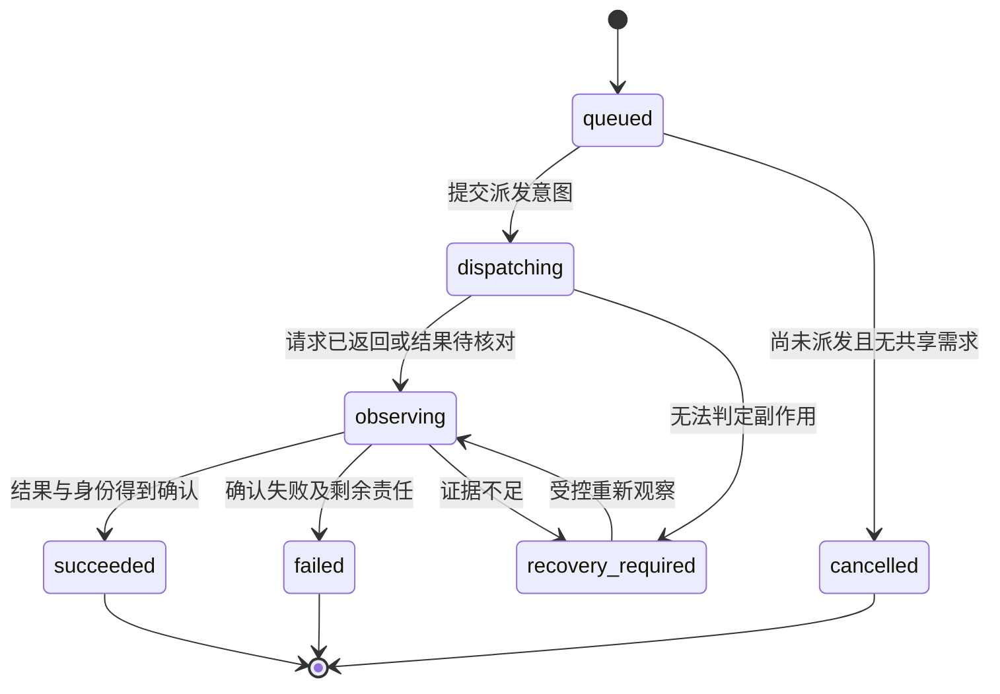
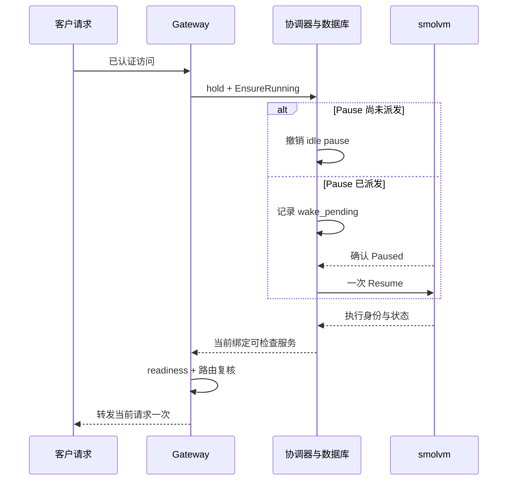

# 第一阶段实现规范

> 2026-11-25 修订版：默认 Guest root；Live Fork 仅使用原生实时复制，不处理或提供应用安全点，活动工作负载不构成额外准入限制。Independent Clone/同逻辑 recovery 的既有捕获策略保持独立。

**规范日期：2026-11-25，Asia/Shanghai。状态：待实施。** 本文定义平台自己的接口与持久化契约；`/v1` 是拟建平台 API，`/api/v1` 是 smolvm 已有 API。本计划不修改 smolvm、内置 Guest Agent、libkrun、libkrunfw、Guest Kernel 或运行时私有数据库。

目标运行时为正式发行 **smolvm v1.37.1 / `9d3ab4c82756456565544558ac2ea5412afa84ef`**。已有动态实验来自 v1.37.0 / `9b476839f529f3a4971f38f9999fb499a0309f8a`；不能把它们标成 v1.37.1 实测。本文所列 1.37.0 源码是已核对在 1.37.1 仍适用的公开接口依据，版本变化由 Runtime Adapter 的契约用例验证。[正式发行](https://github.com/smol-machines/smolvm/releases/tag/v1.37.1)；[原实验复核](https://chatgpt.com/library?file_id=libfile_7eae0844ef548191b6b03681a7aea3fd&account_id=d0bce954-bca4-4a5e-a193-9001db1ee06b)。

阅读配套：[设计](DESIGN.md) → 本文 → [实施计划](IMPLEMENTATION_PLAN.md) → [验收与运维](ACCEPTANCE_AND_OPERATIONS.md)。发生定义冲突时，以最新用户约束、本文的字段/状态/API 契约为准；实施者同步修正其他文档并记录原因，不保留两套行为。

<a id="principles"></a>
## 1. 最小共同约束

1. 一台 Linux 节点、一个 `platformd` 写者、一个独立 smolvm serve。平台启动先取得文件锁；不会同时启动第二个派发者。
2. smolvm 拥有 VM、内置 Agent、磁盘层、原生锁和恢复记录。平台拥有产品身份、操作意图、授权、任务索引、服务入口、快照目录。只通过公开 HTTP/CLI 访问运行时。
3. 任何可能产生副作用的调用，先提交平台意图，再发请求。超时不等于未执行；没有证据的操作进入 `recovery_required`，不换名称重做。
4. 平台不创建资源字节预留账本、共享页预测模型或独立 OOM 管理器。只保留重操作并发门、磁盘低水位检查和原生容量错误映射。
5. 普通空闲休眠受活动与任务保护；smolvm 紧急内存压力保护、VMM 故障和宿主 OOM 是另外的故障路径，不能承诺被平台 lease 阻止。
6. Guest 默认 root。Live Fork 默认原生完整运行态复制，不以用户、活动任务、连接或进程为准入条件；新副本使用独立身份和任务归属。Independent Clone/recovery 单独使用原定捕获策略。
7. 原生 Exec 是临时执行，Persistent Task 是有独立 Guest 记录的长时任务；不得通过替换所有 Exec 来实现持久任务。

<a id="identity"></a>
## 2. 身份、时间与版本

| 字段 | 类型与生成方式 | 不变量 |
|---|---|---|
| `installation_id` | 安装时生成的随机 UUID | 属于本节点的平台安装；不用于分布式选主 |
| `control_epoch` | UUID，普通进程重启保留 | 只有受控平台数据库恢复/重建才更换；旧请求不得自动跨代重放 |
| `machine_id` | `m_` 加随机 ID | 用户可见逻辑实例身份；回滚后 URL、服务归属继续指向它 |
| `binding_generation` | 从 1 开始、允许跳号的整数 | 每个候选绑定在首次 RPC 前分配未用过的新值；对外 current 值只在替换提交时改变，普通 Pause/Resume 不变 |
| `runtime_name` | 平台生成，字符集 `[a-z0-9_-]`，长度受适配器限制 | 永不复用；预先写入操作记录；不是展示名 |
| `runtime_identity` | 原生 `pid`、`startTime`、可选 `bootId`，保存原始类型和值 | 只在观测时成立；不可用 PID 单独推断同一执行；缺项不补造 |
| `operation_id` | `op_` 加随机 ID | 一次平台意图；后续相同幂等键返回同一记录 |
| `runtime_pause_id` | 适配器生成的短 ASCII 标识 | 一次原生 Pause 的身份；Resume 使用所恢复的原 ID，不用新 resume 操作 ID |
| `task_namespace` | 随新实例/新 runtime 绑定生成的随机 ID | 复制或回滚后不能把复制来的旧 task ID 当新任务再次提交 |
| `task_id` / `snapshot_id` / `service_id` | 各自独立随机 ID | ID 不编码 Guest 路径、宿主路径或用户密码 |
| `revision` | 每个逻辑对象的递增整数 | 配置、用户意图或身份切换的 CAS；metrics 采样不递增它 |

候选 generation 在受理事务中按该实例所有历史 binding 的最大值加一分配，失败/未知候选仍占用自己的值，永不复用。例：current=3，候选4失败并保留，下一候选为5，成功后 current 直接从3变5；不能改写失败候选的 runtime_name 来腾位置。原生 `MachineInfo.runtime`、`parentMachine`、`branchable`、`ports`、`stateReason` 已存在。原方案中为取得基本身份而要求 B1 补丁的前置条件取消。[机器详情字段](https://github.com/smol-machines/smolvm/blob/9b476839f529f3a4971f38f9999fb499a0309f8a/src/api/types.rs#L1513-L1642)。

所有数据库时间用 UTC RFC3339 或整数 Unix 毫秒，单列类型必须固定；API 一律 RFC3339 UTC。日志展示可按用户时区转换。进程内 deadline 使用单调时钟；宿主时间回拨、平台重启后重新观察 lease，不能仅凭旧 wall-clock 立即执行休眠或清理。

<a id="runtime-adapter"></a>
## 3. Runtime Adapter：现有接口的精确映射

### 3.1 调用纪律

主通道为私有 HTTP over Unix socket。HTTP 客户端禁止代理环境变量介入，禁用跨地址重定向；只使用配置中的本地 socket。运行时自己的生命周期锁继续负责内部事务，平台不打开其控制 socket、不执行私有 `_boot-*` 命令、不读取或写入其数据库来补充 API。

固定版本适配器返回 `Observation`，包含原始 state、runtime identity、端口、父名称、branchable、stateReason、采样时间、能力与拒绝原因；原生状态未知时保留原值并标 `unknown`。客户端展示名不得成为调用 runtime 的名称来源。

| 平台能力 | 现有 smolvm 接口 | 平台新增语义与限制 |
|---|---|---|
| 版本、格式、就绪 | `GET /health`、`GET /readyz` | `/health` 有 `version`、`checkpoint_device_profiles`、`checkpoint_format_versions`；健康不等于可派发；精确版本不匹配进入维护模式 |
| 列表、详情 | `GET /api/v1/machines`、`GET .../{name}` | 详情新鲜观测；一次 list 缺项不作为删除完成证据 |
| 创建 | `POST /api/v1/machines` | 预定唯一 runtime_name、模板 digest、所有权 label；拒绝用户指定宿主路径、私有参数、Named Network、外部卷 |
| 启动 | `POST .../{name}/start`，body `{"branchable":true}` | 初始受管实例以可分支方式启动；启动后还需 Guest helper 和目标服务 readiness |
| 停止 | `POST .../{name}/stop` | 冷停止不保存 RAM；已有 saved execution 时不能绕过原生冲突，需先明确恢复或删除路径 |
| 完整休眠 | `POST .../{name}/pause?operation_id=...` | 记录原 pause ID；不是 SIGSTOP；不自行查删其内部保存文件 |
| 恢复 | `POST .../{name}/resume?operation_id=...` | 使用原 pause ID；原生 pressure pause 的 ID 不可取得时，采用下文受限的“恢复当前保存执行” |
| 删除 | `DELETE .../{name}` | 受管对象和依赖复核；不使用 `force` 绕过父子保护；查证 absent 后才提交 tombstone |
| Live Fork | `POST .../{source}/branches` | 原生 camelCase、预定 child name；无需 Guest clean 屏障；处理实际父子依赖和原生错误 |
| 获取完整 checkpoint | `POST .../{name}/checkpoint` | 响应流写入平台 staging，完成校验/同步后发布；不把流开始或临时文件当快照成功 |
| 从完整 checkpoint 注册新对象 | `PUT .../{new_name}/checkpoint` | 请求体传原生工件；query 使用 snake_case；返回注册后的 created 对象，随后显式 Start |
| 获取已暂停执行的 checkpoint | `GET .../{name}/pause/checkpoint` | 只经公开导出接口；其独立性、用途和含活任务状态仍需校验，不能把原生一次性 Pause 记录当历史备份 |
| 发布 TCP 端口 | `PUT .../{name}/ports`，body `{"ports":[...]}` | 全量替换端口集合；TCP 可运行态变更；平台持有完整期望集合，不能由两个服务各自覆盖另一方 |
| 网络访问范围 | `PUT .../{name}/network`、`POST .../{name}/egress` | 仅使用已验证的 allowlist 更新子集；没有通用在线断网 API；不暴露原始配置透传 |
| 配置/统计 | `PUT .../{name}/cpu-limit`、`POST .../{name}/resize`、`GET .../{name}/metrics`、`GET /capacity` | 依版本能力设置；不能热改的字段明确要求停机或新模板，不伪装成功 |
| 临时执行/终端 | `POST .../{name}/execs`、exec session 查询/输入/resize/attach；短控制命令可用 `/exec` | 使用客户端指定 exec ID、显式 `autoStart:false`；先经平台 EnsureRunning；保留原生输出丢失和退出语义 |
| 文件 | `GET/PUT .../{name}/files/{path}` | root Guest 路径，复用原生字节传输及可选无状态 helper；不接受 Host path；无 autoStart 参数 |
| 自有 Guest supervisor 启动 | `POST .../{name}/exec`，`background:true` | 仅运行固定 bootstrap 命令，等待独立握手确认；用户长时任务走 Task API |
| 静态模板/版本辅助 | 官方 `smolvm --version`、`serve openapi`；需要时 `machine checkpoint-requirements --name ...` | CLI 只用 argv 数组/固定二进制；checkpoint-requirements 需要运行或 frozen 的合格源，不是任意状态通用 eligibility API |

依据：[路由](https://github.com/smol-machines/smolvm/blob/9b476839f529f3a4971f38f9999fb499a0309f8a/src/api/mod.rs#L331-L537)、[创建请求](https://github.com/smol-machines/smolvm/blob/9b476839f529f3a4971f38f9999fb499a0309f8a/src/api/types.rs#L1145-L1310)、[端口更新](https://github.com/smol-machines/smolvm/blob/9b476839f529f3a4971f38f9999fb499a0309f8a/src/api/handlers/machines.rs#L6810-L6849)。

### 3.2 必须锁定的网络和端口细节

受管模板创建时设置 `networkBackend:"virtio-net"`、`allowedCidrs:["0.0.0.0/0","::/0"]`，**省略 `allowedHosts`**，`egressRules:[]`；宿主显式启用 strict floor。这样公网出站在已有 allowlist 模式下工作，后续恢复后能用公开接口调整；初始显式 `allowedHosts:[]` 会禁止普通 DNS，不能误用。

以下四个“空数组”语义必须分别测试，不得通过通用 JSON 清理器把空数组删掉：

| 请求位置 | 空数组含义 | 正确处理 |
|---|---|---|
| Branch body `ports:[]` | 保留源 Guest 端口集合、重新分配 Host 端口 | 初始为 loopback；按子配置调整并核实，Gateway 不提前发布；并不阻止子内进程执行 |
| Restore query `ports=[]` | 继承捕获的端口，不是清空 | 在导入得到 created 对象后，`PUT /ports {ports:[]}`，GET 复核，再 Start |
| `PUT /ports` body `ports:[]` | 真正将发布集合设为空 | 用于 created 对象启动前配置，以及已运行对象的明确撤销 |
| Restore query `allowed_cidrs=[]&allowed_hosts=[]` | 两项均为显式空 allowlist，限制新启动目标的出站/DNS | 仅接收 `egressRules` 为空的本阶段受管工件；不能省略为空的 query |

独立恢复在绑定身份、处理历史任务、配置服务完成后，通过 `PUT /network {"mode":"allowCidrs","cidrs":["0.0.0.0/0","::/0"],"hosts":[]}` 恢复公网访问，仍受 strict floor 约束。实现后以 DNS、TCP、UDP 策略用例确认，源码判断不等于实测。

`POST /egress` 是 allowlist 增删接口；`PUT /network` 在 running 时不能任意从无过滤切到过滤，也不能直接设 blocked；已有 TCP 流不是一次 policy update 就保证终止。不要用它们构造虚假的全 Guest 网络 fence，也不要加入无法在线撤销的通用 deny 规则后假设能删除。[更新字段](https://github.com/smol-machines/smolvm/blob/9b476839f529f3a4971f38f9999fb499a0309f8a/src/api/types.rs#L472-L516)、[运行态限制](https://github.com/smol-machines/smolvm/blob/9b476839f529f3a4971f38f9999fb499a0309f8a/src/config.rs#L1820-L1864)、[Restore query](https://github.com/smol-machines/smolvm/blob/9b476839f529f3a4971f38f9999fb499a0309f8a/src/api/handlers/machines.rs#L1690-L1725)。

### 3.3 能力计算与配置修改

能力返回 `supported:boolean`、`reason_code`、`message`、`verified_profile`。`supported=true` 表示本版本/模板已通过对应验收，不仅是路由存在。未完成实机 gate 时返回 `CAPABILITY_NOT_VERIFIED`；不把这当产品已完成。

首版合格配置：Linux x86_64、内部磁盘、virtio-net、full durability、无 Host mounts/Named Network/外接设备/cache disk/credential interceptor/secret refs。高级配置不提供原始 JSON 编辑器。默认 root 模板，普通自定义 OCI 镜像只要满足原生分支 profile 也可 Live Fork；Persistent Task、受控 checkpoint 和自动 idle 依赖各自的组件/活动探针，不要求非 root 或清空活动进程来使用原生 Fork。

资源 PATCH 的结果必须包含 `applied` 或 `requires_restart`；磁盘只在原生已验证路径允许扩容，不支持缩盘。不要将平台配置 DB 的更新当成 runtime 已修改。需重建 runtime 的 CPU/设备变化不静默启动一个新的实例。

<a id="public-api"></a>
## 4. 平台 API

### 4.1 通用规则

- JSON 用 `snake_case`；字段未知时 400，防止配置拼写错误被忽略。路径 ID 仅接收合法平台 ID。
- Bearer Token 或 Web 登录会话先认证；本阶段一个 owner 身份可管理整个安装，允许创建多个 token、SSH 公钥和 mTLS 客户端证书，不建设组织/企业 RBAC。Token 可限制为 read、manage、指定实例 tunnel 的简单权限。
- 所有管理变更带 `Idempotency-Key` 和 `If-Control-Epoch`。更新现有对象再带 `If-Match: "<revision>"`。登录、登出、一次性流票据、已有会话的流帧是明确例外，使用自身的认证/序列规则。
- 去重唯一键为 `(control_epoch, principal_id, method+canonical_path, key)`；指纹覆盖规范化业务参数、If-Match、目标 generation。原子提交去重与操作。同键同指纹返回原结果，同键不同参数返回 409；不能先执行再插去重表。
- 长操作返回 202、`operation_id`、`Location`；202 仅表示持久受理。管理列表/详情/状态、metrics、操作轮询和事件 SSE 不改变用户活动时间、不触发 wake；文件内容读取、已认证隧道升级和 Guest 业务 HTTP GET 则是显式访问入口，会按其规则取得 hold 并 EnsureRunning。不能给所有 GET 套用统一的 no-wake 中间件。
- 同一 key 在记录保留期内必须返回原操作；未决操作与去重记录无限保留至明确解决。已完成记录最少保留 30 天，期满的客户端不得假定重试仍安全；删除名字与 runtime_name tombstone 长期保留。
- `control_epoch` 普通服务/节点重启不变。受控 DB 恢复后旧 epoch 的变更拒绝，SDK 不能自动取新 epoch 并重放旧请求。

### 4.2 路由与结果

| 路由 | 输入重点 | 输出与主要约束 |
|---|---|---|
| `GET /v1/control` | 无变更 | build、runtime_version、control_epoch、maintenance、capabilities；尚未 ready 时仍可诊断 |
| `POST /v1/auth/login`、`/logout` | 用户名/密码、CSRF | Argon2id 密码哈希；Secure/HttpOnly/SameSite cookie；禁止把 Token 放 URL |
| `GET/POST /v1/tokens`；`DELETE /v1/tokens/{id}` | label、scope、expiry | 明文只返回一次，数据库仅摘要；撤销后新请求拒绝 |
| `GET/POST /v1/ssh-keys`；`DELETE .../{id}` | 公钥、label | 不生成或收集用户 SSH 私钥；更新 Guest authorized_keys，状态可见 |
| `POST /v1/client-certificates` | 客户端生成的 CSR、scope、期限 | 签发用于 TCP mTLS 的证书；记录证书序列/摘要与撤销；主私钥不离客户端 |
| `GET/POST /v1/machines` | template、resources、idle_policy、start | 列表或 create operation；列表分页 `cursor/limit` |
| `GET/PATCH/DELETE /v1/machines/{id}` | revision、配置或删除策略 | 详情/操作；有依赖、任务或未知操作时明确阻塞 |
| `POST .../{id}/start`、`/stop`、`/pause`、`/resume`、`/wake` | expected_generation、reason；stop/pause 可有明确任务处理策略 | cold start 与 resume 分开；wake 由当前状态选择，默认不唤醒手动 stopped/frozen |
| `GET .../{id}/dependencies` | 无变更 | logical lineage 与 runtime parent/resource protection 分开返回 |
| `POST .../{id}/forks` | child_name、可选 template_policy | 原生运行态 Branch，允许 root 与活动工作；不是独立副本；无安全点或复制策略选项 |
| `POST .../{id}/clones` | child_name、copy_policy=`managed_clean` | 合作式 clean checkpoint + Restore 到新逻辑实例；root 可使用 |
| `GET/POST .../{id}/snapshots` | purpose=`clone`或`recovery`、label | 快照历史/捕获 operation；含任务状态分类与可用恢复方式 |
| `GET/DELETE /v1/snapshots/{id}` | 删除需 revision | 状态/引用/兼容性；使用中的快照不能删除 |
| `GET /v1/snapshots/{id}/export` | 明确的 snapshot ID | 导出平台 manifest 与原生文件；取得读取 pin，结束/断连后释放 |
| `POST /v1/snapshots/import` | 流式归档、声明长度、校验摘要 | staging operation；拒绝绝对路径、`..`、符号链接/硬链接穿越、异常解压尺寸；导入不启动 VM |
| `POST /v1/snapshots/{id}/verify` | verification=`checksum`或`restore` | 校验或受隔离的恢复验证操作；restore 验证可能执行 Guest，需符合 managed/fenced 条件 |
| `POST /v1/restores` | clean snapshot_id、新名字 | 从合格快照创建新逻辑实例；active/unknown 快照不能走此入口 |
| `GET /v1/restores` | 分页 | 查询 kind 为 restore 的操作，等价受控 operations 视图 |
| `POST .../{id}/rollback` | snapshot_id、task_disposition、expected_generation、old_state_policy=`export_then_delete_on_paused` | 同一逻辑实例恢复；running 旧对象可 Stop 后保留，paused 旧对象先导出保护再 Delete 并确认 absent；入口最后原子切换 |
| `POST .../{id}/exec` | argv、cwd、env、user（默认 root）、timeout_seconds、wait_seconds | native session 的便捷封装，短命令返回结果，超出等待返回 exec_id；不自动转为 Persistent Task |
| `GET/POST .../{id}/execs` | argv、user（默认 root）、tty、interactive、cols/rows | native 会话，平台生成固定上游 exec ID；先 wake，显式禁原生 autoStart |
| `GET/DELETE /v1/execs/{id}` | session ID | 查询/终止原生会话；失去原生记录时 `session_lost`，不重放 argv |
| `GET .../execs/{id}/output` | cursor、limit | 字节块、next cursor、gap、exit_code；平台是唯一上游 output reader |
| `POST .../execs/{id}/stdin`、`/resize` | seq+base64、cols/rows | stdin 连续序列去重；仅会话 owner 可写，其他连接只读 |
| `POST .../execs/{id}/attach-ticket`；`GET .../attach` | 一次性票据；WebSocket | 绑定用户、exec、origin、有效期；不允许任意 runtime 路径 |
| `GET/POST .../{id}/tasks` | argv、cwd、env、user（默认 root）、task_key、输出策略 | 独立 Guest Task Manager，持久受理后返回 task_id/op ID |
| `GET /v1/tasks/{id}`、`/output` | stream、offset、limit | Guest journal 为执行结果依据；平台缓存注明 observed_at；输出支持断点重连 |
| `POST /v1/tasks/{id}/cancel` | grace_seconds | TERM→等待→cgroup.kill；确认为空再取消完成，超时仍 cancelling/unknown |
| `GET/PUT .../{id}/files?path=...`；`GET .../{id}/files/list?path=...` | Guest 路径、二进制流 | /workspace 为默认目录，允许 Guest 系统路径；native files 与固定 helper；不接受宿主路径 |
| `GET/POST .../{id}/leases`；`PATCH/DELETE /v1/leases/{id}` | reason、ttl_seconds、lease_token | 显式保持运行；仅 owner 可续约/释放；到期可疑不立即当 idle |
| `GET/POST .../{id}/services`；`GET/PATCH/DELETE /v1/services/{id}` | name、guest_port、protocol、readiness、auth | HTTP、HTTPS、SSH、tcp-mtls；内部后端端口自动分配，外部入口稳定 |
| `GET /v1/services/{id}/tunnel`、`POST .../tunnel-tickets` | WS 认证或短票据 | TCP 字节隧道；授权后才 wake；每个已连接隧道持有活动 hold |
| `GET .../{id}/ssh-tunnel` | 认证 WebSocket | 只连接登记的 Guest SSH 服务；客户端 OpenSSH 仍校验 Guest host key |
| `GET .../{id}/metrics`、`GET /v1/system/metrics` | 时间窗口 | 原生指标和平台连接/操作计数；未知为 null，不写零 |
| `GET/POST /v1/templates` | OCI digest、受管版本与支持声明 | 模板版本不可变；管理员注册并通过探针后启用能力 |
| `GET /v1/system/settings`、`PATCH .../settings` | 可热更新的白名单字段 | 端口、证书、数据路径的变更需要维护流程，不走普通热更新 |
| `GET /v1/system/diagnostics` | 对象/操作过滤 | 脱敏诊断摘要；不返回密钥、完整环境或任意宿主文件 |
| `GET /v1/operations/{id}`；`POST .../reconcile`、`/cancel` | 原 operation ID | reconcile 先观察；cancel 仅在未派发且无其他 wake 等待者时真正取消 |
| `GET /v1/events` | Last-Event-ID | SSE；数据库事件重放，过期要求全量 resync |

Backup/install/upgrade/uninstall 是本机 `sandboxctl admin ...` 运维命令；远程 API 不允许传任意宿主备份或删除目录。

### 4.3 请求和响应示例

示例均为待实现的平台协议，不是本轮已执行请求。

```json
{
  "name": "agent-workspace",
  "template_id": "debian-managed-v1",
  "resources": {"cpu_count": 2, "memory_mib": 2048, "storage_gib": 20, "overlay_gib": 10},
  "idle_policy": {"enabled": true, "timeout_seconds": 1800},
  "start": true
}
```

```json
{
  "operation_id": "op_example",
  "state": "observing",
  "kind": "resume",
  "stage": "waiting_guest",
  "machine_id": "m_example",
  "binding_generation": 2,
  "effect": "applied",
  "result": null,
  "error": null
}
```

```json
{
  "machine_id": "m_example",
  "name": "agent-workspace",
  "binding_generation": 2,
  "revision": 15,
  "observed_state": "running",
  "availability": "not_ready",
  "desired_power": "running",
  "operation_id": "op_example",
  "observed_at": "2026-11-25T04:00:00Z",
  "blocked_reasons": ["guest_bootstrap_pending"],
  "capabilities": {"persistent_task": {"supported": true, "reason_code": null}}
}
```

### 4.4 流协议与认证

SSE 只传状态变更和输出可读提示，不传无限 stdout 数据。Terminal 使用 WebSocket，stdin 是 `seq` 与二进制内容，resize 是明确控制消息。TCP/SSH tunnel 的 WebSocket binary frame 是原始字节，text frame 仅允许协议定义的 `close_write`、`ready`、`error`；支持半关闭，不能把任意 data frame 当控制 JSON。CLI 原生 TLS mTLS 隧道直接双向复制字节，无 WebSocket 帧。

浏览器不能任意设置 WebSocket Authorization header：先用受保护 POST 取得 30 秒一次性票据，通过 `Sec-WebSocket-Protocol` 的专用票据项传递；服务器仅回显固定协议名，不回显秘密项，不记该头的完整值。每票据绑定具体 exec/service、principal、origin；消费后不可再次使用。CLI/SDK 使用 Authorization header，无须 URL bearer。鉴权、Origin、对象权限和全局连接上限通过后，才注册 wake waiter。

<a id="database"></a>
## 5. SQLite 与磁盘数据模型

### 5.1 数据库设置与所有权

数据库位于平台目录，与 runtime DB 分离。使用 `foreign_keys=ON`、`journal_mode=WAL`、`synchronous=FULL`、`busy_timeout=5000`；写操作经一个写连接，读连接数量有界。每个新连接设置适用 PRAGMA；SQLite 事务不得跨 runtime RPC、Guest 等待、大文件读写或网络转发。[SQLite WAL](https://sqlite.org/wal.html)、[同步模式](https://sqlite.org/pragma.html#pragma_synchronous)。

以下是第一阶段需要的数据表，不预建 tenants、nodes、resource_reservations、volumes、object-store、IPAM 或分布式 lease 表。`TEXT JSON` 表示 UTF-8 JSON 列，写入时验证结构；没有实际查询需要的字段不额外拆表。

| 表 | 主要列与类型 | 关键约束、所有者与生命周期 |
|---|---|---|
| `meta` | `id INTEGER=1`、`schema_version INTEGER`、`installation_id TEXT`、`control_epoch TEXT`、`maintenance INTEGER`、`recovery_reason TEXT?`、`settings_json TEXT` | 单例；受控 DB 恢复先换 epoch 并 maintenance；安装标记单独保存供受控恢复校验 |
| `principals` | `id TEXT PK`、`username TEXT UNIQUE`、`password_hash TEXT?`、`disabled INTEGER`、`created_at INTEGER` | 首版 owner；无租户/组织；密码只存 Argon2id 编码 |
| `credentials` | `id TEXT PK`、`principal_id FK`、`kind TEXT`、`digest TEXT UNIQUE`、`public_material TEXT?`、`scope_json TEXT`、`expires_at INTEGER?`、`revoked_at INTEGER?` | kind 为 api_token/web_session/ssh_public_key/client_certificate；私密 Token 只存摘要；证书/公钥只存公共材料 |
| `templates` | `id TEXT PK`、`name TEXT`、`version INTEGER`、`image_digest TEXT`、`guest_release TEXT?`、`spec_json TEXT`、`capabilities_json TEXT`、`verified_at INTEGER?` | `(name,version)` 唯一；已经使用的版本不可变；验证不通过只能提供明确较少能力 |
| `machines` | `id TEXT PK`、`name TEXT UNIQUE`、`template_id FK`、`revision INTEGER`、`binding_generation INTEGER`、`desired_power TEXT`、`current_binding_id TEXT?`、`idle_policy_json TEXT`、`keep_running INTEGER`、`last_user_activity_at INTEGER`、`deleted_at INTEGER?` | current_binding 指向自己的 current 记录；删除保留 tombstone；展示名可改但 runtime_name 不改 |
| `runtime_bindings` | `id TEXT PK`、`machine_id FK`、`generation INTEGER`、`runtime_name TEXT UNIQUE`、`status TEXT`、`observed_state TEXT`、`runtime_identity_json TEXT?`、`observed_at INTEGER?`、`runtime_pause_id TEXT?`、`pause_status TEXT?`、`task_namespace TEXT`、`spec_hash TEXT`、`ports_json TEXT`、`guest_management_status TEXT`、`guest_management_evidence_json TEXT` | `(machine_id,generation)` 唯一且候选代不复用；status candidate/current/retired/unknown；最多一个 current；pause_status active/consumed/unknown/null；guest_management_status ready/degraded/unknown，随当前探针更新，不作为原生 Fork 准入 |
| `operations` | `id TEXT PK`、`control_epoch TEXT`、`principal_id FK?`、`kind TEXT`、`state TEXT`、`stage TEXT`、`request_json TEXT`、`result_json TEXT?`、`error_json TEXT?`、`effect TEXT`、`created_at/updated_at INTEGER`、`heavy INTEGER`、`wake_pending INTEGER` | request 保存 names、generations、pause ID、目标 artifact 等必要身份；stage 受每类操作白名单约束；unknown 不假装 failed-none |
| `operation_locks` | `machine_id TEXT PK`、`operation_id FK`、`expected_generation INTEGER`、`role TEXT` | 多对象按 ID 顺序取得；每个实例至多一个未决 mutation owner；只有结果已确定才解除 |
| `idempotency` | `control_epoch TEXT`、`principal_id TEXT`、`scope TEXT`、`key TEXT`、`request_hash TEXT`、`operation_id FK?`、`response_json TEXT?`、`expires_at INTEGER?` | 四列复合 PK；与操作/配置更新同事务；未决记录不能过期 |
| `exec_sessions` | `id TEXT PK`、`machine_id FK`、`binding_id FK`、`upstream_exec_id TEXT`、`spec_hash TEXT`、`state TEXT`、`exit_code INTEGER?`、`output_start/output_end INTEGER`、`last_observed_at INTEGER?` | 平台记录不赋予原生会话持久性；serve 丢会话时记 lost；内存 output ring 丢失用 gap 表达 |
| `tasks` | `id TEXT PK`、`machine_id FK`、`binding_generation INTEGER`、`task_namespace TEXT`、`guest_task_id TEXT`、`start_token TEXT`、`spec_hash TEXT`、`spec_json TEXT`、`state TEXT`、`exit_code INTEGER?`、`origin_machine_id TEXT?`、`origin_task_id TEXT?`、`observed_at INTEGER?`、`result_json TEXT?` | `(task_namespace,start_token)` 唯一；继承任务以 `(task_namespace,origin_machine_id,origin_task_id)` 唯一约束进行幂等接管，子 start_token 独立；Guest 记录是执行依据；敏感 env 在平台 secret 文件引用，日志脱敏；未知不重发 |
| `leases` | `id TEXT PK`、`machine_id FK`、`binding_generation INTEGER`、`principal_id FK`、`token_hash TEXT`、`reason TEXT`、`expires_at INTEGER`、`state TEXT` | active/suspect/released；过期进入 suspect；新 generation 不继承旧 lease；显式释放需 owner/管理员 |
| `services` | `id TEXT PK`、`machine_id FK`、`name TEXT`、`revision INTEGER`、`kind TEXT`、`guest_port INTEGER`、`public_host TEXT?`、`public_port INTEGER?`、`readiness_json TEXT`、`access_json TEXT`、`enabled INTEGER` | `(machine_id,name)` 唯一；HTTP hostname 全局唯一；外部 tcp-mtls listen tuple 唯一；不接受用户自选后端 Host IP |
| `port_allocations` | `id TEXT PK`、`binding_id FK`、`service_id FK?`、`protocol TEXT`、`host_port INTEGER`、`guest_port INTEGER`、`state TEXT` | 非 released 行的 `(protocol,host_port)` 唯一；allocated/bound/unknown/released；有未决 runtime 使用时不复用；端口不是内存资源账本 |
| `dependencies` | `parent_binding_id FK`、`child_binding_id FK`、`kind TEXT`、`observed_at INTEGER?`、`status TEXT` | live_branch_resource 与 logical_origin 分开；只镜像平台拥有且有证据的关系；未知关系阻止父破坏性操作 |
| `snapshots` | `id TEXT PK`、`source_machine_id FK?`、`source_generation INTEGER?`、`purpose TEXT`、`task_content TEXT`、`state TEXT`、`relative_path TEXT UNIQUE`、`sha256 TEXT?`、`size_bytes INTEGER?`、`manifest_json TEXT`、`provenance TEXT`、`signer_key_id TEXT?`、`capture_receipt_json TEXT?`、`closure_verified_at INTEGER?`、`restore_verified_at INTEGER?`、`created_at INTEGER` | purpose clone/recovery；task_content clean/active/unknown；provenance local_record/trusted_signature/untrusted；路径 UUID 不复用；未受信的 clean 声明不授予执行能力；restore_verified 仅真恢复后填写 |
| `snapshot_pins` | `snapshot_id FK`、`owner_kind TEXT`、`owner_id TEXT`、`created_at INTEGER` | 复合 PK；restore/export/clone/backup/retained-binding 等引用；新增 pin 与 ready 状态复核同事务 |
| `events` | `seq INTEGER PK AUTOINCREMENT`、`control_epoch TEXT`、`type TEXT`、`machine_id TEXT?`、`operation_id TEXT?`、`payload_json TEXT`、`created_at INTEGER` | 状态变更同事务插入；也是基础审计，密钥不进入 payload；stdout、每秒 metrics 不入表 |

少量重要约束示意，不是完整 migration 实现：

```sql
CREATE UNIQUE INDEX one_current_binding
ON runtime_bindings(machine_id) WHERE status = 'current';

CREATE UNIQUE INDEX one_runtime_name ON runtime_bindings(runtime_name);
CREATE UNIQUE INDEX task_start_once ON tasks(task_namespace, start_token);
CREATE UNIQUE INDEX machine_service_name ON services(machine_id, name);
CREATE UNIQUE INDEX native_host_port ON port_allocations(protocol, host_port)
WHERE state <> 'released';
```

`port_allocations` 保留历史行，部分唯一索引只约束非 released 行。不能以已释放历史永久占住端口；也不能释放仍可能被运行时占用的端口。

### 5.2 磁盘目录

```text
/var/lib/sandbox-platform/
  platform.db
  installation.json
  artifacts/<snapshot-id>/manifest.json
  artifacts/<snapshot-id>/manifest.sig
  artifacts/<snapshot-id>/runtime.checkpoint
  staging/<operation-id>/
  diagnostics/<operation-id>/
  secrets/                  # 0700；证书私钥、snapshot 签名私钥、平台管理的 Guest host key 等
  backups/                  # 默认本地副本，不能冒充异故障域备份
```

运行时目录另设 `/var/lib/smolvm-platform-runtime/`，由官方运行时拥有。平台可管理自己的 staging/artifacts，不对 runtime data-dir 做 glob 清理、共享层 unlink 或数据库修复。备份工具的 runtime 一致备份方案必须遵守运维文档中的停写/公开导出边界。

Guest 内部磁盘路径：`/workspace`、`/var/lib/sandbox-taskd`；`/run/sandbox-taskd/control.sock` 是可重建 IPC，不能把持久任务 journal 放 `/run`。Task 输出大文件不放平台 SQLite。

### 5.3 必须原子的事务

| 事务 | 同一次 FULL 提交中的内容 | 事务外的副作用 |
|---|---|---|
| 受理 | epoch/权限前提、去重、operation、locks、预定 runtime_name/候选绑定、事件 | 尚未调用 runtime |
| 派发 | operation=dispatching、精确参数/身份、heavy 标记、事件 | 原生 HTTP/CLI；不能持写事务等待 |
| 完成观测 | 当前 owner/generation 复核、结果与绑定/暂停状态、route 失效标记、必要 pins、事件 | 通知等待者；重建内存路由 |
| 替换绑定 | 旧绑定 retired、新绑定 current、machines 指针切到候选预分配 generation、任务归属、事件 | 仅在旧执行已停止且新执行完成既定确认之后发布入口 |
| 快照发布 | 原子 rename+fsync 完成后，插入完整 manifest、状态 ready、事件 | 文件流/哈希/同步先在事务外完成 |
| 删除快照 | 复核零 pin、状态从 ready 到 deleting、删除操作/事件 | 只删除该固定 ID 的平台目录，完成后提交 deleted |

如果平台在文件发布后、DB 提交前退出，启动协调只把文件视为待核对孤儿工件；能用 operation ID 和完整摘要证明归属时补记，否则保留隔离。DB 显示 ready 但文件丢失则 quarantined，绝不重新生成同 ID 覆盖它。

<a id="lifecycle"></a>
## 6. 生命周期、并发与异常恢复

### 6.1 状态表示

实例只保留三项有不同用途的状态：`observed_state`、`desired_power`、`availability`。进行中的动作从 operation 读取，不再为 saving/restoring/branching 各造一个永久实例状态。

| 当前观测 | 请求 | 正常动作 | 拒绝/特殊处理 |
|---|---|---|---|
| created/stopped | start | 原生 Start → Guest bootstrap → ready | 有 saved execution 时转明确 Resume 流程；不静默冷启丢 RAM |
| running | pause | 检查活动/依赖 → 原生 Pause → paused | 自动策略不打断任务；手动 pause 仅允许显式 `allow_active_tasks=true` 且所有 Task 可观测，SSH/终端需先关闭 |
| paused | resume/wake | 用原 pause ID 恢复 →刷新 identity/ports→ready | 原生压力暂停 ID 不明时见 6.4；不能从 frozen 冒充 resume |
| running | stop | 处理任务与连接 → 原生 Stop → stopped | 默认有任务则409；明确 cancel_tasks 后先取消并核实，不把 stop 当任务成功 |
| paused | stop | 返回状态冲突和可行操作 | 当前原生 stop 可能拒绝 saved execution；只提供恢复后停止或明确删除，不编辑 saved execution |
| running | fork/checkpoint | 源生命周期锁；Fork 直接 Branch，checkpoint 按 purpose 协调 | 不绕过 branchable、profile、原生依赖限制；不以活动工作拒绝 Fork |
| 任意非 deleted | delete | 无未知操作/资源依赖，受控任务处理，再原生 Delete | runtime 拒绝保留原错误和依赖说明；不能自动递归删除后代 |
| frozen | 普通 wake | 不执行 | 一期不创建 freeze-source 模式；外部 frozen 对象只读/受限恢复，不假装 paused |
| unknown | 任意新副作用 | 先 reconcile | 只读诊断可用；新名字、新 key 不能绕过未知结果 |

手动 cold stop 默认不由 HTTP/SSH 自动冷启动。产品 UI 可单独配置 `wake_stopped=true`，明确这是从持久磁盘冷启动，不保存上次 RAM/任务进程；默认 false。完整 paused 的访问自动 Resume 是标准能力。

### 6.2 操作状态机



`failed` 不自动意味 `effect=none`。source checkpoint 已发生但子创建失败属于 partial；runtime 已 running 但目标端口不 ready 是执行已恢复、服务尚未就绪，不能再次启动 VM。`recovery_required` 不解除 operation_locks 或仍在执行的 heavy 许可。

### 6.3 并发与空闲竞态

每实例持久锁是权威；进程内 mutex/singleflight 用于减少重复等待。父子操作在一个短事务中按 machine_id 排序取得全部目标锁；遇冲突返回 409 或附着语义相同的 wake，首版不建立复杂的持久优先级队列。

```text
EnsureRunning(machine, authenticated_trigger, waiter):
  verify control_epoch and per-object access
  lock machine coordinator
  reject maintenance, deleted, unknown outcome, unsupported profile
  install waiter activity hold; advance activity_seq
  if running and current binding identity is fresh: return readiness wait
  if same binding already has wake: join it
  if pause not dispatched: withdraw idle pause and observe current VM
  if pause dispatched: persist wake_pending and join successor
  if paused: accept one durable resume operation
  if manually stopped and wake_stopped is false: reject without Start
  release coordinator; worker owns background operation beyond waiter lifetime
  before backend dial, compare current binding + runtime identity + service revision
```



取消一个 waiter 只移除自己的等待，不取消其他请求依赖的 Resume。管理 API 显式 Resume 即使没有 Gateway waiter 也继续。最后一个 waiter 离开且操作未派发时可以取消；一旦可能派发，继续观察到结论。

自动 idle 的合取条件：开启策略、running、观测新鲜、超过无用户活动时间、无活跃连接/Exec/Task、无 unknown/suspect Task/lease、无其他 mutation、Guest helper 明确给出允许空闲、profile 支持 Pause、磁盘低水位检查通过。最后在 coordinator 内再次核对 activity_seq。采样 CPU/网络零速率不能替代上述条件。

Guest Task 轮询默认活跃时 5 秒、闲置时 15 秒；30 秒内没有可信状态则暂停自动 idle。客户端 disconnect 不结束 Persistent Task hold。平台重启后的 idle 保护至少 60 秒，并先完成运行实例与任务观察。阈值是工程初值，验收后可调整，不是性能承诺。

### 6.4 重启与不确定结果

启动顺序：文件锁 → 数据库/安装标记/版本检查 → maintenance/recovery 判断 → native health/ready → 逐个已知 runtime_name 观察 → 未决操作协调 → Task 与端口复核 → Gateway 监听和路由恢复 → ready。出现未知对象只读展示，不接管或删除名称相似的手工机器。

| 未决操作 | 可以确认成功的证据 | 不允许的猜测 |
|---|---|---|
| Create | 预定 name 存在、标签/配置指纹与记录一致 | 一次404后换名重建；删除冲突对象 |
| Start/Resume | 当前 name 的新鲜 running identity；必要时 Guest 握手 | 服务探针失败就再 Start/Restore |
| Pause | 原 pause ID 的原生幂等语义加最新 state；接口返回与随后观测一致 | 把本地文件存在当 pause 完成；给重试生成新 ID |
| Branch | 预定 child 存在、`parentMachine` 匹配、源/子公开状态可核实；单独记录子接管与路由 | child 暂未出现就再次 Fork；源 running 即所有步骤完成 |
| Checkpoint | 完整响应流、摘要/manifest/同步成功；源屏障可恢复 | staging 文件大小非零即成功；截断流发布为备份 |
| Restore/Rollback | 预定 candidate 导入状态可辨、旧执行已停、新执行身份明确 | 超时后另开候选，或新执行未知时恢复旧执行造成双运行 |
| Delete | 原 name 通过详情确认 absent，先前对象身份连续，相关未决动作已排除 | runtime 不可达等同 absent；直接 rm 其目录 |

原生内存保护可以自行 Pause/Resume。对 ID 不可获得的 pressure pause，仅在机器持久锁下确认 name、最新 paused 状态、没有平台发起的冲突保存操作后，允许一次不带 operation_id 的 `POST /resume`，含义严格为“恢复当前保存执行”。该请求不得跨新一轮 pause 延迟重试；超时先只读观察，不能因过去的 running 证据证明此刻的执行。只要 ID 已知就必须传原 ID。依据：[原生可选 ID 的 Resume 路径](https://github.com/smol-machines/smolvm/blob/9b476839f529f3a4971f38f9999fb499a0309f8a/src/embedded/runtime.rs#L412-L470)。

全节点 heavy 并发默认 1：Start/Resume、Branch、checkpoint/import/clone/rollback 的重步骤共用一个计数门；复合操作由同一 owner 持有一次，不递归再申请。重启从未决 heavy operations 重建占用；底层工作不明时不放开更多重操作，但读、已有连接和诊断继续。操作明确结束才释放，不与 HTTP waiter deadline 绑定。这不是物理内存预留或高级调度器。

<a id="gateway"></a>
## 7. Gateway 与入口稳定性

### 7.1 地址、认证和路由

管理 origin 与 Guest 服务 origin 分开，例如 `console.example.test` 和 `*.apps.example.test`。Wildcard DNS 指向 Gateway；记录不会随 VM pause 消失。每个 HTTP 服务以不可变 service ID 生成 host，展示别名可另设。浏览器业务 cookie 必须 host-only；不能将平台管理 cookie 转发进 Guest。预览页不在管理 origin 注入 HTML。

HTTP/HTTPS 在 Gateway 认证后调用 EnsureRunning。服务私有登录使用一次性授权交换并签发该 service host 的短 session；不要给整个 apps 域设置共享宽域 cookie。Guest 响应禁止设置平台专用认证 cookie 或伪造平台错误头；登录跳转的 return_to 限定为已登记服务 origin，防开放跳转。第三方普通 HTTP 客户端可用 service-scoped Bearer Token。

Gateway 在转发前剥离用于平台鉴权的 Authorization、平台专用 cookie、交换票据及外部传入的内部身份/转发头，再按自己的可信连接重建必要代理头。不能把 service-scoped 平台 Token 交给 Guest。应用需要自己的 Authorization 时，通过已授权的 service cookie、mTLS 或独立外层隧道完成平台鉴权，业务 Authorization 才能按明确策略转发；不能让同一个 header 同时承担两种凭据。认证票据与 URL query 不写入常规访问日志。

公开 TCP listener 只启用 mTLS；校验证书链、有效期、撤销状态和 service scope 之后才 wake。非 TLS 协议客户端通过 `sandboxctl port-forward` 的本地 loopback 端口使用已认证 WebSocket 隧道。源 CIDR 白名单是额外访问约束，不能冒充用户身份认证。不提供匿名 TCP 连接触发 VM 恢复。

SSH 使用 Guest OpenSSH 与 `sandboxctl ssh-proxy`：先获得平台授权隧道，再进行端到端 SSH 握手和 Guest 公钥认证。CLI 生成明确的 `ProxyCommand`、`HostKeyAlias` 与专用 known_hosts 配置，不关闭 host-key 校验。SSH 连接作为 hold；访问被拒绝时不消耗 Resume 资源。Guest 新副本必须重新生成 host key 并重启 sshd，不能只写新 key 文件而让内存里的 sshd 继续使用旧 key。

内存 route 对象为 `(service_id, binding_generation, runtime_identity, service_revision, backend_loopback_port, ready)`；绑定改变、运行身份改变、serve/platform 重启后失效。进入 backend dial 前再比较当前映射；路由失效只允许在尚未写任何业务字节前重新解析。

### 7.2 Ready 与不重放

ready 分为运行时 running、Guest helper 可控、目标服务 TCP/HTTP ready，分别报告。Live Fork 子的 GTM 降级不阻止已验证身份和端口的原生服务/Exec/SSH，只有依赖 GTM 的动作需要其就绪。端口探测不等同应用业务健康；HTTP readiness 可配置路径/预期状态码，禁止用户把任意外部 URL 作为探针，目标始终是该实例已登记的端口。

| `forwarding` | 进入条件 | 后续策略 |
|---|---|---|
| `not_started` | 未尝试写入任何 backend 请求字节 | 可以继续排队/刷新路由；返回网关自己的可验证“未转发”错误 |
| `may_have_started` | 第一次尝试 backend write **之前** | 任何 write/reset/timeout 都不能降回 not_started；不自动重放 |
| `completed` | 完整响应传输完成 | 不等同业务成功；应用错误原样按业务语义返回 |

反向代理实现必须避免底层 HTTP Transport 自动重试已发送请求，特别是带 Idempotency-Key 的请求。最简单首版对敏感方法使用单次 fresh backend connection、不设置 GetBody/重试回调；实现时仍要用计数 oracle 测实际只转发一次，不能只写 `DisableKeepAlives` 就认为已经证明。Guest 的同名 header/trailer 必须剥离。[Go Transport 文档](https://pkg.go.dev/net/http#Transport)、[HTTP 重试规则](https://www.rfc-editor.org/rfc/rfc9110.html#name-retrying-requests)。

默认每实例最多 64 个 wake waiter；等待 HTTP 请求只缓存头及至多 64 KiB 有界首段，后续背压，不把大上传整体读入 RAM。等待 deadline 默认 90 秒；超时移除 waiter，底层 Resume 继续。SSE、WS、SSH、TCP 的连接结束才释放 hold；后台轮询/health check 不人为延长机器 idle。

<a id="tasks"></a>
## 8. Guest Task Manager 协议

### 8.1 组件与启动

Guest 由三个自有 Go 命令角色组成：`taskd`（控制服务/恢复扫描）、`task-runner`（单任务等待与结果记录）、`taskctl`（短命令客户端及 stateless 文件目录 helper）。成熟 runit 监督 `taskd` 和受管服务；已有 Guest/容器 keepalive 继续充当其原来的 init/reaper，不声称自有进程是 Guest PID1。

模板预装二进制、runit、OpenSSH 和 root 工作环境（UID/GID 0）；SSH 默认 root 公钥认证、禁止密码。平台 Start 后以原生 background:true Exec 启动固定 supervisor bootstrap；锁保证防重入，独立 UDS 握手确认。冷启动恢复 supervisor，普通 Resume 复用已有服务。

平台调用固定 argv 的 `taskctl rpc`，JSON 走 stdin，返回 JSON 走 stdout；这些控制 RPC 不登记为用户 activity、不经 shell 拼接任务命令。`taskctl` 连接 Guest 私有 UDS；Task 进程和 runner 不持有这个临时 Exec 的 stdout/父进程依赖。控制会话退出不影响已受理 Task。

### 8.2 RPC 与持久记录

| RPC | 输入 | 输出/幂等键 |
|---|---|---|
| `hello` | 期望协议/绑定 | helper版本、binding、boot信息、cgroup能力、barrier、活动摘要 |
| `bind` | machine_id、generation、namespace、copy/recovery模式、operation ID | 新绑定；相同请求可重入；不同绑定不能覆盖仍在运行的任务而不处理归属 |
| `start` | start_token、spec_hash、argv、cwd、env、用户、输出限额 | task ID/当前状态；相同 token+spec 返回原记录，不再次 spawn |
| `status` / `list` | namespace、task ID/过滤 | 状态、runner身份、exit码或未知原因、日志区间、观测时间 |
| `output` | task ID、stream、offset、limit | byte-exact base64、start/end/next、gap、complete |
| `cancel` | task ID、grace、operation ID | cancelling 或最终取消；不允许从客户端传任意 PID |
| `prepare_copy` | operation ID、managed_clean | 仅用于 Independent Clone/clean checkpoint 的合作式协调，持久清单与 source identity；Live Fork 不调用 |
| `prepare_recovery_capture` | operation ID | 冻结所有受管 payload cgroups、确认 frozen、持久任务清单与 barrier |
| `finish_capture` | operation ID、仅 source 身份 | 源恢复相应服务/任务；不能由 child 凭复制来的记录自动调用 |
| `complete_copy` | 新 namespace/身份、历史处理政策 | clean Clone 的新 namespace 空、来源终态历史只读、SSH 身份更新后解除协调 |
| `adopt_live_fork` | child machine_id/generation/namespace、nonce、source IDs、operation ID | 子内新 Task IDs 与 origin 对应，接管本地原 runner/日志/结果；幂等，不 spawn 原 argv；失败 unknown，不撤销原生子 VM |
| `complete_recovery` | 新 generation、cancel_captured/resume_captured、旧执行停止证据摘要 | 取消或受控续接捕获任务，绑定 origin_task_id；绝不重新执行 argv |

每个物理任务目录 `/var/lib/sandbox-taskd/runs/<run_id>/` 含：`request.json`（taskd 创建的不可变规范与 start token）、`dispatch.json`（runner 的启动意图）、`runner.json`（runner 的 Guest boot/PID/start-time/任务 cgroup）、`owner.json`（taskd 管理的 namespace 归属）、`result.json`（runner 唯一写者的不可变终态）、`state.json`（taskd 派生状态缓存）、分段 stdout/stderr 与 runner 拥有的输出索引。runner 不写 state.json，taskd 不伪造或覆盖 result.json；runner 丢失时 unknown/interrupted 放在派生状态和平台记录中，而不制造退出码。这样避免两个进程互相覆盖同一收据。

namespace 的 owner/alias 索引与物理 run 目录分开；`resume_captured` 绑定既有 run_id，不移动仍被 runner 使用的目录，不让恢复出的 runner 写到不存在的旧路径。写 request/state/owner 采用同目录临时文件→fsync→rename→目录 fsync；最终结果在输出已同步之后发布。证据不足保持 unknown；文件存在不自动表示其任务已开始或结束。

建议输出每段 8 MiB、每任务默认总上限 256 MiB；达到上限按请求的 `output_policy=truncate` 继续排空并丢弃后续字节、记明确 dropped/gap，或 `cancel` 取消任务。默认 truncate，避免磁盘被静默写满或堵住子进程管道；UI 必须显示截断。不可宣称保存了被限额丢弃的全部 stdout。用户可配置更大上限。读取的 byte offset 不因 UTF-8 切分而更改；SDK 最后再解码文本。

### 8.3 启动、取消和崩溃窗口

任务启动：平台耐久受理 → Guest 写 start_token/spec intent → 启动唯一 runner → 建立 payload cgroup、记录身份和 launch intent → 子进程进入该组，以请求用户（默认 root）exec argv → runner wait → 同步日志与 result。root 使用原生 workload 支持的权限；不额外强制降权。必须有启动握手。

任意位置都可能崩溃。若启动意图已记但不能判断 exec 是否发生，置 unknown，不再次启动。taskd 崩溃时 runit 重启它，独立 runner 继续 wait/记录；runner 死亡但 payload 存在时记录 orphan/unknown 并保留 hold，可按核实过的 cgroup 取消；无法重建已丢 wait status 时不能猜 exit_code。Guest 冷启动后 boot 变更、旧 runner 不在，任务置 interrupted/unknown，不按旧 request 自动拉起。

取消先对核实的 payload 组发送 TERM，默认等待 10 秒，再写 `cgroup.kill`；必须确认 `cgroup.events` 的 populated=0。runner 位于 payload 组外，才能记录取消和收尾输出。Guest 的 cgroup2 create/migrate/freeze/kill 权限是受管模板 gate；不满足或 root 改写 cgroup 导致无法核实时不得用进程名 kill、PID 复用或单一 process group 伪装全树取消。[cgroup v2 文档](https://docs.kernel.org/admin-guide/cgroup-v2.html)。

Task 状态：accepted→starting→running→succeeded/failed；running→cancelling→cancelled；任何不能证明结果的故障→unknown；确认冷启动或显式恢复取消→interrupted。`exit_code` 只表示真实观测的进程退出码；被恢复政策取消另记录 `reason=interrupted_by_restore`，不能伪造原历史任务执行成功。`unknown` 阻止 idle，直到核实或用户以明确的“放弃等待并解除保活”动作处理；该动作仍不把业务结果改成成功/失败。

### 8.4 Exec 与 Task 的边界

普通 Exec/Terminal/Task 默认 user=root，保持原生 stdin、PTY、超时、退出与字节输出；SSH 公钥登录 root。允许显式普通用户。Guest 安装软件和修改系统文件无需额外高级模式，不记录永久污染状态。`guest_management_status` 仅表示组件当前健康，可随实际探针修复，失联标 unknown/degraded；不影响原生 Live Fork。任务 cgroup 取消及 journal 可信性以合作式正常运行和实际证据为条件，root 故意破坏后不能保证。

原生输出 `after` 同时确认并丢弃更早的 bytes，故多个浏览器不能各自直接轮询同一 upstream cursor。平台每 session 一个 reader，再向客户端 fan-out，并提供自己的有界 ring 与 gap；平台重启丢掉已确认但尚未持久化的普通 Exec 输出是明确的临时会话限制。需要持久输出的工作使用 Persistent Task。[原生会话请求/输出](https://github.com/smol-machines/smolvm/blob/9b476839f529f3a4971f38f9999fb499a0309f8a/src/api/types.rs#L567-L714)。

### 8.5 文件操作保持工作区权限

原生 files 在 Guest container root 中工作，默认 /workspace 只用于便捷路径，不限制已授权用户访问 Guest 系统文件。按目标机器鉴权、校验 Guest path 和传输大小，不允许宿主 path、任意 shell 或跨机器访问。字节流复用 native files；需要目录操作/原子提交时用固定无状态 helper，限制 staging 空间与生命周期。符号链接按明确的 Guest 内语义处理，不能逃出目标 Guest；不将字符串检查当宿主隔离。用户可修改 GTM 配置或 sshd，影响由实时健康检查展示，不设置 root taint，也不因此禁止 Live Fork。

文件 API 内部没有 `autoStart:false`。平台先 EnsureRunning 并持有活动/生命周期保护，再调用 native files；其内部 ensure 会拒绝已有 paused saved execution，压力暂停竞态得到冲突而非隐式恢复。Created/Stopped 仍可能被原生隐式启动，因此不得将文件原生路由直接公开。[files 调用](https://github.com/smol-machines/smolvm/blob/9d3ab4c82756456565544558ac2ea5412afa84ef/src/api/handlers/files.rs#L126-L139)、[原生 paused guard](https://github.com/smol-machines/smolvm/blob/9d3ab4c82756456565544558ac2ea5412afa84ef/src/api/state.rs#L1605-L1685)。

<a id="snapshots"></a>
## 9. Live Fork、Independent Clone 与恢复

### 9.1 复制准入与任务政策

| 操作 | 对任务/进程的要求 | 结果 |
|---|---|---|
| Live Fork | 只校验原生分支条件、授权、容量与操作冲突；允许 root、active/unknown Task、SSH/Exec/WS/TCP 与任意 Guest 后台进程 | 新逻辑实例；捕获的进程继续执行；独立 Task namespace/来源关系；保留真实父子依赖 |
| Independent Clone / 新机 Restore | clean 快照与合作式捕获记录；不含已知活动或未知任务，不按 Guest UID 拒绝 | 新逻辑实例、新 namespace、新 SSH 身份；通过独立性 gate |
| recovery checkpoint | 全部受管 active payload 已冻结，runner/task 清单完整；其他不受控用户进程已清理 | 可保留活动计算点，仅供同逻辑实例受控恢复 |
| rollback 默认 | 旧执行确认停止，新目标启动仍保留冻结状态 | `cancel_captured`，冻结任务被取消并归档；新 namespace 无自动重跑 |
| rollback 显式续接 | 同上，冻结保存/恢复 gate 已通过，用户明确接受历史外部副作用无法回滚 | `resume_captured`，绑定新 generation+origin ID 后解冻已有进程；不能 spawn 原 argv |
| unknown/unmanaged snapshot | 无法证明进程/任务安全边界 | 允许保存证据工件；不自动执行或打开网络，不宣称可用独立克隆 |

Live Fork 不执行 PrepareCopy，不要求停止服务、取消任务、断开连接、冻结任务或枚举全部进程。第一阶段不接入应用安全点或上游 forkpoint/hold/waitReady，不提供可选安全点参数、等待或信号接口。父子可能立即同时执行，平台仅隔离控制身份与路由，不保证既有 TCP、外部副作用、应用 token/随机状态自动修复。UI/CLI/SDK 提示风险但不阻塞。子 GTM 接管采用 `adopt_live_fork`：以子本地 journal/runner/真实结果为依据，为每个已复制非终态 Task 分配新全局 task_id 与 origin_task_id/origin_machine_id，保留 run_id/进程/日志；父任务不改，终态历史只读，未知不得补 spawn。接管失败不删除子或暂停父，仅报告任务管理降级，保留原生访问和 unknown/hold。原生 Exec/SSH 连接句柄不克隆为子会话。`managed_clean` 只适用于 Independent Clone/clean checkpoint，且是合作式观察记录，不是对 Guest root 无法修改状态的保证。

### 9.2 快照发布与导入

首版默认 `full_state + standalone` 原生 checkpoint；历史由平台 catalog 表达。底层 CoW/增量层管理继续由 smolvm 完成。原生增量工件仅在公开导入/导出链和依赖闭包验证通过后作为存储优化开启；它不是完成快照历史、导入导出和基本备份的前置条件，也不允许自写增量引擎或扫描私有 store。

平台导出包至少包含 `manifest.json`、`manifest.sig`、`runtime.checkpoint`、必要的官方模板/格式兼容声明。manifest 记录 source IDs、runtime版本/架构、capture purpose、任务状态/冻结清单、guest_management_status、原生工件摘要/长度、外部依赖列表、模板版本和捕获收据。它发布后不可变；后续完整性检查/恢复验收时间属于可变 catalog，不回写已经签名的 manifest。元数据只描述内容，不执行导入者提供的 hooks、shell 或任意宿主路径。秘密可能在 RAM/磁盘内，包默认私有、0600；不能因为是 checkpoint 就允许公开分享。

**内容完整性不等于捕获来源可信。** 每个本安装捕获将 operation 收据和 checkpoint SHA256 关联；导出用平台独立 Ed25519 key 对发布时的原始 manifest 字节签名，签名覆盖其中的 checkpoint hash 与 copy/freeze 声明。校验时使用同一原始字节，不对 JSON 重新序列化再验签；签名算法/格式版本固定。密钥只在平台 secrets 中，随受控备份保护，不进入 Guest 或公开包。受信公钥列表通过本机配置维护，首版不构建通用 PKI。

导入只有能匹配本地耐久 capture 记录，或签名来自已配置受信导出方，才可继承相应合作式 clean/frozen 捕获分类；还要检查本阶段实际配置与版本 gate。任意上传包自称 clean/frozen、SHA256 正确，仍只得到 untrusted/quarantined 的存储/静态校验结果，不能自动 Start、在线 verify 或变成安全 Independent Clone。签名证明受信捕获方的记录，不是恶意 Guest root 的硬件远程认证。原生无平台收据的 checkpoint 可保存供人工诊断，本阶段不为它伪造受管承诺。

ready 条件是来源/签名符合策略、流完整、摘要匹配、必要依赖齐全、原子发布和目录同步成功；仅满足字节完整性的未知来源仍为 quarantined。`closure_verified_at` 表示静态完整性，`restore_verified_at` 只表示真恢复成功；两者不能混用。“同名称不同 runtime”不等于生命周期独立。

### 9.3 独立性验证与引用释放

每个发布 runtime/profile/template 组合必须做一次隔离验证：从源 capture 原生 standalone；用独立 runtime data-dir 和新名字导入；禁用原路径/缓存访问；原源实例通过公开 API 停止/删除；新副本读取完整 RAM 工作集与文件 canary、写入新数据、Pause/Resume、冷停止再启动，并再次导出恢复。使用同一宿主、隔离测试目录即可，不要求建设第二节点。不能在真实唯一工作区做此试验。

每次正式 clone 仍需核对导入结果、parentMachine、端口/绑定/屏障与所需工件 pins；不能因发布时测过就跳过个体检查。只要 target 仍可能依赖导入 checkpoint 或原生物化未得到证据，就保留该 artifact 的 binding pin；独立于源 VM，不等于可以删掉它自身的恢复文件。未通过独立性 gate 时该功能为阻塞项，不能把另一种 Branch 改名叫 Independent Clone。

逻辑树的 origin 关系永久保留；真实 dependency 由平台记录和原生 parent/拒绝结果共同验证。删除 UI 节点只改逻辑展示，不能直接释放共享层。父实例存在 live children 时默认禁止 pause/stop/delete，展示子列表和成本明确的 Independent Clone 路径；即使部分底层关系理论上可解除，也不绕过原生保护。

### 9.4 回滚步骤与失败恢复

```text
accept rollback(machine_id, snapshot_id, expected_generation, old_state_policy)
persist candidate binding, unused next generation, unique runtime_name before any RPC
pin snapshot; acquire logical machine lock; close new access and task starts
verify trusted capture receipt/profile/task policy
if old is running: native Stop; confirm Stopped and restart policy never
if old is created/stopped: verify fresh state, no saved execution or auto-restart intent
if old is paused/saved (including pressure pause):
  public GET pause/checkpoint -> durable protected artifact
  native Delete with cascade=false -> confirm old runtime_name absent
if any export/Stop/Delete outcome is unknown or dependency blocks: stop, keep pins/lock
import target under permanently new runtime_name; created only
clear native ports via PUT /ports; verify deny egress import and template metadata
mark candidate Start dispatch intent; Start candidate once
verify Guest barrier/freezer state; apply cancel_captured or explicit resume_captured
rotate/reinstall approved SSH identity; set ports; verify service readiness
CAS old binding retired + candidate current + preallocated binding_generation
publish Gateway route, finish operation
retain stopped old runtime only in branches where it was not deleted
retain protected pre-replacement artifact for the paused/deleted branch
```

原生 Stop 对 paused saved execution 会返回冲突，且 pressure-paused 对象可能被原生 guard 自动 Resume；因此“没有 PID”不是这种旧对象的持久 fence。采用上面的公开导出＋删除流程，不保留会自行恢复的旧 paused 对象。导出的当前保存态若没有 managed freeze 收据，保留为 recovery evidence/unknown，不冒充安全可执行 clean 快照；任何导出/删除失败都阻塞替换，不清理唯一状态。UI/API 必须说明此分支保留的是恢复工件，不能承诺旧 runtime 对象仍可一键启动。父依赖导致 Delete 拒绝时不 cascade 删除后代。[原生 Stop 约束](https://github.com/smol-machines/smolvm/blob/9d3ab4c82756456565544558ac2ea5412afa84ef/src/api/handlers/machines.rs#L6180-L6260)、[压力保护的自动恢复](https://github.com/smol-machines/smolvm/blob/9d3ab4c82756456565544558ac2ea5412afa84ef/src/api/memory_pressure.rs#L836-L872)。

候选已启动但网络或应用不 ready：继续诊断候选，旧执行保持停止或已删除；若决定回退到仍保留的旧对象，必须先通过公开接口确认候选停止，之后才能启动旧对象。只有旧工件时须走新一次受控恢复，不能复用已删除 runtime_name。候选 start 超时或未知时，禁止以“回滚失败”为由直接启动旧执行。数据库切换不能 fence VM，只有实际停止/删除及原生证据能完成这一步。

<a id="errors-events-config"></a>
## 10. 错误、事件、配置与模块接口

### 10.1 错误契约

```json
{
  "error": {
    "code": "OUTCOME_UNKNOWN",
    "message": "恢复请求已发出，正在核对当前运行实例",
    "request_id": "req_example",
    "operation_id": "op_example",
    "effect": "unknown",
    "retry": "poll_operation"
  }
}
```

`effect=none|applied|partial|unknown`；`retry=never|same_key|poll_operation|after_precondition|client_decision`。HTTP 200 与任务 exit code 分开。实际未知时不得为了让 SDK 自动重试而填写 none。

| code | HTTP | 行为 |
|---|---:|---|
| INVALID_ARGUMENT | 400 | 不派发；说明字段 |
| UNAUTHENTICATED / PERMISSION_DENIED | 401/403 | 不 wake；不通过错误枚举秘密 |
| NOT_FOUND | 404 | 平台对象不存在或不可见；不是 runtime absent 的替代证据 |
| REVISION_CONFLICT / GENERATION_CONFLICT | 409 | 重新读取并由调用方决定新意图 |
| CONTROL_EPOCH_CHANGED | 409 | 禁止 SDK 自动换 epoch/key 重放；旧结果可只读查询 |
| MAINTENANCE / RUNTIME_UNAVAILABLE | 503 | 只读诊断继续；已派发请求另记 unknown |
| IDEMPOTENCY_CONFLICT | 409 | 相同 key 参数不一致 |
| OPERATION_IN_PROGRESS | 409或202 | 相同 wake 附着原操作；其他冲突不并发派发 |
| ACTIVE_ACTIVITY / DEPENDENCY_BLOCKED | 409 | 返回阻塞 Task/连接/子实例及处理方式 |
| COPY_NOT_QUIESCENT / PROFILE_UNSUPPORTED | 409/422 | 前者仅用于 clean Clone/受控 recovery；后者用于原生不支持的配置；不得以活动/未知任务或 root 身份拒绝 Live Fork |
| CAPABILITY_NOT_VERIFIED | 422 | 实施/发布 gate 尚未通过，不能宣称功能完成 |
| RESOURCE_EXHAUSTED / DISK_LOW | 503/507 | 保留原生容量信息；不得另起高级调度器规避 |
| OUTCOME_UNKNOWN / RECOVERY_REQUIRED | 202或409 | 观察原操作，不另发 Exec/Fork/Restore |
| CHECKPOINT_CORRUPT / DEPENDENCY_MISSING | 422/409 | 隔离快照，保护其他有效恢复点 |
| TASK_OUTCOME_UNKNOWN / SESSION_LOST | 200的状态或409 | 不自动重跑；需要可靠结果的任务使用 Task 协议 |
| OUTPUT_GAP / EVENT_CURSOR_EXPIRED | 200中的gap/410 | 输出缺口显式呈现；事件全量 resync |
| SERVICE_NOT_READY | 503 | VM 可能已 running；不再次 Resume |

### 10.2 事件与模块接口

事件 ID 为 `<control_epoch>:<seq>`。同状态提交事务插入 `events`，SSE 至少一次传送；客户端按 ID 去重。类别限定为 machine、operation、task、service、snapshot、lease、auth、maintenance；metrics 走独立拉取，不制造高频写库。事件保留默认 7 天，安全/删除/恢复审计保留 90 天；输出日志按任务策略。游标过期先读资源快照和当前事件水位，再继续订阅；恢复旧 DB 换 epoch，旧 cursor 410。

模块接口用 Go interface/类型表示职责，正式代码由工作包实现：

| 接口 | 输入 | 输出/所有权 |
|---|---|---|
| `Runtime.Observe/Apply` | 已校验 runtime_name、操作参数、固定身份 | Observation/Receipt；不拥有平台状态 |
| `Operations.Accept/Reconcile` | actor、epoch、key、规范化意图 | durable operation；唯一持久副作用协调入口 |
| `Lifecycle.EnsureRunning/AcquireActivity` | machine ID、可信 trigger、waiter | 当前绑定/hold；不是客户端自行调用 runtime |
| `Gateway.Resolve/DialOnce` | service ID、principal、当前绑定 | 已授权 stream；转发状态单调，不重放 |
| `GuestTasks.Call` | binding、固定 method、JSON | Guest journal/能力/结果；不自动替用户重启命令 |
| `Snapshots.Capture/Import/Pin/Delete` | platform IDs、已验证政策 | 本地 catalog/原生工件；不能操作 runtime 共享层 |
| `Auth.Authenticate/Authorize` | cookie/token/certificate、action、object | principal/scope；失败在 wake 前 |
| `Events.Append/Subscribe` | 当前 DB transaction 或 cursor | 已提交状态通知；不承担独立队列服务 |

### 10.3 配置结构

以下默认值用于首版实施起点；端口和路径冲突在安装时拒绝，不自动占用/杀死其他服务。

```yaml
version: 1
state_dir: /var/lib/sandbox-platform
api:
  listen: 127.0.0.1:8443
  public_origin: https://console.example.test
  tls_cert_file: /etc/sandbox-platform/tls/server.crt
  tls_key_file: /etc/sandbox-platform/tls/server.key
runtime:
  version: 1.37.1
  socket: /run/smolvm-platform/api.sock
  executable: /opt/sandbox-platform/runtime/1.37.1/bin/smolvm
  data_dir: /var/lib/smolvm-platform-runtime
database:
  path: /var/lib/sandbox-platform/platform.db
  busy_timeout_ms: 5000
lifecycle:
  default_idle_seconds: 1800
  startup_idle_guard_seconds: 60
  guest_status_stale_seconds: 30
  wake_stopped: false
  max_heavy_operations: 1
gateway:
  apps_domain: apps.example.test
  max_waiters_per_machine: 64
  wake_wait_seconds: 90
  queued_prefix_bytes: 65536
  backend_port_range: [30000, 39999]
  tcp_mtls_port_range: [20000, 20999]
  client_ca_file: /etc/sandbox-platform/tls/client-ca.crt
storage:
  minimum_free_bytes: 2147483648
  minimum_free_percent: 15
  snapshot_encoding: standalone
  manifest_signing_key_id: local-v1
  manifest_signing_key_file: /var/lib/sandbox-platform/secrets/snapshot-ed25519.pem
  trusted_manifest_signers:
    - key_id: local-v1
      public_key_file: /etc/sandbox-platform/trust/snapshot-local-v1.pub
tasks:
  protocol_version: 1
  default_output_limit_bytes: 268435456
  output_segment_bytes: 8388608
  cancel_grace_seconds: 10
  default_output_policy: truncate
observability:
  log_format: json
  events_retention_days: 7
  audit_retention_days: 90
```

绑定到非 loopback 时必须有 TLS，或通过只信任 loopback 反代的明确部署模式，由前置 Caddy 终止 TLS；不得把示例的证书路径当已安装证书。配置 secrets 用独立文件/环境引用，不能写入 Git 或普通配置导出。Gateway 外部 listener、证书和管理 origin 在设置页面显示实际生效值。

安装时生成本机 Ed25519 manifest key；私钥文件 0600、所在 secrets 目录 0700，仅平台服务账户与宿主管理员可读。公钥与可信 signer 列表由本机管理员维护，上传包不能自行增加信任。首版 `manifest.sig` 使用版本化 JSON：`version:1`、`algorithm:"Ed25519"`、`key_id`、`signature_base64`；signature 是对 manifest.json 原始 UTF-8 字节的 Ed25519 签名。解析拒绝重复 JSON key、未知算法/版本和不匹配的 signer，先验签再解释其声明。密钥轮换保留旧公钥供历史包验证，私钥进入独立加密备份而不进入普通 export；未知 key 只允许静态隔离。

运行时 systemd 环境显式设置 `SMOLVM_PUBLISH_ADDR=127.0.0.1`、`SMOLVM_EGRESS_FLOOR=strict`，并避免继承削弱隔离的 override。内存保护保持官方默认，平台不屏蔽紧急保护。[原生默认 strict floor](https://github.com/smol-machines/smolvm/blob/9b476839f529f3a4971f38f9999fb499a0309f8a/src/cli/serve.rs#L409-L427)、[端口绑定](https://github.com/smol-machines/smolvm/blob/9b476839f529f3a4971f38f9999fb499a0309f8a/crates/smolvm-network/src/publish_bind.rs#L1-L35)。

部署选用非 root `platformd` 与 root 身份的官方 serve。原因是当前原生独立 systemd VM scope 硬要求 root，非 root 回退路径不能直接承诺跨服务重启保活。运行时的 VMM 降权、seccomp、Landlock 仍按官方路径启用。serve 的 UDS 发布为 0600；root-owned `ExecStartPost` helper 每次检查 socket 类型、owner 与固定路径后，赋予专用平台组 0660，父目录同样受限。platformd 获得运行时完整控制权限仍是宿主特权边界，不能把“进程非 root”描述成强隔离。必要 CLI 补口通过固定 root-owned allowlist wrapper/oneshot 执行，不授予任意 sudo shell。[原生 scope 前提](https://github.com/smol-machines/smolvm/blob/9d3ab4c82756456565544558ac2ea5412afa84ef/src/systemd_scope.rs#L421-L450)、[UDS 权限](https://github.com/smol-machines/smolvm/blob/9d3ab4c82756456565544558ac2ea5412afa84ef/src/cli/serve.rs#L1047-L1074)。

<a id="implementation-gates"></a>
## 11. 开发时必须兑现的边界

- 无底层补丁仍可完成阶段目标。Live Fork 必须保留原生运行态语义；不保证外部副作用一致性。GTM、合作式冻结与恢复政策分别验证，不以其失败限制原生 Fork。
- UI 中所有操作来自本规范 API；pending、unknown、blocked、输出缺口和 native pressure 原因必须可见。尚未通过 gate 的按钮显示不可用原因，不使用模拟成功数据。
- `If-Control-Epoch`、原 pause ID、预定 runtime name、generation 和 route identity 是针对实际失败窗口保留的最小字段；不加入未实现的多节点身份或资源水位体系。
- 原研究包中的 B1–B7、原生 Guest Agent Task 扩展、Named Network、外部卷、高级资源预留与多 Worker 均不是本规范的实现依赖。若实际版本仍不能完成某个高风险动作，保留阻塞和证据，继续其他工作；不得靠私有接口或补丁标记完成。
- 整体完成标准见[验收与运维](ACCEPTANCE_AND_OPERATIONS.md)，开发推进顺序见[实施计划](IMPLEMENTATION_PLAN.md)。本文是工程契约，没有宣称已经部署或完成新的 PVE 测试。
